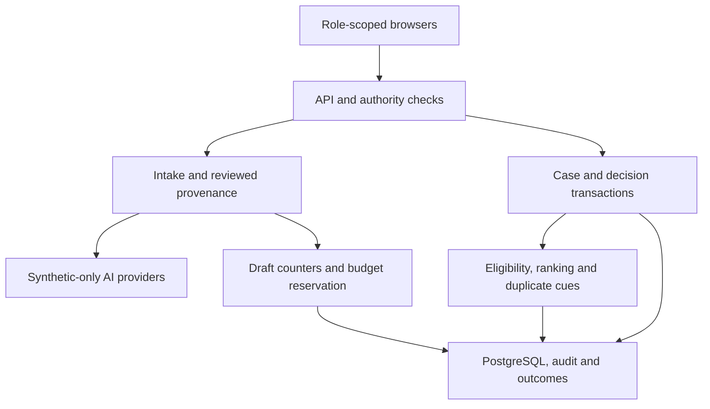
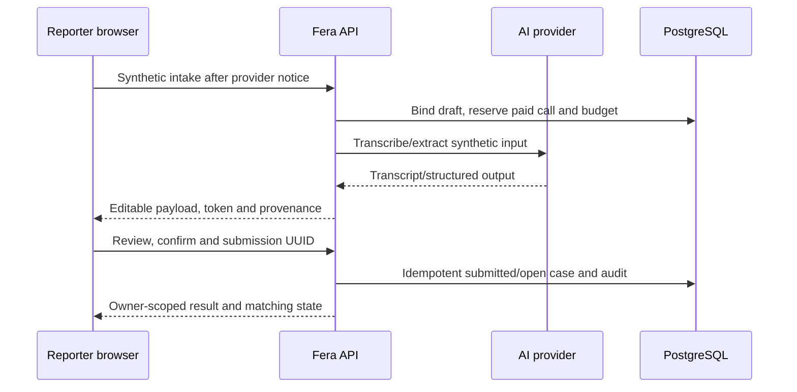
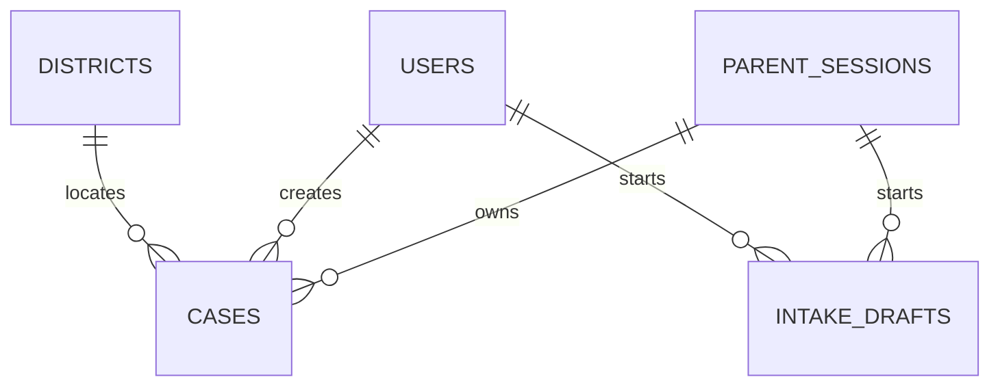
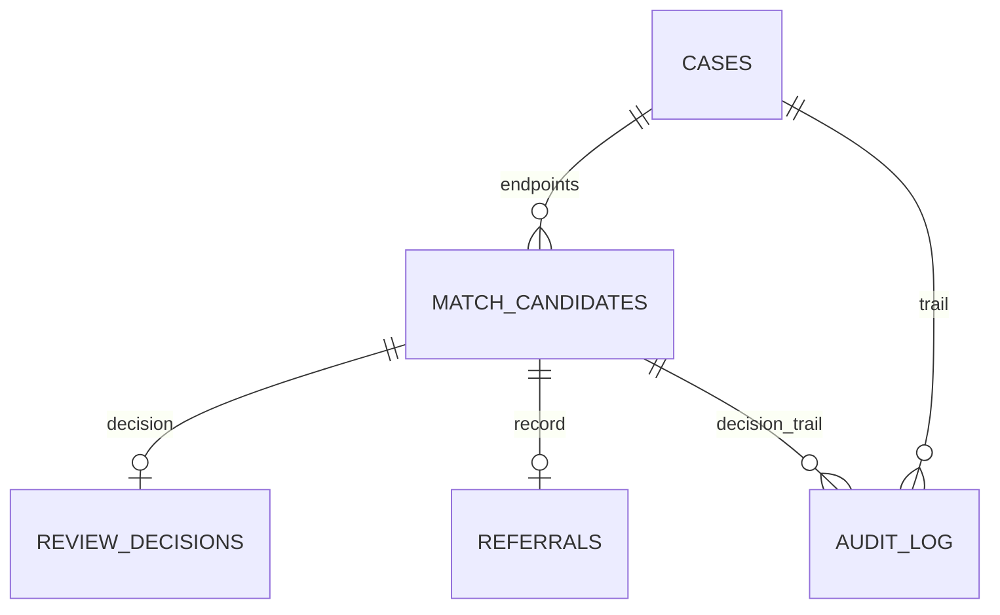

# D2 — Technical Requirements Document — Fera — Part A (§1–§9)

| Field | Value |
|---|---|
| Version | 2.0 |
| Date | 11 Oct 2026 (Asia/Dhaka, UTC+6) |
| Owner | Sadman Shaharier (lead/integration) |
| Authors | Sadman Shaharier; Obidit Islam |
| Status | V2 team handover; implementation status UNVERIFIED |
| Split | Part A = §1–§9 (this file). Part B = §10–§19 plus `schema_v2.sql`, which must equal §7 here byte for byte. |
| Inputs | D1_PRD_V2.md; V2 registry; validation report; schema_v2.sql and fera_types_v2.ts. |

## V2 release contract

**Authors:** Sadman Shaharier and Obidit Islam. **Version:** 2.0. **Issued:** 11 October 2026, Asia/Dhaka (UTC+6).

This is the revised team specification, not evidence that the application has been built. Actual repository progress, account configuration, interviews, evaluations, and spend remain **UNVERIFIED** until evidence is attached. V1 defaults are superseded by the V2 rules below; existing requirement IDs are retained.

- This release is a **synthetic-data prototype**. Officer verification and referral delivery are simulated and labelled. The schema rejects records marked non-synthetic; the application must also prevent real reports from entering this release.
- A candidate score is similarity, not identity probability. A reviewer decision does not establish guardian authority or safe reunification. A referral row means **referral recorded**, not delivered or acknowledged.
- Draft payload stays on the device before report confirmation, but providers process audio/text beforehand with a notice. Only expiry/counter/hash metadata and cost reservations are stored server-side before submission.
- Possible duplicates remain visible. Shared phone alone never establishes one child. No physical child-return action is performed by Fera.
- Counts distinguish missing-report rows, found-report rows, and confirmed pairs. They are not a census of unique children or proof of rescue.
- Sources, diagrams, tables, code blocks, and acceptance criteria are part of the handover. The companion code must match the embedded code exactly. [Team handover](TEAM_HANDOVER_V2.md) records change closure, evidence gaps, and release gates.

## Changes to earlier documents

V2 freezes adapter, API, role DTO, draft-token, idempotency, matching-state, decision-transaction and schema contracts. API-021/022 close missing admin/district paths; API-023 specifies optional duplicate resolution. ENTITY-015–017 support counters and reservations. These changes implement the validation findings; the application remains unverified.

---

## 1 Technical summary

| Item | Value |
|---|---|
| Shape | One Next.js App Router app in TypeScript: UI and API route handlers in a single deployable. |
| Data | PostgreSQL 16 with pgvector. One `cases` table holds missing and found records. |
| AI use | Speech-to-text (1 call per voice note) and field extraction (1–2 calls, ≤ 2 more for unparsed answers). Everything else is deterministic. |
| Matching | SQL hard filters → pgvector cosine on local embeddings → rule bonuses → template reason. No LLM in ranking. |
| Offline | Local embeddings, template outputs and a demo-safe cache let the scripted journey run with no internet (FR-027). |
| Budget | ≤ 3 paid AI calls per typical case (NFR-016 cap = 6). Usage estimate against USD 30 is in Part B §12. |

---

## 2 Stack

| Layer | Choice | One-line justification |
|---|---|---|
| Frontend | Next.js App Router, React, TypeScript (strict), Tailwind CSS | Deck stack; one codebase for mobile parent and desktop officer screens. |
| Backend | Next.js route handlers, Node.js runtime | Same deployable as UI; Node runtime needed for audio parsing and local embeddings. |
| Validation | Zod | One schema validates requests, AI output and forms (PRD v2). |
| Database | PostgreSQL 16 + pgvector (exact filtered cosine baseline; optional HNSW) | Relational state machine plus vectors in one store (DECISION-002). |
| DB access | `pg` driver + `pgvector` helper + hand-written SQL | `schema_v2.sql` stays the single source; no ORM migration drift. |
| Auth | Auth.js credentials provider (staff, officer, admin); signed anonymous cookie (parents) | PRD v2 choice; parents need no account (D1 FR-037). |
| Speech-to-text | Whisper API behind `SpeechProvider` adapter | Deck choice; adapter allows swap or cache. |
| LLM | `LLMProvider` adapter with Gemini, OpenAI and Claude implementations; model IDs in env | No vendor lock-in (deck, PRD v2). Default provider: OQ-004. |
| Embeddings | Transformers.js running a local multilingual sentence model (candidate: multilingual-e5-small, 384-d) | Free, offline, no per-call cost (Assumption A-026, A-027). |
| Map | Leaflet + OpenStreetMap tiles; GeoJSON markers without tiles offline | Deck choice; free (DECISION-009). |
| Poster image | Browser canvas render to PNG | No server image library; Bangla font already loaded in the page (DECISION-015). |
| Hosting | Vercel (Round 2); laptop `next start` + local Postgres (finale fallback) | Free tier; local copy survives venue Wi-Fi failure (DECISION-010). |
| Managed DB | Free-tier Postgres host with pgvector | Host choice open (OQ-021, Assumption A-034). |
| Unit/integration tests | Vitest | Fast TypeScript tests for normaliser, matcher, state guard. |
| End-to-end + a11y | Playwright + @axe-core/playwright | Scripted journey and WCAG checks in one runner. |
| Logging | pino JSON logs with a redaction list | Structured logs; names and phones redacted (NFR-010). |
| Evaluation | `tsx` scripts in `/eval` | One command per metric (Part B §17). |

### 2.1 LLM adapter contract

The authoritative interfaces are in D5 section 6 and fera_types_v2.ts. ExtractInput contains kind, sourceText, normalisedText and explicit nowIso. Evidence quotes/spans refer to sourceText, never to a silently changed numeric spelling. The normaliser preserves a source-span map and records deterministic derivations. Unknown defaults and metadata are exempt from evidence; every non-null extracted/derived fact requires a supported span or an explicit reviewed manual field.

1. Parse strict runtime schemas; reject unknown keys. One repair retry is allowed and consumes a reserved paid call.
2. Check quote/span integrity, field/value support and normaliser derivation; absent/contradictory evidence becomes unknown for user review. A substring match alone is not semantic verification.
3. Providers have no tool execution, no URL fetching and no authority to decide identity or status. Input is delimited data; test prompt injection and contradictory statements.
4. Timeout/fallback each has its own budget reservation and draft counter increment. Propagate AbortSignal; uncertain provider usage retains its reservation until reconciled.
5. Provider/model/account/data terms are pending team evidence. Only synthetic inputs may reach primary or fallback endpoints in V2.

### 2.2 Speech adapter contract

SpeechProvider accepts Uint8Array, MIME and Bangla hint. Convert at the endpoint boundary if a provider SDK expects Buffer. Accept tested WebM/Opus, MP4 or WAV only within actual size/duration limits; Ogg requires verified endpoint support or explicit transcoding. Verify codec/duration server-side. A character-script threshold is a heuristic, not proof of language or intelligibility. Transcript remains editable; silence/noise/dialect/number tests are required.

### 2.3 Embedding adapter contract

EmbeddingProvider returns exactly 384 finite values per text, L2-normalised; reject empty/zero/incorrect vectors. Pin model artifact revision, dtype, pooling, prefixes and normalisation in embedding_space. For symmetric report-to-report comparison, use the documented query prefix consistently on both sides. Exact filtered retrieval is the baseline. Switching space requires pausing matching, re-embedding every live eligible case, validating coverage, then atomically activating the new space. Never mix spaces; budget/terms review is required for an API fallback.

---

## 3 Architecture

### 3.1 System context

| Actor / system | Interaction |
|---|---|
| Parent (mobile browser) | Creates missing cases; gets outputs. No account. |
| Staff (mobile/desktop) | Creates found cases. |
| Officer (desktop) | Reviews candidates, confirms/rejects, closes; views map. |
| Admin (desktop) | Verifies officers [MOCK], imports, redact identifying payloadss. |
| Speech provider | Receives audio; returns transcript. |
| LLM providers (2) | Receive normalised case text; return extraction JSON. |
| Map tile server | Serves base tiles to officer browsers only. |
| CID / MUN Alert | No integration. Families use 13219 themselves (D1 A-009). |

### 3.2 Architecture



Trust boundaries: device payload; signed-in or anonymous principal; server enforcement; database role; external provider. Optional public map tiles receive browser requests; the offline baseline uses bundled district outlines and a table.

### 3.3 Sequence: intake and submission



Candidate decisions are a separate transaction: authenticate and lock candidate/endpoints in sorted order; recheck versions/eligibility; record decision, confirmed pair, both statuses, simulated referral and safe audit; void competitors and reconcile affected queue states. Closure records a coordination outcome, not rescue. These operations have no external custody effect.

### 3.4 Data flow

1. Input arrives at an API route as audio, text or a form.
2. Audio → COMP-006 → transcript. Parent edits transcript client-side.
3. Text → COMP-008 normaliser (Bangla numerals, dates, phone) → COMP-007 extraction → evidence check → draft.
4. Missing required fields → templated Bangla question (COMP-009). Answers parsed by COMP-008 first; LLM only if unparsed.
5. Draft payload is held on the device before confirm. Only principal/expiry/hash/counter/budget metadata reaches the DB; outside providers process synthetic intake after a notice (BR-004).
6. Confirm → COMP-014 inserts `submitted`, embeds, runs COMP-013, sets `open`, runs COMP-012, writes audit.
7. Officer decisions go through COMP-014; the database trigger rejects illegal transitions.
8. Dashboard separates missing reports, found reports and confirmed pairs; all 64 districts appear, including zero rows (BR-014).

### 3.5 Trust boundaries

| ID | Boundary | Trusted for | Not trusted for | Controls |
|---|---|---|---|---|
| TB1 | Parent device | Holding its own draft | Any input content, session tampering | Zod validation, signed cookie, rate limits |
| TB2 | Staff/officer device | Authenticated role actions | Role claims from client | Server-side role and `verified` check per request |
| TB3 | Fera server | All business rules | — | Secrets in env only; state guard; audit |
| TB4 | Third-party AI APIs | Returning text/JSON | Correctness; data retention (OQ-013) | Zod parse, evidence check, synthetic data only until OQ-013 closes |
| TB5 | Database host | Storage | Network exposure | TLS connection string; no public access; app role without DDL |

### 3.6 Single points of failure

| SPOF | Effect | Mitigation |
|---|---|---|
| Database | Whole app down | Local Postgres copy for finale; seed in < 2 min |
| Hosting region | App down | Laptop-local `next start` (DECISION-010) |
| Speech provider | No voice | Typed path; cache for scripted notes |
| LLM providers | No extraction | Fallback provider; manual form (FR-026); cache for scripted text |
| Venue network | Live calls fail | Phone on own mobile data; demo-safe mode |
| Demo laptop | No officer screens | Second team laptop with the same local setup |

---

## 4 Component design

| ID | Component | Responsibility | Inputs | Outputs | Depends on | Failure behaviour |
|---|---|---|---|---|---|---|
| COMP-001 | Parent client | Screens SCREEN-001–006; draft in `localStorage` | User text, audio, edits | API calls | COMP-003, COMP-004 | Keeps draft on network loss; retry button (NFR-008) |
| COMP-002 | Staff/officer/admin client | SCREEN-007–016 | Session, user actions | API calls | COMP-004, COMP-018 | Shows E-xxx message; no optimistic decisions |
| COMP-003 | Voice recorder | Capture 5–120 s via MediaRecorder; show timer | Mic stream | Audio blob (webm/opus) | Browser mic, secure origin | No permission or no API → focus text box (E-022) |
| COMP-004 | API layer | Route handlers; Zod; auth guard; rate limit; request ID | HTTP requests | JSON responses, error envelope | COMP-005, COMP-021 | Uniform error envelope; never leaks stack traces |
| COMP-005 | Auth and session | Auth.js credentials; parent cookie | Credentials, cookies | Session `{role, verified, userId}` or `{parentSessionId}` | DB `users`, `parent_sessions` | Expired → E-019 (parent) or E-002 (staff) |
| COMP-006 | Speech adapter | Transcribe; script check; cache lookup | Audio, mime | Transcript | STT provider, COMP-017 | Timeout 25 s → E-014; empty/garbled → E-010; down → E-011 |
| COMP-007 | LLM adapter | Extraction via contract §2.1; retry; fallback | Normalised text | `ExtractOutput` | LLM providers, COMP-017 | Invalid twice → E-012; down → E-013 |
| COMP-008 | Normaliser | Bangla numerals → ASCII; dates/time words → BST ISO; phone; district lookup (bn/en/alias); romanise names | Raw text, fields | Normalised text and fields | `districts` table, alias list | Unknown token left as text; never invents |
| COMP-009 | Intake orchestrator | Merge extraction + answers; evidence check; required-field check; templated question; AI call counter (≤ 6) | Text, prior draft, answer | Draft, missing fields, next question | COMP-006–008 | Counter reached → review screen with "unknown" fields |
| COMP-010 | Output generator | GD, poster text, 13219 summary from templates | Confirmed case | Bangla text | COMP-016 | Missing field → "অজানা"; banned word → E-016 |
| COMP-011 | Embedding service | Build case description string; embed | Case fields | `vector(384)` | Transformers.js model files | Model load failure → case saved `open` without vector; matching uses rules only; logged |
| COMP-012 | Matching engine | Hard filters (SQL), cosine (pgvector), bonuses, top 5, template reason | Case ID | `match_candidates` rows | DB, COMP-011 | No candidates → case stays `open` |
| COMP-013 | Duplicate detector | Apply D1 BR-021; write `duplicate_links` | New case | Links | DB | Errors logged; case still opens |
| COMP-014 | Case service + state guard | Create, edit (versions), transitions, referral, close, redact identifying payloads | Commands | DB rows, audit | DB trigger, COMP-015 | Illegal transition → E-005; transaction rollback |
| COMP-015 | Audit logger | Append `audit_log` rows inside the same transaction | Action, actor, case | Row | DB | Audit write failure aborts the action |
| COMP-016 | Wording guard | Block alert wording and "runaway" terms in Fera-generated text and labels | Generated text | Pass / E-016 | Term list (bn + en) | Blocked text never shown; logged |
| COMP-017 | Demo-safe cache | Fixtures for scripted inputs: transcript, extraction, embeddings | SHA-256 of normalised text or audio fixture ID | Stored output, `cached: true` | `/fixtures/*.json` | Miss → live call (or E-011/E-013 when offline) |
| COMP-018 | Dashboard and map | Aggregate counts; Leaflet map; table view | Stats API | Map + accessible table | Leaflet, tiles, district centroids | Tiles fail → markers on blank background; table always shown |
| COMP-019 | Admin tools | Seed loader (CLI), public import, redact identifying payloadsr, verify officer [MOCK] | Files, commands | Cases, updates | COMP-014 | Import row error → skipped row reported; batch continues |
| COMP-020 | Evaluation harness | Compute 5 metrics; write report | Labelled sets | `eval/report-<date>.md` | COMP-007–013 | Any metric error → report marks it "not measured" |
| COMP-021 | Rate limiter | Fixed-window counters in Postgres | Key (session/user/IP), action | Allow / E-007 | DB `rate_limits` | DB error → allow and log (fail-open only for limiter) |

Wording guard scope (COMP-016): it checks Fera-generated text and UI labels. A parent's own words in `circumstances` are stored as given but never copied into generated outputs.

---

## 5 API specification

### 5.1 Conventions

- Base path `/api`. JSON in and out, UTF-8. Times ISO 8601 with `+06:00`.
- Every response carries header `x-request-id`.
- Case data responses send `Cache-Control: no-store`.
- Error envelope (all endpoints):

```json
{ "error": { "id": "E-012", "key": "LLM_INVALID_OUTPUT", "message_bn": "…", "message_en": "…", "retryable": false, "fallback": "manual_form" } }
```

### 5.2 Error IDs used by the API

Full user-facing messages and recovery actions are in Part B §13.

| ID | Key | HTTP |
|---|---|---|
| E-001 | VALIDATION_FAILED | 400 |
| E-002 | UNAUTHENTICATED | 401 |
| E-003 | FORBIDDEN_ACTION | 403 |
| E-004 | NOT_FOUND (also returned for records the caller may not see) | 404 |
| E-005 | ILLEGAL_TRANSITION | 409 |
| E-006 | SUBMISSION_PAYLOAD_CONFLICT | 409 |
| E-007 | RATE_LIMITED | 429 |
| E-008 | AUDIO_TOO_LARGE | 413 |
| E-009 | AUDIO_LENGTH_OUT_OF_RANGE | 422 |
| E-010 | SPEECH_UNINTELLIGIBLE | 422 |
| E-011 | SPEECH_UNAVAILABLE | 503 |
| E-012 | LLM_INVALID_OUTPUT | 422 |
| E-013 | LLM_UNAVAILABLE | 503 |
| E-014 | AI_TIMEOUT | 504 |
| E-015 | UNSUPPORTED_LANGUAGE | 422 |
| E-016 | OUTPUT_BLOCKED | 422 |
| E-017 | REFERRAL_REQUIRED | 409 |
| E-018 | EDIT_LOCKED | 409 |
| E-019 | SESSION_EXPIRED | 401 |
| E-020 | OUTPUT_REQUEST_LIMIT_RESERVED | 429 |
| E-021 | INTERNAL | 500 |
| E-022 | MIC_UNAVAILABLE (client-only, no HTTP) | — |
| E-023 | AI_BUDGET_CAP (≤ 6 calls per draft reached) | 429 |

### 5.3 Auth labels

| Label | Meaning |
|---|---|
| `parent` | Valid signed parent-session cookie (created on first intake call) |
| `staff` | Auth.js session, role `staff`, or role `officer` with `verified=false` |
| `officer` | Auth.js session, role `officer`, `verified=true` [MOCK verification] |
| `admin` | Auth.js session, role `admin` |
| `public` | No session needed |

### 5.4 Shared types

D5 section 6 and `fera_types_v2.ts` are authoritative. Runtime request/response validation is required in the application; TypeScript alone does not validate provider JSON or HTTP bodies. There is no shared unrestricted CaseView for every role.

| Contract | Required boundary |
|---|---|
| CaseDraft | Reviewed editable missing/found payload; no signed token, AI counter or session metadata inside the draft |
| ExtractResponse / TranscribeResponse | Opaque draft token and expiry beside the payload; server-owned call count |
| OwnerCaseView / StaffOwnCaseView | Own payload for review/edit before lock; status/outputs afterward; no other-party evidence |
| OfficerCaseView | Verified active officer operational projection; contact access and reads audited |
| AdminCaseView | Identifier, status, district and redaction metadata only; no child payload, candidates or similarity scores |
| DecisionRequest | Discriminated confirm/reject; candidate plus expected endpoint versions; reject needs reason; confirm needs review checklist |
| DecisionResponse | Recorded simulated referral, explicit endpoint state/version; no receipt or custody claim |
| DashboardCounts | Missing-report counts, found-report counts and confirmed-pair count kept separate |

Database numeric/bigint/timestamp/vector values require explicit boundary conversion. Pin tested dependencies and maintain strict validation examples alongside the app. The supplied TS file is a specification companion, not implementation of these validators.

### 5.5 Endpoints

**API-001 · POST /api/intake/transcribe · Must**

| Field | Value |
|---|---|
| Purpose | Editable synthetic voice transcript; FR-002 |
| Auth | Parent for missing; staff/unverified officer/verified officer for own found draft |
| Request | Multipart audio, kind, optional draft_token, duration_s hint, optional fixture_id in protected DEMO_MODE only |
| Response | TranscribeResponse: transcript, verified duration, language hint, cached, draft_id, draft_token, ai_calls_used |
| Validation | Server codec/size ≤2 MB and duration 5–120 s; synthetic/provider notice; ownership/token expiry; atomic paid-call reservation. Same-Origin CSRF check applies to multipart. |
| Failure | E-007–E-011/E-014/E-015/E-023; editable typed/manual path; no silent cached result |

**API-002 · POST /api/intake/extract · Must**

| Field | Value |
|---|---|
| Auth | Parent missing; staff/officer found only |
| Request | kind; text OR answer; prior CaseDraft and draft_token when continuing; reject expired/foreign/replayed revision updates |
| Response | ExtractResponse includes opaque token, draft ID/revision/expiry, draft, missing_fields, next_question, calls_used and cached |
| Validation | Strict runtime schema; supported raw-source spans and derivations; six dispatched paid transcribe/extract calls per draft; all retries/fallbacks count |
| Follow-up | One question at a time, at most four rounds; unresolved required values move to the manual form with explicit blocking fields |
| Errors | E-001/E-007/E-012/E-013/E-014/E-015/E-019/E-023 |

**API-003 · POST /api/cases · Must**

| Field | Value |
|---|---|
| Auth | Parent session owner |
| Request | CreateMissingRequest: reviewed missing draft, confirmed=true, client_submission_id UUID, optional draft_token |
| Response | 201 new OwnerCaseView; 200 identical UUID retry returns the same ref and replayed=true; outputs_available and matching_state |
| Validation | BR-015/016, server synthetic-only mode, own principal, canonical payload hash, same UUID/different payload → E-005 |
| Transaction | Unique(session, submission UUID); save reviewed payload as submitted then open, audit; output is owner-scoped. A same-hash/time-window warning never replaces UUID idempotency. |
| Matching | Bounded synchronous matching or durable queued state with retry via API-014; never an unawaited serverless background promise |
| Errors | E-001/E-005/E-006/E-007/E-019/E-021 |

**API-004 · GET /api/cases/:id · Must**

| Field | Value |
|---|---|
| Auth | Ownership or verified operational role checked server-side |
| Response | Parent: OwnerCaseView including own editable draft only before terminal lock; staff: StaffOwnCaseView for own entry; verified officer: OfficerCaseView; admin: AdminCaseView metadata only |
| Privacy | No parent/staff candidate details or other-party report fields; no admin candidate ID/score or child payload |
| Errors | E-004 indistinguishable missing/forbidden; safe denial audit with nullable case FK |

**API-005 · PATCH /api/cases/:id · Should**

| Field | Value |
|---|---|
| Auth | Owning parent |
| Request | Reviewed draft, confirmed=true, expected_version |
| Response | OwnerCaseView with version+1 and current matching state |
| Transaction | Lock, verify editable state/version, snapshot, increment, void old pending pairs, reconcile affected reports, queue/retry rematching and audit |
| Errors | E-001/E-004/E-005/E-018; terminal reports locked |

**API-006 · POST /api/cases/:id/outputs · Must GD/poster; Should helpline**

| Field | Value |
|---|---|
| Auth | Owning parent |
| Request | type gd/poster/helpline; poster contact inclusion chosen in separate share preview |
| Response | OutputResponse; reviewed fixed template, draft label and ≤80-word helpline summary |
| Storage | Unique(case,type,version) returns cached deterministic output. Output for obsolete versions is never served as current. |
| Privacy | Download acknowledgement explains child/phone/location exposure and lack of remote recall |
| Errors | E-004/E-016/E-007; E-020 reserved |

**API-007 · POST /api/found-cases · Must**

| Field | Value |
|---|---|
| Auth | Staff or officer; owner is server-derived user ID |
| Request | Reviewed found draft, confirmed=true, client_submission_id UUID; optional own draft_token |
| Response | StaffOwnCaseView plus matching_state; no candidate details; officer can separately read queue |
| Validation | Description/place/district/event/contact required; age may be unknown; no photo |
| Idempotency | Unique(created_by_user_id,submission UUID), canonical hash, same UUID/different payload conflict; synthetic label server-owned |
| Errors | E-001/E-002/E-005/E-006/E-007 |

**API-008 · GET /api/review-queue · Must**

| Field | Value |
|---|---|
| Auth | Active verified officer |
| Query | district?, limit 1–50, cursor? |
| Response | Own authorised operational queue with OfficerCaseView and up to five current qualified candidates; cursor; uncertain components visible |
| Rules | Flagged duplicates stay discoverable; no threshold-qualified candidates → explicit empty state |
| Errors | E-002/E-003 |

**API-009 · GET /api/candidates/:id · Must**

| Field | Value |
|---|---|
| Auth | Active verified officer only |
| Response | CandidateDecisionView, raw supported field comparison, contradictions/unknowns, score components and versions |
| Privacy | No identity probability or safe return claim; authorised officer contact is not logged |
| Errors | E-002/E-004; missing and forbidden identical |

**API-010 · POST /api/candidates/:id/decision · Must**

| Field | Value |
|---|---|
| Auth | Active verified officer; author ID ignored if client supplied |
| Request | Discriminated DecisionRequest: reject requires reason 3–500; confirm requires reviewed checklist and both expected versions |
| Confirm transaction | Sorted endpoint locks, live version/eligibility/verification checks; decision, candidate confirmed, missing confirmed, found referred with closed_at, simulated referral, safe audit; void competitors and reconcile all affected reports |
| Reject transaction | Reasoned decision and rejected candidate; reconcile states when last pending candidate disappears; same-version rejection not re-suggested |
| Response | DecisionResponse with referral_state=recorded and referral_is_simulated=true |
| Errors | E-001/E-002/E-004/E-005; conflict returns current safe status; retry never creates a second decision |

**API-011 · POST /api/cases/:id/close · Must**

| Field | Value |
|---|---|
| Auth | Active verified officer |
| Request | outcome coordination_recorded or resolved_outside_fera; reviewed note 3–500; expected_version |
| Validation | coordination_recorded requires confirmed pair and its simulated referral; resolved_outside_fera requires open missing report. Both are synthetic coordination outcomes. |
| Transaction | Lock, record status/outcome/closed_at and officer audit; no physical child action |
| Response | Ref, closed status and coordination timestamp |
| Errors | E-001/E-004/E-005/E-017 |

**API-012 · GET /api/dashboard/stats · Must**

| Field | Value |
|---|---|
| Auth | Verified officer or admin |
| Response | DashboardStatsResponse; counting_basis=report_rows_separated_by_kind; missing_reports, found_reports, confirmed_pairs; all 64 district rows including zeros |
| Privacy | Only aggregates; no child/source/contact payload |
| Count rule | One confirmed pair contributes one pair count; referral updates found category; missing closure changes only missing category |
| Errors | E-002/E-003 |

**API-013 · GET /api/cases/:id/audit · Must**

| Field | Value |
|---|---|
| Auth | Verified officer operational access; admin safe audit metadata |
| Response | Timestamp, actor role, internal actor ID/display if authorised, action and allowlisted safe details |
| Privacy | No report/free-text/provider payload, phone/name, unmasked requested URL or raw network address |
| Errors | E-002/E-004 |

**API-014 · POST /api/match/:caseId · Must**

| Field | Value |
|---|---|
| Auth | Verified officer, admin or trusted internal call |
| Response | RematchResponse only: case_id and matching_state. Candidate details are available separately through officer-only API-008/009. |
| Logic | Idempotent bounded work; model-space check; durable queued/running/complete/failed status; retry on known failure |
| Errors | E-004/E-005; terminal/redacted ineligible |

**API-015 · POST /api/admin/import · Should; synthetic samples only**

| Field | Value |
|---|---|
| Auth | Admin on protected synthetic deployment |
| Request | 1–50 invented test texts with example.invalid source URLs and explicit synthetic annotation; kind and fixture intake time |
| Validation | No real public child reports in V2; no URL fetch; prompt injection is data; model terms and budget enforced |
| Response | Imported/skipped counts and flagged duplicate counts; no child/candidate payload |
| Errors | E-001/E-002/E-003/E-023 |

**API-016 · POST /api/admin/anonymise · Must; legacy route name**

| Field | Value |
|---|---|
| Auth | Admin route plus restricted redaction DB role |
| Request | Exactly one of case_ids or all_eligible; explicit typed action confirmation |
| Response | redacted, skipped_not_eligible; mode=pseudonymisation; external_copies_removed=false |
| Logic | Call redact_case: direct identifiers, exact age, related outcome/referral/decision/candidate notes, payload provenance/hashes, vectors/model metadata, snapshots and outputs cleared; audit IDs/aggregate fields retained |
| Eligibility | Missing closed; found referred only when its confirmed missing report is closed; otherwise preserve evidence |
| Disclosure | Legacy anonymised_at records redaction time. Backups, browser exports and provider copies follow separate retention policies. |
| Errors | E-001/E-002/E-003/E-018 |

**API-017 · POST /api/admin/users/:id/verify · Must [MOCK]**

| Field | Value |
|---|---|
| Auth | Admin, synthetic deployment only |
| Request | verified boolean |
| Response | ID, officer role, verified flag; no password hash |
| Rules | Real-world onboarding/identity verification is a pilot gate; verification revocation checked per officer request |
| Errors | E-001/E-003/E-004 |

**API-018 · GET /api/my-case · Should**

| Field | Value |
|---|---|
| Auth | Parent session owner |
| Response | Owner report refs/status/updated/editable; own details via API-004 only. No candidates or found details. |
| Dependency | SCREEN-006 and owner edit are Should together; their minimal owner-read API-004 is Must |
| Errors | E-019 |

**API-019 · GET /api/health · Must**

| Field | Value |
|---|---|
| Auth | Public, no data |
| Response | App version, DB/embedding readiness, synthetic/demo mode; no credentials/provider raw error |
| Use | Readiness evidence, not a disclosure of sensitive topology |

**API-020 · /api/auth/* · Must**

| Field | Value |
|---|---|
| Auth | Public sign-in; seeded accounts protected from public paid-API abuse |
| Request | Credentials username/password |
| Response | 8-hour credential session; httpOnly, Secure on production HTTPS, SameSite=Lax, __Host- path rules |
| Errors | Generic E-002; E-007 after five failures/min hashed network key |
| Local | Separate browser profiles for staff/officer; local HTTP cookie/mic behaviour tested or use laptop-only scenario |

**API-021 · GET /api/admin/users · Must for admin verification screen**

| Field | Value |
|---|---|
| Auth | Admin |
| Query | Cursor and limit 1–50 |
| Response | ID, username, display_name, role, verified, is_active; no hash, secrets or child data |
| Covers | FR-035, SCREEN-013 |

**API-022 · GET /api/cases · Must for district drill-through**

| Field | Value |
|---|---|
| Auth | Active verified officer |
| Query | District, kind, status-group, cursor, limit 1–50 |
| Response | OfficerCaseView rows with no candidate leakage to other roles |
| Covers | FR-019, SCREEN-011/012 |

**API-023 · POST /api/duplicates/:id/decision · Could**

| Field | Value |
|---|---|
| Auth | Active verified officer |
| Request | DuplicateDecisionRequest: confirmed_same/dismissed, reason and profile_evidence_reviewed |
| Validation | Same-kind endpoints, explicit profile evidence; same_phone alone cannot confirm_same; no deletion or automatic hidden report |
| Response | Link status and safe audit ref; grouping preserves original access |
| Covers | FR-023, SCREEN-014 |

### 5.6 Transaction and DTO acceptance

Route handlers use the D5 type shapes and runtime validators, explicit field allowlists, request IDs, no-store and same-origin checks. SQL constraints are defence in depth, not an authorisation substitute. Return a stable 200 replay for the same submission UUID; no duplicate rows. Canonical submission hashes include reviewed values/intervals but no device-specific timestamps. Denials never expose existence or fail because the requested case FK does not exist. Always recheck the live report versions before a decision.

---

## 6 Data model

### 6.1 Entities

| ID | Entity | Table | Purpose |
|---|---|---|---|
| ENTITY-001 | User | `users` | Staff, officer and admin accounts |
| ENTITY-002 | ParentSession | `parent_sessions` | Anonymous parent identity for own cases |
| ENTITY-003 | Case | `cases` | Missing and found records |
| ENTITY-004 | CaseVersion | `case_versions` | Edit history snapshots |
| ENTITY-005 | MatchCandidate | `match_candidates` | Ranked pairs |
| ENTITY-006 | ReviewDecision | `review_decisions` | Officer confirm/reject |
| ENTITY-007 | Referral | `referrals` | Child-protection referral record |
| ENTITY-008 | DuplicateLink | `duplicate_links` | Possible same child |
| ENTITY-009 | AuditEntry | `audit_log` | Append-only trail |
| ENTITY-010 | District | `districts` | 64 districts, names, centroid |
| ENTITY-011 | DistrictNeighbour | `district_neighbours` | Adjacency for search widening |
| ENTITY-012 | GeneratedOutput | `generated_outputs` | GD/poster/summary texts and regeneration count |
| ENTITY-013 | AiCall | `ai_calls` | AI usage and cost tracking, no PII |
| ENTITY-014 | RateLimitBucket | `rate_limits` | Fixed-window counters |
| ENTITY-015 | IntakeDraft | `intake_drafts` | Principal/expiry/hash and paid-call count; no child payload |
| ENTITY-016 | AiBudget | `ai_budget` | One committed/reserved cost cap |
| ENTITY-017 | AiReservation | `ai_reservations` | Upper bound, settlement and uncertain usage |

### 6.2 Key fields (ENTITY-003 Case)

| Fields | Type / requirement | V2 interpretation |
|---|---|---|
| id, ref_code | UUID; unique M/F code | Stable report reference, not child identity |
| kind, status, version | Kind, persisted state, positive version | Immutable kind; forward audited state transitions; optimistic edit/decision checks |
| source, source_url, is_synthetic | Enum, optional fixture URL, true | Public real-child imports disabled; synthetic input guard required beyond this flag |
| reporter_session_id / created_by_user_id | Parent session / staff author | Scoped ownership; no owner authority from client body |
| client_submission_id, submission_payload_hash | UUID + SHA-256 required for parent/staff | Unique per principal; application returns stable retry/conflict response |
| raw_text, child_name, child_name_latin | Optional bounded strings | Reviewed source and names; no invented name; identifying payload |
| age_years, age_min, age_max | Missing: complete 0–17 exact/range; found: unknown or 0–25 estimate | Exact age equals both endpoints; found unknown is valid |
| sex | male/female/other/unknown | Explicit unknown remains uncertain evidence |
| height_cm, clothing, marks, circumstances | Optional bounded facts; found description required | Never fill absent facts merely to increase similarity |
| event_at, event_at_lower, event_at_upper, event_at_approx | Reviewed display instant plus consistent bounds | Exact event has equal bounds; approximate eligibility uses intervals |
| district_code, place_text, contact_phone | Required non-redacted submission values | Internal district 1–64, non-empty place, normalised 01 phone; not verified contact ownership |
| thana, reporter_relation, gd_number | Optional reviewed facts | Subdistrict/provenance minimisation; no document image |
| provenance | JSON field-span/derivation mapping | Case payload after submit only; no free notes in safe audit |
| embedding, embedding_model, embedding_revision, embedding_space | Optional 384-vector with pinned space metadata | Reliable matching can fail/queue without losing saved report; never mix spaces |
| matching_state, matched_at, match_error_id | queued/running/complete/failed, time, safe error | Bounded retry; no detached serverless promise |
| input_hash | Optional deterministic input hash | Not a child identity or the submission idempotency key |
| outcome, outcome_note, closed_at | Coordination outcome and terminal time | Closure is not rescue; notes are identifying payload and are cleared by redaction |
| anonymised_at | Legacy timestamp name | Payload redaction/pseudonymisation, not proven irreversible anonymity |
| created_at, updated_at | Timestamps | Encode explicit timezone at API boundary |

No precise per-case latitude/longitude (DECISION-013). The authoritative column/check definitions are in section 7. Redaction clears identifiers, source/provenance/hash/vector metadata, notes, snapshots and generated outputs; district/date/status and coarse age remain restricted pseudonymous data.

### 6.3 Relationships

#### Intake and ownership relationships



#### Candidate decision and audit relationships



| Additional relationship | Cardinality / rule |
|---|---|
| District → district_neighbours | One-to-many outgoing rows; no self-neighbour |
| Case → case_versions / generated_outputs | One-to-many; versioned snapshots/templates, cleared on redaction |
| Case ↔ duplicate_links | Each link references two ordered same-kind endpoints; reports retained |
| User → review_decisions / referrals | One-to-many authors; decision author must be active verified officer at decision time |
| User / parent_session → audit_log | Optional actor references; safe audit remains after payload redaction |
| Intake draft → ai_reservations / ai_calls | One-to-many metadata and usage links; no child payload in draft metadata |
| Reservation → ai_calls | At most one usage row per reservation |
| Case → ai_calls | Optional case link after submission |
| ai_budget singleton | Global reserved/committed cap enforced transactionally; no per-child identity |


### 6.4 Indexes and constraints (summary)

| Table | Index / constraint | Purpose |
|---|---|---|
| cases | `(kind, status, district_code)` | Hard filters, map counts |
| cases | `(event_at)` | Time filter |
| cases | scoped submission UUID unique | Race-safe idempotency |
| cases | HNSW `embedding vector_cosine_ops` | Nearest neighbours |
| cases | CHECKs: age ranges, kind/status pairs, closed ⇒ outcome, payload-redacted ⇒ PII null | Integrity |
| cases | Trigger `enforce_case_transition` | D1 BR-012, BR-013 at DB level |
| match_candidates | Unique `(missing_case_id, found_case_id, missing_version, found_version)` | BR-019 via versions |
| match_candidates | Partial unique on each side `WHERE status='confirmed'` | BR-020 one-to-one |
| audit_log | Triggers block UPDATE/DELETE/TRUNCATE; restricted runtime grants | NFR-017 |
| duplicate_links | `CHECK (case_a < case_b)`, unique pair | No double links |

---

## 7 Database schema (PostgreSQL 16 + pgvector >= 0.8.1)

The fresh-database companion schema_v2.sql is exact. It is not an in-place V1 migration. Non-synthetic rows are rejected; application input safeguards remain required. The runtime role must not own/alter tables. The validation report distinguishes the portable PostgreSQL execution check from the still-required target-host/role/concurrency checks.

```sql
-- Fera schema V2.0 - D2A section 7. PostgreSQL 16, pgvector >= 0.8.1.
-- Authors: Sadman Shaharier; Obidit Islam. Date: 11 October 2026, Asia/Dhaka.
-- Fresh synthetic-demo database only. This is not an in-place V1 migration.
-- Rows marked non-synthetic are blocked by cases_synthetic_release_only.
-- Application runtime must use restricted credentials, never the schema owner.
BEGIN;

CREATE EXTENSION IF NOT EXISTS vector;

-- Enums ---------------------------------------------------------------
CREATE TYPE case_kind        AS ENUM ('missing', 'found');
CREATE TYPE case_status      AS ENUM ('submitted', 'open', 'matched_pending_review', 'confirmed', 'closed', 'referred');
CREATE TYPE sex_t            AS ENUM ('male', 'female', 'other', 'unknown');
CREATE TYPE source_t         AS ENUM ('parent', 'staff', 'public_import', 'synthetic');
CREATE TYPE user_role        AS ENUM ('staff', 'officer', 'admin');
CREATE TYPE candidate_status AS ENUM ('pending', 'confirmed', 'rejected', 'voided', 'superseded');
CREATE TYPE decision_t       AS ENUM ('confirm', 'reject');
CREATE TYPE outcome_t        AS ENUM ('coordination_recorded', 'resolved_outside_fera');
CREATE TYPE duplicate_status AS ENUM ('flagged', 'confirmed_same', 'dismissed');
CREATE TYPE matching_state_t AS ENUM ('queued', 'running', 'complete', 'failed');
CREATE TYPE output_t         AS ENUM ('gd', 'poster', 'helpline');
CREATE TYPE actor_t          AS ENUM ('parent', 'staff', 'officer', 'admin', 'system');

-- Shared trigger: updated_at -----------------------------------------
CREATE FUNCTION set_updated_at() RETURNS trigger LANGUAGE plpgsql AS $$
BEGIN
  NEW.updated_at := now();
  RETURN NEW;
END $$;

-- Reference data -----------------------------------------------------
CREATE TABLE districts (
  code        smallint PRIMARY KEY CHECK (code BETWEEN 1 AND 64),
  name_en     text NOT NULL UNIQUE,
  name_bn     text NOT NULL UNIQUE,
  division_en text NOT NULL,
  lat         numeric(8,5) NOT NULL CHECK (lat BETWEEN 20 AND 27),
  lng         numeric(8,5) NOT NULL CHECK (lng BETWEEN 88 AND 93)
);

CREATE TABLE district_neighbours (
  district_code  smallint NOT NULL REFERENCES districts(code),
  neighbour_code smallint NOT NULL REFERENCES districts(code),
  PRIMARY KEY (district_code, neighbour_code),
  CHECK (district_code <> neighbour_code)
);

-- Identities ---------------------------------------------------------
CREATE TABLE users (
  id            uuid PRIMARY KEY DEFAULT gen_random_uuid(),
  username      text NOT NULL UNIQUE CHECK (username ~ '^[a-z0-9._-]{3,32}$'),
  display_name  text NOT NULL CHECK (length(display_name) BETWEEN 2 AND 80),
  password_hash text NOT NULL,
  role          user_role NOT NULL,
  verified      boolean NOT NULL DEFAULT false,
  district_code smallint REFERENCES districts(code),
  is_active     boolean NOT NULL DEFAULT true,
  created_at    timestamptz NOT NULL DEFAULT now(),
  updated_at    timestamptz NOT NULL DEFAULT now(),
  CHECK (role = 'officer' OR verified = false)
);
CREATE TRIGGER users_updated_at BEFORE UPDATE ON users
  FOR EACH ROW EXECUTE FUNCTION set_updated_at();

CREATE TABLE parent_sessions (
  id           uuid PRIMARY KEY DEFAULT gen_random_uuid(),
  created_at   timestamptz NOT NULL DEFAULT now(),
  last_seen_at timestamptz NOT NULL DEFAULT now(),
  expires_at   timestamptz NOT NULL DEFAULT (now() + interval '30 days'),
  revoked_at   timestamptz,
  CHECK (expires_at > created_at)
);

-- Draft metadata (no transcript or case payload before submission) -----
CREATE TABLE intake_drafts (
  id uuid PRIMARY KEY DEFAULT gen_random_uuid(),
  session_id uuid REFERENCES parent_sessions(id),
  user_id uuid REFERENCES users(id),
  kind case_kind NOT NULL,
  created_at timestamptz NOT NULL DEFAULT now(),
  expires_at timestamptz NOT NULL DEFAULT (now() + interval '24 hours'),
  payload_hash text CHECK (payload_hash ~ '^[0-9a-f]{64}$'),
  ai_calls_used smallint NOT NULL DEFAULT 0 CHECK (ai_calls_used BETWEEN 0 AND 6),
  revision integer NOT NULL DEFAULT 1 CHECK (revision >= 1),
  CHECK ((session_id IS NOT NULL) <> (user_id IS NOT NULL)),
  CHECK (expires_at > created_at)
);

-- Cases --------------------------------------------------------------
CREATE TABLE cases (
  id                  uuid PRIMARY KEY DEFAULT gen_random_uuid(),
  ref_code            text NOT NULL UNIQUE CHECK (ref_code ~ '^[MF]-[0-9A-Z]{6}$'),
  kind                case_kind NOT NULL,
  status              case_status NOT NULL,
  source              source_t NOT NULL,
  source_url          text,
  is_synthetic        boolean NOT NULL DEFAULT true,
  reporter_session_id uuid REFERENCES parent_sessions(id) ON DELETE SET NULL,
  created_by_user_id  uuid REFERENCES users(id),
  raw_text            text CHECK (length(raw_text) <= 4000),
  child_name          text CHECK (length(child_name) <= 80),
  child_name_latin    text CHECK (length(child_name_latin) <= 80),
  age_years           smallint CHECK (age_years BETWEEN 0 AND 17),
  age_min             smallint CHECK (age_min BETWEEN 0 AND 25),
  age_max             smallint CHECK (age_max BETWEEN 0 AND 25),
  sex                 sex_t NOT NULL DEFAULT 'unknown',
  height_cm           smallint CHECK (height_cm BETWEEN 40 AND 220),
  clothing            text CHECK (length(clothing) <= 300),
  marks               text CHECK (length(marks) <= 300),
  circumstances       text CHECK (length(circumstances) <= 500),
  event_at            timestamptz,
  event_at_approx     boolean NOT NULL DEFAULT false,
  event_at_lower      timestamptz,
  event_at_upper      timestamptz,
  provenance          jsonb NOT NULL DEFAULT '{}',
  embedding_model     text,
  embedding_revision  text,
  embedding_space     text,
  matching_state      matching_state_t NOT NULL DEFAULT 'queued',
  matched_at          timestamptz,
  match_error_id      text,
  place_text          text CHECK (length(place_text) <= 200),
  district_code       smallint REFERENCES districts(code),
  thana               text CHECK (length(thana) <= 80),
  reporter_relation   text CHECK (length(reporter_relation) <= 40),
  contact_phone       text CHECK (contact_phone ~ '^01[0-9]{9}$'),
  gd_number           text CHECK (length(gd_number) <= 40),
  embedding           vector(384),
  client_submission_id uuid,
  submission_payload_hash text CHECK (submission_payload_hash ~ '^[0-9a-f]{64}$'),
  input_hash          text CHECK (input_hash ~ '^[0-9a-f]{64}$'),
  version             integer NOT NULL DEFAULT 1 CHECK (version >= 1),
  outcome             outcome_t,
  outcome_note        text CHECK (length(outcome_note) <= 500),
  closed_at           timestamptz,
  anonymised_at       timestamptz,
  created_at          timestamptz NOT NULL DEFAULT now(),
  updated_at          timestamptz NOT NULL DEFAULT now(),
  CONSTRAINT cases_synthetic_release_only CHECK (is_synthetic),
  CHECK ((age_min IS NULL) = (age_max IS NULL)),
  CHECK (age_min IS NULL OR age_min <= age_max),
  CHECK (age_years IS NULL OR (age_min IS NOT NULL AND age_min = age_years AND age_max = age_years)),
  CHECK (kind = 'found' OR age_min IS NULL OR age_min <= 17),
  CHECK (event_at_lower IS NULL OR event_at_upper IS NULL OR event_at_lower <= event_at_upper),
  CHECK (event_at IS NULL OR (event_at_lower IS NOT NULL AND event_at_upper IS NOT NULL
         AND event_at BETWEEN event_at_lower AND event_at_upper)),
  CHECK (event_at_approx OR event_at IS NULL OR (event_at = event_at_lower AND event_at = event_at_upper)),
  CHECK (embedding IS NULL OR (embedding_model IS NOT NULL AND embedding_revision IS NOT NULL AND embedding_space IS NOT NULL)),
  CHECK (source <> 'parent' OR anonymised_at IS NOT NULL OR
        (kind = 'missing' AND reporter_session_id IS NOT NULL AND client_submission_id IS NOT NULL
         AND submission_payload_hash IS NOT NULL)),
  CHECK (source <> 'staff' OR anonymised_at IS NOT NULL OR
        (created_by_user_id IS NOT NULL AND client_submission_id IS NOT NULL
         AND submission_payload_hash IS NOT NULL)),
  CHECK (anonymised_at IS NOT NULL OR
        (event_at IS NOT NULL AND event_at_lower IS NOT NULL AND event_at_upper IS NOT NULL
         AND district_code IS NOT NULL AND contact_phone IS NOT NULL AND place_text IS NOT NULL AND length(place_text) >= 1)),
  CHECK (kind <> 'missing' OR anonymised_at IS NOT NULL OR age_min IS NOT NULL),
  CHECK (kind <> 'found' OR anonymised_at IS NOT NULL OR
        length(trim(concat_ws(' ', circumstances, clothing, marks))) >= 3),
  CHECK (kind = 'found' OR age_max IS NULL OR age_max <= 17),
  CHECK (kind = 'missing' OR status NOT IN ('submitted', 'confirmed', 'closed')),
  CHECK (kind = 'found' OR status <> 'referred'),
  CHECK ((ref_code LIKE 'M-%') = (kind = 'missing')),
  CHECK (source <> 'public_import' OR anonymised_at IS NOT NULL OR source_url IS NOT NULL),
  CHECK (source <> 'synthetic' OR is_synthetic),
  CHECK ((status IN ('closed', 'referred')) = (closed_at IS NOT NULL)),
  CHECK (status <> 'closed' OR outcome IS NOT NULL),
  CHECK (anonymised_at IS NULL OR status IN ('closed', 'referred')),
  CHECK (anonymised_at IS NULL OR (child_name IS NULL AND child_name_latin IS NULL
         AND contact_phone IS NULL AND raw_text IS NULL AND place_text IS NULL AND embedding IS NULL
         AND height_cm IS NULL AND clothing IS NULL AND marks IS NULL AND circumstances IS NULL
         AND thana IS NULL AND reporter_relation IS NULL AND gd_number IS NULL AND source_url IS NULL
         AND age_years IS NULL AND outcome_note IS NULL AND reporter_session_id IS NULL
         AND created_by_user_id IS NULL AND input_hash IS NULL AND submission_payload_hash IS NULL
         AND client_submission_id IS NULL AND provenance = '{}'::jsonb
         AND embedding_model IS NULL AND embedding_revision IS NULL AND embedding_space IS NULL)),
  UNIQUE (reporter_session_id, client_submission_id),
  UNIQUE (created_by_user_id, client_submission_id)
);
CREATE TRIGGER cases_updated_at BEFORE UPDATE ON cases
  FOR EACH ROW EXECUTE FUNCTION set_updated_at();

CREATE INDEX cases_kind_status_district_idx ON cases (kind, status, district_code);
CREATE INDEX cases_event_at_idx             ON cases (event_at);
CREATE INDEX cases_session_hash_idx         ON cases (reporter_session_id, input_hash);
-- Optional index; V2 demo matcher uses exact filtered search first.
CREATE INDEX cases_embedding_hnsw_idx       ON cases USING hnsw (embedding vector_cosine_ops);

-- State machine guard (D1 BR-012, BR-013) ------------------------------
CREATE FUNCTION enforce_case_transition() RETURNS trigger LANGUAGE plpgsql AS $$
DECLARE step text;
BEGIN
  IF TG_OP = 'INSERT' THEN
    IF (NEW.kind = 'missing' AND NEW.status <> 'submitted') OR
       (NEW.kind = 'found' AND NEW.status <> 'open') THEN
      RAISE EXCEPTION 'invalid initial case status' USING ERRCODE = 'check_violation';
    END IF;
  ELSE
    IF NEW.kind <> OLD.kind THEN
      RAISE EXCEPTION 'case kind is immutable' USING ERRCODE = 'check_violation';
    END IF;
    IF OLD.anonymised_at IS NOT NULL AND
       (to_jsonb(NEW) - 'updated_at') IS DISTINCT FROM (to_jsonb(OLD) - 'updated_at') THEN
      RAISE EXCEPTION 'redacted case is immutable' USING ERRCODE = 'check_violation';
    END IF;
    IF OLD.status IN ('confirmed','closed','referred') AND NEW.anonymised_at IS NULL AND
       (to_jsonb(NEW) - ARRAY['status','closed_at','outcome','outcome_note','updated_at']) IS DISTINCT FROM
       (to_jsonb(OLD) - ARRAY['status','closed_at','outcome','outcome_note','updated_at']) THEN
      RAISE EXCEPTION 'terminal report fields are locked' USING ERRCODE = 'check_violation';
    END IF;
    IF OLD.status IN ('closed','referred') AND NEW.anonymised_at IS NULL AND
       (to_jsonb(NEW) - 'updated_at') IS DISTINCT FROM (to_jsonb(OLD) - 'updated_at') THEN
      RAISE EXCEPTION 'terminal outcome is locked' USING ERRCODE = 'check_violation';
    END IF;
    step := OLD.status::text || '>' || NEW.status::text;
    IF NEW.status <> OLD.status AND NOT (
      (OLD.kind = 'missing' AND step = ANY (ARRAY[
      'submitted>open','open>matched_pending_review','matched_pending_review>open',
      'matched_pending_review>confirmed','confirmed>closed','open>closed'])) OR
      (OLD.kind = 'found' AND step = ANY (ARRAY[
      'open>matched_pending_review','matched_pending_review>open','matched_pending_review>referred']))
    ) THEN
      RAISE EXCEPTION 'illegal transition % for % case', step, OLD.kind USING ERRCODE = 'check_violation';
    END IF;
    -- Redaction may alter only identifying fields; it may not rewrite the lifecycle.
    IF NEW.anonymised_at IS NOT NULL AND OLD.anonymised_at IS NULL AND
       (NEW.status <> OLD.status OR NEW.outcome IS DISTINCT FROM OLD.outcome OR
        NEW.closed_at IS DISTINCT FROM OLD.closed_at OR NEW.kind <> OLD.kind OR
        NEW.ref_code <> OLD.ref_code OR NEW.district_code IS DISTINCT FROM OLD.district_code OR
        NEW.event_at IS DISTINCT FROM OLD.event_at OR NEW.sex <> OLD.sex) THEN
      RAISE EXCEPTION 'redaction must preserve aggregate lifecycle fields' USING ERRCODE = 'check_violation';
    END IF;
  END IF;
  IF NEW.anonymised_at IS NULL AND NEW.event_at_lower > clock_timestamp() THEN
    RAISE EXCEPTION 'event interval starts in future' USING ERRCODE = 'check_violation';
  END IF;
  RETURN NEW;
END $$;
CREATE TRIGGER cases_transition_guard BEFORE INSERT OR UPDATE ON cases
  FOR EACH ROW EXECUTE FUNCTION enforce_case_transition();

CREATE TABLE case_versions (
  id        uuid PRIMARY KEY DEFAULT gen_random_uuid(),
  case_id   uuid NOT NULL REFERENCES cases(id),
  version   integer NOT NULL CHECK (version >= 1),
  snapshot  jsonb,
  edited_by actor_t NOT NULL,
  edited_at timestamptz NOT NULL DEFAULT now(),
  UNIQUE (case_id, version)
);

-- Matching -------------------------------------------------------------
CREATE TABLE match_candidates (
  id              uuid PRIMARY KEY DEFAULT gen_random_uuid(),
  missing_case_id uuid NOT NULL REFERENCES cases(id),
  found_case_id   uuid NOT NULL REFERENCES cases(id),
  missing_version integer NOT NULL CHECK (missing_version >= 1),
  found_version   integer NOT NULL CHECK (found_version >= 1),
  score           numeric(5,2) NOT NULL CHECK (score BETWEEN 0 AND 100),
  rank            smallint NOT NULL CHECK (rank BETWEEN 1 AND 5),
  reason_bn       text NOT NULL CHECK (length(reason_bn) <= 200),
  reason_en       text NOT NULL CHECK (length(reason_en) <= 200),
  components      jsonb NOT NULL,
  status          candidate_status NOT NULL DEFAULT 'pending',
  created_at      timestamptz NOT NULL DEFAULT now(),
  decided_at      timestamptz,
  CHECK (missing_case_id <> found_case_id),
  CHECK ((status = 'pending') = (decided_at IS NULL)),
  UNIQUE (missing_case_id, found_case_id, missing_version, found_version)
);
CREATE INDEX match_candidates_missing_status_idx ON match_candidates (missing_case_id, status);
CREATE INDEX match_candidates_found_status_idx   ON match_candidates (found_case_id, status);
CREATE UNIQUE INDEX match_candidates_one_confirmed_missing ON match_candidates (missing_case_id) WHERE status = 'confirmed';
CREATE UNIQUE INDEX match_candidates_one_confirmed_found   ON match_candidates (found_case_id)   WHERE status = 'confirmed';

CREATE TABLE review_decisions (
  id           uuid PRIMARY KEY DEFAULT gen_random_uuid(),
  candidate_id uuid NOT NULL UNIQUE REFERENCES match_candidates(id),
  officer_id   uuid NOT NULL REFERENCES users(id),
  decision     decision_t NOT NULL,
  reason       text CHECK (length(reason) <= 500),
  decided_at   timestamptz NOT NULL DEFAULT now(),
  officer_verified_at_decision boolean NOT NULL DEFAULT true CHECK (officer_verified_at_decision),
  CHECK (decision = 'confirm' OR (reason IS NOT NULL AND length(reason) BETWEEN 3 AND 500))
);

CREATE TABLE referrals (
  id              uuid PRIMARY KEY DEFAULT gen_random_uuid(),
  candidate_id    uuid NOT NULL UNIQUE REFERENCES match_candidates(id),
  found_case_id   uuid NOT NULL REFERENCES cases(id),
  missing_case_id uuid NOT NULL REFERENCES cases(id),
  agency_name     text NOT NULL DEFAULT 'শিশু সুরক্ষা সেবা' CHECK (length(agency_name) <= 120),
  referred_by     uuid NOT NULL REFERENCES users(id),
  referred_at     timestamptz NOT NULL DEFAULT now(),
  record_state    text NOT NULL DEFAULT 'recorded' CHECK (record_state = 'recorded'),
  is_simulated    boolean NOT NULL DEFAULT true CHECK (is_simulated),
  note            text CHECK (length(note) <= 500)
);

CREATE TABLE duplicate_links (
  id          uuid PRIMARY KEY DEFAULT gen_random_uuid(),
  case_a      uuid NOT NULL REFERENCES cases(id),
  case_b      uuid NOT NULL REFERENCES cases(id),
  score       numeric(5,2) NOT NULL CHECK (score BETWEEN 0 AND 100),
  rule        text NOT NULL CHECK (rule IN ('profile', 'same_phone')),
  status      duplicate_status NOT NULL DEFAULT 'flagged',
  created_at  timestamptz NOT NULL DEFAULT now(),
  resolved_by uuid REFERENCES users(id),
  resolved_at timestamptz,
  reason      text CHECK (length(reason) <= 500),
  CHECK (case_a < case_b),
  CHECK (rule <> 'same_phone' OR status <> 'confirmed_same'),
  CHECK ((status = 'flagged') = (resolved_at IS NULL)),
  CHECK ((status = 'flagged') = (resolved_by IS NULL)),
  CHECK (status = 'flagged' OR (reason IS NOT NULL AND length(reason) >= 3)),
  UNIQUE (case_a, case_b)
);

-- Outputs, audit, usage, limits ----------------------------------------
CREATE TABLE generated_outputs (
  id           uuid PRIMARY KEY DEFAULT gen_random_uuid(),
  case_id      uuid NOT NULL REFERENCES cases(id),
  type         output_t NOT NULL,
  text_bn      text CHECK (length(text_bn) <= 3000),
  case_version integer NOT NULL,
  created_at   timestamptz NOT NULL DEFAULT now()
);
CREATE UNIQUE INDEX generated_outputs_version_idx ON generated_outputs (case_id, type, case_version);
CREATE INDEX generated_outputs_case_type_idx ON generated_outputs (case_id, type);

CREATE TABLE audit_log (
  id                bigint GENERATED ALWAYS AS IDENTITY PRIMARY KEY,
  at                timestamptz NOT NULL DEFAULT now(),
  actor_type        actor_t NOT NULL,
  actor_user_id     uuid REFERENCES users(id),
  actor_session_id  uuid REFERENCES parent_sessions(id),
  action            text NOT NULL CHECK (action ~ '^[a-z_.]{3,60}$'),
  case_id           uuid REFERENCES cases(id),
  candidate_id      uuid REFERENCES match_candidates(id),
  details           jsonb NOT NULL DEFAULT '{}'::jsonb,
  request_id        text
);
CREATE INDEX audit_log_case_idx ON audit_log (case_id, at);

CREATE FUNCTION audit_log_append_only() RETURNS trigger LANGUAGE plpgsql AS $$
BEGIN
  RAISE EXCEPTION 'audit_log is append-only' USING ERRCODE = 'insufficient_privilege';
END $$;
CREATE TRIGGER audit_log_no_truncate BEFORE TRUNCATE ON audit_log
  FOR EACH STATEMENT EXECUTE FUNCTION audit_log_append_only();
CREATE TRIGGER audit_log_no_update_delete BEFORE UPDATE OR DELETE ON audit_log
  FOR EACH ROW EXECUTE FUNCTION audit_log_append_only();

-- Atomic global budget reservations; failed/uncertain provider calls still count.
CREATE TABLE ai_budget (
  id boolean PRIMARY KEY DEFAULT true CHECK (id),
  cap_usd numeric(10,6) NOT NULL DEFAULT 25 CHECK (cap_usd > 0 AND cap_usd <= 30),
  committed_usd numeric(10,6) NOT NULL DEFAULT 0 CHECK (committed_usd >= 0),
  reserved_usd numeric(10,6) NOT NULL DEFAULT 0 CHECK (reserved_usd >= 0),
  CHECK (committed_usd + reserved_usd <= cap_usd)
);
INSERT INTO ai_budget (id) VALUES (true);
CREATE TABLE ai_reservations (
  id uuid PRIMARY KEY DEFAULT gen_random_uuid(),
  draft_id uuid REFERENCES intake_drafts(id),
  reserved_usd numeric(10,6) NOT NULL CHECK (reserved_usd >= 0),
  actual_usd numeric(10,6) CHECK (actual_usd >= 0),
  state text NOT NULL DEFAULT 'reserved' CHECK (state IN ('reserved','settled')),
  created_at timestamptz NOT NULL DEFAULT now(),
  settled_at timestamptz,
  CHECK ((state = 'settled') = (settled_at IS NOT NULL)),
  CHECK ((state = 'settled') = (actual_usd IS NOT NULL))
);

CREATE TABLE ai_calls (
  id            bigint GENERATED ALWAYS AS IDENTITY PRIMARY KEY,
  at            timestamptz NOT NULL DEFAULT now(),
  draft_id      uuid REFERENCES intake_drafts(id),
  case_id       uuid REFERENCES cases(id),
  reservation_id uuid UNIQUE REFERENCES ai_reservations(id),
  request_id    text,
  operation     text NOT NULL CHECK (operation IN ('transcribe', 'extract', 'embed')),
  provider      text NOT NULL,
  model         text NOT NULL,
  duration_ms   integer NOT NULL CHECK (duration_ms >= 0),
  input_units   integer,
  output_units  integer,
  est_cost_usd  numeric(10,6) NOT NULL DEFAULT 0 CHECK (est_cost_usd >= 0),
  cache_hit     boolean NOT NULL DEFAULT false,
  ok            boolean NOT NULL,
  error_id      text CHECK (error_id ~ '^E-[0-9]{3}$')
);
CREATE INDEX ai_calls_at_idx ON ai_calls (at);

CREATE TABLE rate_limits (
  key          text NOT NULL,
  window_start timestamptz NOT NULL,
  count        integer NOT NULL DEFAULT 0 CHECK (count >= 0),
  PRIMARY KEY (key, window_start)
);

-- Relationship and decision checks are deferred until the transaction is complete.
CREATE FUNCTION check_pair_integrity() RETURNS trigger LANGUAGE plpgsql AS $$
DECLARE c match_candidates; m cases; f cases; d review_decisions; r referrals;
        cid uuid;
BEGIN
  IF TG_TABLE_NAME = 'cases' THEN
    SELECT * INTO m FROM cases WHERE id=NEW.id;
    IF EXISTS (SELECT 1 FROM match_candidates p JOIN cases x ON x.id=p.missing_case_id
        JOIN cases y ON y.id=p.found_case_id
        WHERE (p.missing_case_id=m.id OR p.found_case_id=m.id) AND p.status='pending'
        AND (p.missing_version<>x.version OR p.found_version<>y.version
          OR x.status NOT IN ('open','matched_pending_review')
          OR y.status NOT IN ('open','matched_pending_review'))) THEN
      RAISE EXCEPTION 'case update leaves an ineligible or stale pending candidate' USING ERRCODE='check_violation';
    END IF;
    IF m.status='matched_pending_review' AND NOT EXISTS (
        SELECT 1 FROM match_candidates p WHERE p.status='pending'
          AND (p.missing_case_id=m.id OR p.found_case_id=m.id)) THEN
      RAISE EXCEPTION 'pending-review case requires a pending candidate' USING ERRCODE='check_violation';
    END IF;
    IF m.status = 'confirmed' AND NOT EXISTS (
      SELECT 1 FROM match_candidates WHERE missing_case_id=NEW.id AND status='confirmed') THEN
      RAISE EXCEPTION 'confirmed case requires confirmed candidate' USING ERRCODE='check_violation';
    END IF;
    IF m.status = 'referred' AND NOT EXISTS (
      SELECT 1 FROM match_candidates WHERE found_case_id=NEW.id AND status='confirmed') THEN
      RAISE EXCEPTION 'referral-recorded case requires confirmed candidate' USING ERRCODE='check_violation';
    END IF;
    IF m.status='closed' AND m.outcome='coordination_recorded' AND NOT EXISTS (
      SELECT 1 FROM match_candidates WHERE missing_case_id=NEW.id AND status='confirmed') THEN
      RAISE EXCEPTION 'coordination closure requires confirmed pair' USING ERRCODE='check_violation';
    END IF;
    RETURN NULL;
  END IF;
  IF TG_TABLE_NAME='match_candidates' THEN cid:=NEW.id;
  ELSE cid:=NEW.candidate_id; END IF;
  SELECT * INTO c FROM match_candidates WHERE id=cid;
  SELECT * INTO m FROM cases WHERE id=c.missing_case_id;
  SELECT * INTO f FROM cases WHERE id=c.found_case_id;
  IF m.kind <> 'missing' OR f.kind <> 'found' THEN
    RAISE EXCEPTION 'candidate endpoint kinds are invalid' USING ERRCODE='check_violation';
  END IF;
  IF c.status='pending' AND (m.version<>c.missing_version OR f.version<>c.found_version OR
      m.status NOT IN ('open','matched_pending_review') OR f.status NOT IN ('open','matched_pending_review') OR
      m.anonymised_at IS NOT NULL OR f.anonymised_at IS NOT NULL) THEN
    RAISE EXCEPTION 'pending candidate must use eligible current versions' USING ERRCODE='check_violation';
  END IF;
  SELECT * INTO d FROM review_decisions WHERE candidate_id=cid;
  SELECT * INTO r FROM referrals WHERE candidate_id=cid;
  IF d.id IS NOT NULL AND ((d.decision='confirm' AND c.status<>'confirmed') OR
      (d.decision='reject' AND c.status<>'rejected')) THEN
    RAISE EXCEPTION 'decision must agree with candidate status' USING ERRCODE='check_violation';
  END IF;
  IF c.status='rejected' AND (d.id IS NULL OR d.decision<>'reject') THEN
    RAISE EXCEPTION 'rejected candidate requires rejection decision' USING ERRCODE='check_violation';
  END IF;
  IF r.id IS NOT NULL AND (r.missing_case_id<>c.missing_case_id OR r.found_case_id<>c.found_case_id OR
      c.status<>'confirmed' OR r.referred_by<>d.officer_id) THEN
    RAISE EXCEPTION 'referral must describe its confirmed candidate and author' USING ERRCODE='check_violation';
  END IF;
  IF c.status='confirmed' AND (d.id IS NULL OR d.decision<>'confirm' OR r.id IS NULL OR
      m.version<>c.missing_version OR f.version<>c.found_version OR
      m.status NOT IN ('confirmed','closed') OR f.status<>'referred') THEN
    RAISE EXCEPTION 'confirmed pair requires decision, referral record, and both final states' USING ERRCODE='check_violation';
  END IF;
  IF d.id IS NOT NULL AND NOT EXISTS (SELECT 1 FROM audit_log a
      WHERE a.candidate_id=cid AND a.actor_type='officer' AND a.actor_user_id=d.officer_id
        AND a.action=('match.' || d.decision::text)) THEN
    RAISE EXCEPTION 'review decision requires matching officer audit event' USING ERRCODE='check_violation';
  END IF;
  RETURN NULL;
END $$;
CREATE CONSTRAINT TRIGGER candidates_integrity AFTER INSERT OR UPDATE ON match_candidates
  DEFERRABLE INITIALLY DEFERRED FOR EACH ROW EXECUTE FUNCTION check_pair_integrity();
CREATE CONSTRAINT TRIGGER decisions_integrity AFTER INSERT OR UPDATE ON review_decisions
  DEFERRABLE INITIALLY DEFERRED FOR EACH ROW EXECUTE FUNCTION check_pair_integrity();
CREATE CONSTRAINT TRIGGER referrals_integrity AFTER INSERT OR UPDATE ON referrals
  DEFERRABLE INITIALLY DEFERRED FOR EACH ROW EXECUTE FUNCTION check_pair_integrity();
CREATE CONSTRAINT TRIGGER cases_integrity AFTER INSERT OR UPDATE ON cases
  DEFERRABLE INITIALLY DEFERRED FOR EACH ROW EXECUTE FUNCTION check_pair_integrity();

CREATE FUNCTION verify_decision_author() RETURNS trigger LANGUAGE plpgsql AS $$
BEGIN
  IF NOT EXISTS (SELECT 1 FROM users WHERE id=NEW.officer_id AND role='officer' AND verified AND is_active) THEN
    RAISE EXCEPTION 'decision author must be an active verified officer' USING ERRCODE='insufficient_privilege';
  END IF;
  RETURN NEW;
END $$;
CREATE TRIGGER decisions_author BEFORE INSERT ON review_decisions
  FOR EACH ROW EXECUTE FUNCTION verify_decision_author();

CREATE FUNCTION lock_decision_history() RETURNS trigger LANGUAGE plpgsql AS $$
BEGIN
  IF TG_OP='UPDATE' AND NEW.reason='[REDACTED]' AND
     (to_jsonb(NEW)-'reason')=(to_jsonb(OLD)-'reason') THEN RETURN NEW; END IF;
  RAISE EXCEPTION 'decision history is immutable; use an audited correction workflow before a pilot'
    USING ERRCODE='insufficient_privilege';
END $$;
CREATE TRIGGER decisions_history BEFORE UPDATE OR DELETE ON review_decisions
  FOR EACH ROW EXECUTE FUNCTION lock_decision_history();

CREATE FUNCTION protect_confirmed_candidate() RETURNS trigger LANGUAGE plpgsql AS $$
BEGIN
  IF OLD.status='confirmed' THEN
    IF TG_OP='UPDATE' AND NEW.reason_bn='[REDACTED]' AND NEW.reason_en='[REDACTED]'
       AND NEW.components='{}'::jsonb AND
       (to_jsonb(NEW)-ARRAY['reason_bn','reason_en','components'])=
       (to_jsonb(OLD)-ARRAY['reason_bn','reason_en','components']) THEN RETURN NEW; END IF;
    RAISE EXCEPTION 'confirmed pair history is locked except payload redaction' USING ERRCODE='check_violation';
  END IF;
  RETURN CASE WHEN TG_OP='DELETE' THEN OLD ELSE NEW END;
END $$;
CREATE TRIGGER confirmed_candidate_lock BEFORE UPDATE OR DELETE ON match_candidates
  FOR EACH ROW EXECUTE FUNCTION protect_confirmed_candidate();

CREATE FUNCTION lock_referral_history() RETURNS trigger LANGUAGE plpgsql AS $$
BEGIN
  IF TG_OP='UPDATE' AND NEW.note IS NULL AND
     (to_jsonb(NEW)-'note')=(to_jsonb(OLD)-'note') THEN RETURN NEW; END IF;
  RAISE EXCEPTION 'referral history is immutable except note redaction' USING ERRCODE='insufficient_privilege';
END $$;
CREATE TRIGGER referrals_history BEFORE UPDATE OR DELETE ON referrals
  FOR EACH ROW EXECUTE FUNCTION lock_referral_history();

CREATE FUNCTION check_duplicate_integrity() RETURNS trigger LANGUAGE plpgsql AS $$
DECLARE a cases; b cases;
BEGIN
  SELECT * INTO a FROM cases WHERE id=NEW.case_a;
  SELECT * INTO b FROM cases WHERE id=NEW.case_b;
  IF a.kind<>b.kind THEN RAISE EXCEPTION 'duplicate reports must have same kind' USING ERRCODE='check_violation'; END IF;
  IF NEW.status<>'flagged' AND NOT EXISTS (
      SELECT 1 FROM users WHERE id=NEW.resolved_by AND role='officer' AND verified AND is_active) THEN
    RAISE EXCEPTION 'duplicate resolution requires verified officer' USING ERRCODE='insufficient_privilege';
  END IF;
  RETURN NEW;
END $$;
CREATE TRIGGER duplicate_integrity BEFORE INSERT OR UPDATE ON duplicate_links
  FOR EACH ROW EXECUTE FUNCTION check_duplicate_integrity();

-- Reserve upper-bound provider cost before dispatch. Identity/expiry is checked in API.
-- No refunds to the per-draft count: dispatched retries/fallbacks each consume a call.
CREATE FUNCTION reserve_ai_call(p_draft uuid, p_upper_usd numeric) RETURNS uuid LANGUAGE plpgsql AS $$
DECLARE rid uuid;
BEGIN
  IF p_upper_usd IS NULL OR p_upper_usd<=0 THEN RAISE EXCEPTION 'positive cost upper bound required'; END IF;
  -- Global lock order: budget first, then draft; settlement uses budget then reservation.
  PERFORM 1 FROM ai_budget WHERE id=true FOR UPDATE;
  IF p_draft IS NOT NULL THEN
    UPDATE intake_drafts SET ai_calls_used=ai_calls_used+1,revision=revision+1
      WHERE id=p_draft AND expires_at>now() AND ai_calls_used<6;
    IF NOT FOUND THEN RAISE EXCEPTION 'draft expired or six-call limit reached' USING ERRCODE='check_violation'; END IF;
  END IF;
  UPDATE ai_budget SET reserved_usd=reserved_usd+p_upper_usd
    WHERE id=true AND committed_usd+reserved_usd+p_upper_usd<=cap_usd;
  IF NOT FOUND THEN RAISE EXCEPTION 'AI budget exhausted' USING ERRCODE='check_violation'; END IF;
  INSERT INTO ai_reservations(draft_id,reserved_usd) VALUES(p_draft,p_upper_usd) RETURNING id INTO rid;
  RETURN rid;
END $$;

CREATE FUNCTION settle_ai_call(p_reservation uuid,p_actual_usd numeric) RETURNS void LANGUAGE plpgsql AS $$
DECLARE r ai_reservations;
BEGIN
  PERFORM 1 FROM ai_budget WHERE id=true FOR UPDATE;
  SELECT * INTO r FROM ai_reservations WHERE id=p_reservation FOR UPDATE;
  IF NOT FOUND THEN RAISE EXCEPTION 'reservation not found'; END IF;
  IF r.state='settled' THEN
    IF r.actual_usd IS DISTINCT FROM p_actual_usd THEN RAISE EXCEPTION 'settlement conflicts with prior result'; END IF;
    RETURN;
  END IF;
  IF p_actual_usd IS NULL OR p_actual_usd<0 OR p_actual_usd>r.reserved_usd THEN
    RAISE EXCEPTION 'actual cost exceeds reserved upper bound';
  END IF;
  UPDATE ai_budget SET reserved_usd=reserved_usd-r.reserved_usd,committed_usd=committed_usd+p_actual_usd WHERE id=true;
  UPDATE ai_reservations SET state='settled',actual_usd=p_actual_usd,settled_at=now() WHERE id=p_reservation;
END $$;

-- Clearing identifying payloads is pseudonymisation, not irreversible anonymity.
CREATE FUNCTION redact_case(p_case uuid,p_admin uuid) RETURNS void LANGUAGE plpgsql AS $$
DECLARE rec cases;
BEGIN
  IF NOT EXISTS (SELECT 1 FROM users WHERE id=p_admin AND role='admin' AND is_active) THEN
    RAISE EXCEPTION 'redaction requires active admin' USING ERRCODE='insufficient_privilege';
  END IF;
  SELECT * INTO rec FROM cases WHERE id=p_case FOR UPDATE;
  IF NOT FOUND OR rec.status NOT IN ('closed','referred') THEN RAISE EXCEPTION 'case not eligible for redaction'; END IF;
  IF rec.kind='found' AND EXISTS (SELECT 1 FROM match_candidates mc JOIN cases m ON m.id=mc.missing_case_id
      WHERE mc.found_case_id=p_case AND mc.status='confirmed' AND m.status<>'closed') THEN
    RAISE EXCEPTION 'retain found evidence until linked missing report is closed';
  END IF;
  IF rec.anonymised_at IS NOT NULL THEN RETURN; END IF;
  UPDATE cases SET child_name=NULL,child_name_latin=NULL,age_years=NULL,
    age_min=CASE WHEN age_min IS NULL THEN NULL ELSE 2*(age_min/2) END,
    age_max=CASE WHEN age_max IS NULL THEN NULL ELSE least(25,2*(age_max/2)+1) END,
    height_cm=NULL,clothing=NULL,marks=NULL,circumstances=NULL,contact_phone=NULL,
    raw_text=NULL,place_text=NULL,thana=NULL,reporter_relation=NULL,gd_number=NULL,source_url=NULL,
    outcome_note=NULL,reporter_session_id=NULL,created_by_user_id=NULL,input_hash=NULL,
    submission_payload_hash=NULL,client_submission_id=NULL,embedding=NULL,
    embedding_model=NULL,embedding_revision=NULL,embedding_space=NULL,provenance='{}',anonymised_at=now()
    WHERE id=p_case;
  UPDATE case_versions SET snapshot=NULL WHERE case_id=p_case;
  DELETE FROM generated_outputs WHERE case_id=p_case;
  UPDATE match_candidates SET reason_bn='[REDACTED]',reason_en='[REDACTED]',components='{}'
    WHERE missing_case_id=p_case OR found_case_id=p_case;
  UPDATE review_decisions SET reason='[REDACTED]' WHERE candidate_id IN (
    SELECT id FROM match_candidates WHERE missing_case_id=p_case OR found_case_id=p_case);
  UPDATE referrals SET note=NULL WHERE missing_case_id=p_case OR found_case_id=p_case;
  UPDATE duplicate_links SET reason='[REDACTED]' WHERE case_a=p_case OR case_b=p_case;
  INSERT INTO audit_log(actor_type,actor_user_id,action,case_id,details)
    VALUES('admin',p_admin,'case.payload_redacted',p_case,'{"mode":"pseudonymisation","external_copies_removed":false}');
END $$;

REVOKE UPDATE,DELETE,TRUNCATE ON audit_log FROM PUBLIC;
REVOKE ALL ON FUNCTION redact_case(uuid,uuid) FROM PUBLIC;
REVOKE ALL ON FUNCTION reserve_ai_call(uuid,numeric),settle_ai_call(uuid,numeric) FROM PUBLIC;
-- Hosting operator must grant service functions to separate restricted runtime roles.
-- No application role may own tables, create/alter schema, disable triggers, or truncate.
COMMIT;
```

### 7.1 Applying the companion schema

Apply `schema_v2.sql` only to a fresh synthetic-demo database. It is not an idempotent deployment script or an in-place V1 migration. Back up and review any existing database; a versioned migration and rollback rehearsal are required before changing a live environment. Load missing reports initially as submitted, then open them; load found reports as open. Terminal demo states must be constructed through complete audited transactions, never by inserting a confirmed/closed row directly. Keep all seeded names, phones, reports and identities fictional.

Deferred pair checks run at transaction completion: a confirmed pair requires current versions, one verified decision, the corresponding match.confirm audit event, a matching simulated referral and both final endpoint states. Rejection requires match.reject audit. Pending reports cannot retain stale candidates or a pending-review state without a pending candidate. Confirmed candidate/decision/referral history is immutable except prescribed payload redaction. HTTP authority, lock order, UI state reconciliation and durable retry still require application tests.

## 8 State management

| Concern | V2 rule |
|---|---|
| Device draft | Reviewed source, parsed fields and provenance on device only; clear on submit/discard; expiry checked on access, with clear-device control. No audio persisted. |
| Server draft metadata | intake_drafts principal/expiry/hash/revision/counter, no transcript or case payload; delete expired metadata under a documented cleanup task. |
| Paid-call counter | Atomic server update and budget reservation before every dispatched transcription/extraction/repair/fallback. Signed token binds ID/principal/expiry; old tokens cannot reset usage. |
| Global budget | Reserve a cost upper bound in one transaction; settle actual usage; retain uncertain reservations; fail closed for paid dispatch. Manual forms remain usable. |
| Submission | Scoped UUID unique + canonical payload hash; identical replay returns same case, altered payload conflicts. |
| Matching | queued/running/complete/failed, bounded request or durable retry; no detached serverless promises. |
| Concurrency | Sorted endpoint locks, candidate lock, live versions, verified officer, transaction retries for known conflicts. Reconcile other cases after candidate invalidation. |
| UI | No optimistic submit/decision/closure/redaction. AbortSignal/cancellation is propagated; provider usage is accounted for even when UI stops waiting. |
| Cache | Case/queue/stats no-store; deterministic outputs by version; local assets pinned; demo fixtures excluded from quality evaluation. |
| Model switch | Pause matching, re-embed eligible data, validate dimension/space coverage, activate atomically. |

---

## 9 Authentication and authorisation

### 9.1 Roles

| Role | How obtained | Session |
|---|---|---|
| parent | First intake call sets a signed cookie `fera_ps` (HMAC of `parent_sessions.id`) | 30 days; draft separately 24 h |
| staff | Admin-created account; role `staff` | Auth.js JWT cookie, 8 h |
| officer | Admin-created; `verified=true` set by admin [MOCK] | Auth.js JWT cookie, 8 h |
| admin | Seeded account | Auth.js JWT cookie, 8 h |

An officer with `verified=false` gets staff permissions only (D1 BR-024).

### 9.2 Permission matrix

| Action/API | Parent | Staff / unverified officer | Verified officer | Admin |
|---|---|---|---|---|
| API-001/002 intake | Own missing | Own found | Own found | None |
| API-003 / API-007 create | Missing only | Found only | Found only | None |
| API-004 read | Own OwnerCaseView | Own StaffOwnCaseView | Operational OfficerCaseView | AdminCaseView metadata |
| API-005/006/018 | Own edit/output/status | None | None | None |
| API-008/009/010/011/022 | None | None | Allowed | None |
| API-012 aggregate stats | None | None | Allowed | Allowed |
| API-013 safe audit | None | None | Operational | Metadata only |
| API-014 rematch | None | None | Status only | Status only |
| API-015/016/017/021 | None | None | None | Synthetic admin tools |
| API-023 duplicate resolution | None | None | Could | None |
| API-019/020 | Public health/auth only | Public health/auth only | Public health/auth only | Public health/auth only |

### 9.3 Access-control rules

Every handler validates principal, ownership and role on the server. Officer active/verified state is read on every operational request and rechecked in decision transactions. Record reads use SQL ownership filters plus explicit allowlist DTOs. Staff may read their own found payload; neither staff nor parents receive other-party found details or candidate data. Admin never receives candidate scores/references or child payload and cannot decide or close. E-004 is identical for absent/forbidden resources; audit uses a null FK when the requested ID is absent, with safe identifier details only. Client authority, synthetic flags, owner IDs and verification claims are ignored.

### 9.4 Sessions, tokens and CSRF

Parent sessions have server-side expires_at/revoked_at; signed cookies bind an opaque session. Draft tokens bind draft ID/principal/expiry; their embedded counters are not authoritative. Credential sessions expire at 8 hours. Production cookies use httpOnly/Secure/SameSite=Lax, __Host- prefix, Path=/ and no Domain. Local secure-context behaviour is tested; offline fallback uses one local backend and separate browser profiles.

State-changing routes require same-origin validation and explicit route content types: JSON for normal APIs, multipart for API-001. Auth.js handles its auth-route protections; other routes still enforce their own checks. Password hashes and provider keys are never shipped in the package. Restrict seeded demo access and paid endpoints; do not expose one-click privileged public login.

### 9.5 Account recovery

| Role | Recovery |
|---|---|
| staff, officer | Admin resets password and re-sets `verified` |
| admin | Re-seed from environment on the server |
| parent | None across devices (D1 OQ-020). Same device keeps access while the cookie lives. |

---

## Decisions (Part A)

| ID | Decision | Section |
|---|---|---|
| DECISION-001 | Single Next.js App Router app (UI + API), TypeScript strict | §2 |
| DECISION-002 | PostgreSQL 16 + pgvector; raw SQL via `pg`; `schema_v2.sql` is the migration | §2, §7 |
| DECISION-003 | Auth.js credentials for staff/officer/admin; signed anonymous cookie for parents | §9 |
| DECISION-004 | LLM used for extraction only, behind a fixed JSON contract, temp 0, 1 retry, 1 fallback provider | §2.1 |
| DECISION-005 | Speech via `SpeechProvider`; Whisper API default; cache for scripted notes | §2.2 |
| DECISION-006 | Local embeddings (Transformers.js, 384-d) by default; API embeddings as switchable fallback | §2.3 |
| DECISION-007 | Follow-up questions, GD, poster, 13219 summary and match reasons from templates, not LLM | §4 |
| DECISION-008 | Matching = SQL hard filters + pgvector cosine + rule bonuses | §4 |
| DECISION-009 | Leaflet with OSM tiles online; tile-less markers plus table offline | §2 |
| DECISION-010 | Vercel for Round 2; laptop-local copy for the finale; phone uses its own mobile data | §3.6 |
| DECISION-011 | Rate limits stored in Postgres (serverless-safe) | §4 |
| DECISION-012 | No optimistic updates for any state-changing action | §8 |
| DECISION-013 | No per-case coordinates; district centroid only | §6 |
| DECISION-014 | Draft held in the browser; nothing persisted before confirm | §3.4, §8 |
| DECISION-015 | Poster PNG rendered in the browser via canvas | §2 |

## Assumptions (Part A)

| ID | Assumption |
|---|---|
| A-026 | The candidate local model (multilingual-e5-small, 384-d) gives usable Bangla similarity; verified in the 11 Oct evaluation. Its documented input prefixes are applied. |
| A-027 | The local model loads within the hosting function's size and time limits; if not, `EMBED_PROVIDER=api` and re-embed (RISK-015, OQ-023). |
| A-028 | Match score = 100 × (0.55 cosine + 0.15 name + 0.15 clothing + 0.10 district + 0.05 age closeness); weights tuned on the synthetic set. |
| A-029 | Duplicate "high description similarity" = No fixed raw-cosine identity threshold. Calibrate on identity-grouped dev hard negatives, then freeze before test. |
| A-030 | Android Chrome MediaRecorder output (webm/opus) is accepted by the speech provider; verified 10 Oct (OQ-022). |
| A-031 | Browsers allow microphone access only on HTTPS or localhost. The finale phone reaches the deployed HTTPS app over its own mobile data. |
| A-032 | District codes 1–64 are Fera-internal, not official geocodes. |
| A-033 | The team builds a Bangla→Latin romanisation table for name similarity. |
| A-034 | A free-tier managed Postgres with pgvector >= 0.8.1 (HNSW) is available (OQ-021). |
| A-035 | Time words map to fixed hours: সকাল 08:00, দুপুর 13:00, বিকেল 16:00, সন্ধ্যা 18:30, রাত 21:00, all flagged approximate ±2 h. |
| A-036 | 2 MB is enough for a 120 s webm/opus note from Android Chrome. |

## Open questions (Part A)

| ID | Question | Default |
|---|---|---|
| OQ-021 | Which free-tier managed Postgres host (with pgvector HNSW) will the team use? Limits UNKNOWN. | Pick on 10 Oct; must pass `CREATE EXTENSION vector` and HNSW index creation |
| OQ-022 | Speech provider's accepted formats, size limit and per-minute price? UNKNOWN in sources. | Verify from provider docs on 10 Oct; record in Part B §12 |
| OQ-023 | Hosting function size and duration limits for the local embedding model? UNKNOWN. | 10 Oct spike; fallback A-027 |

## Risks (Part A)

| ID | Risk | L | I | Mitigation | Owner |
|---|---|---|---|---|---|
| RISK-015 | Local embedding model too large or slow for serverless hosting | M | M | Spike on 10 Oct; switch to API embeddings and re-embed | Masnun |
| RISK-016 | Phone microphone blocked when the app is served over plain HTTP in local mode | M | M | Phone uses deployed HTTPS app; local fallback shows parent flow on laptop with the scripted note | Sadman |

---

## IDs introduced

- COMP-001 Parent client
- COMP-002 Staff/officer/admin client
- COMP-003 Voice recorder
- COMP-004 API layer
- COMP-005 Auth and session
- COMP-006 Speech adapter
- COMP-007 LLM adapter
- COMP-008 Normaliser
- COMP-009 Intake orchestrator
- COMP-010 Output generator
- COMP-011 Embedding service
- COMP-012 Matching engine
- COMP-013 Duplicate detector
- COMP-014 Case service and state guard
- COMP-015 Audit logger
- COMP-016 Wording guard
- COMP-017 Demo-safe cache
- COMP-018 Dashboard and map
- COMP-019 Admin tools
- COMP-020 Evaluation harness
- COMP-021 Rate limiter
- API-001 Transcribe
- API-002 Extract
- API-003 Create missing case
- API-004 Read case
- API-005 Edit case
- API-006 Generate output
- API-007 Create found case
- API-008 Review queue
- API-009 Candidate detail
- API-010 Decision
- API-011 Close case
- API-012 Dashboard stats
- API-013 Case audit trail
- API-014 Re-run matching
- API-015 Public import
- API-016 Redact identifying payloads
- API-017 Verify officer [MOCK]
- API-018 Parent status
- API-019 Health
- API-020 Auth routes
- ENTITY-001 User
- ENTITY-002 ParentSession
- ENTITY-003 Case
- ENTITY-004 CaseVersion
- ENTITY-005 MatchCandidate
- ENTITY-006 ReviewDecision
- ENTITY-007 Referral
- ENTITY-008 DuplicateLink
- ENTITY-009 AuditEntry
- ENTITY-010 District
- ENTITY-011 DistrictNeighbour
- ENTITY-012 GeneratedOutput
- ENTITY-013 AiCall
- ENTITY-014 RateLimitBucket
- DECISION-001 – DECISION-015 (one line each in "Decisions")
- E-001 – E-023 (one line each in §5.2)
- A-026 – A-036 (one line each in "Assumptions")
- OQ-021 Postgres host
- OQ-022 Speech provider limits and price
- OQ-023 Function limits for local model
- RISK-015 Local embeddings on serverless
- RISK-016 Phone mic over HTTP

## IDs referenced

- FR-001 – FR-037, BR-001 – BR-026, NFR-008, NFR-010, NFR-016, NFR-017 (D1)
- A-009, A-016 (D1)
- OQ-004, OQ-013, OQ-020 (00, D1)
- SCREEN-001 – SCREEN-016 (D1, reserved)
