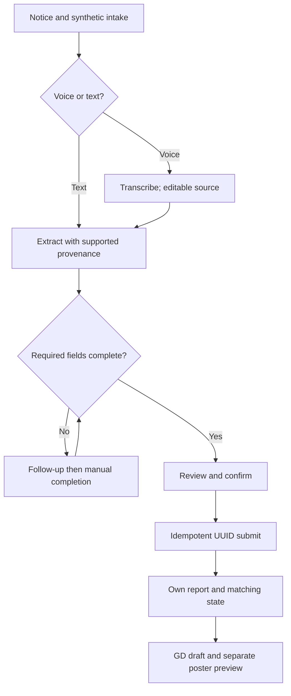
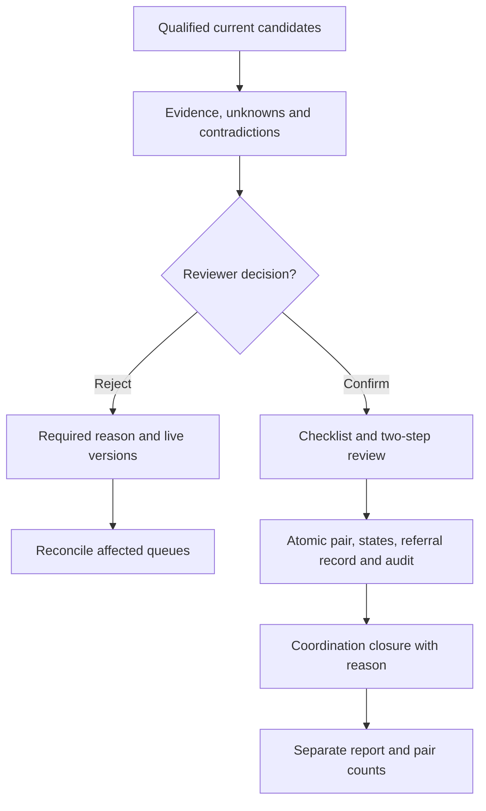

# D3 — App Flow Document — Fera

| Field | Value |
|---|---|
| Version | 2.0 |
| Date | 11 Oct 2026 (Asia/Dhaka, UTC+6) |
| Owner | Sadman Shaharier |
| Authors | Sadman Shaharier; Obidit Islam |
| Status | V2 team handover; implementation status UNVERIFIED |
| Inputs | D1 and D2 Parts A/B V2.0; V2 role projections and state/decision contracts. |
| Notation | Screen [S-xxx] = SCREEN-xxx; action ACT-xxx; decision D-xxx; API call API-xxx; error E-xxx. UI components COMP-022 – COMP-050 are specified in D4. |

## V2 release contract

**Authors:** Sadman Shaharier and Obidit Islam. **Version:** 2.0. **Issued:** 11 October 2026, Asia/Dhaka (UTC+6).

This is the revised team specification, not evidence that the application has been built. Actual repository progress, account configuration, interviews, evaluations, and spend remain **UNVERIFIED** until evidence is attached. V1 defaults are superseded by the V2 rules below; existing requirement IDs are retained.

- This release is a **synthetic-data prototype**. Officer verification and referral delivery are simulated and labelled. The schema rejects records marked non-synthetic; the application must also prevent real reports from entering this release.
- A candidate score is similarity, not identity probability. A reviewer decision does not establish guardian authority or safe reunification. A referral row means **referral recorded**, not delivered or acknowledged.
- Draft payload stays on the device before report confirmation, but providers process audio/text beforehand with a notice. Only expiry/counter/hash metadata and cost reservations are stored server-side before submission.
- Possible duplicates remain visible. Shared phone alone never establishes one child. No physical child-return action is performed by Fera.
- Counts distinguish missing-report rows, found-report rows, and confirmed pairs. They are not a census of unique children or proof of rescue.
- Sources, diagrams, tables, code blocks, and acceptance criteria are part of the handover. The companion code must match the embedded code exactly. [Team handover](TEAM_HANDOVER_V2.md) records change closure, evidence gaps, and release gates.

## Changes to earlier documents

V2 brings parent, staff, officer and admin screens into agreement with the V2 role projections and APIs; adds manual completion, abstention, stale-decision and referral-recorded states. SCREEN-006 retains its Should priority from the earlier change history.

---

## 1 Navigation map per role

| Role | Entry | Reachable screens | Home after action |
|---|---|---|---|
| Parent (no account) | Shared link or `/` | S-001 → S-002 → S-003 → S-004; S-005 (fallback); S-006 (Should); S-015 (Could) | S-004 |
| Staff | `/staff` → S-008 | S-007, S-016 | S-007 |
| Officer (verified) | `/officer` → S-008 | S-009, S-010, S-011, S-012, S-014 (Could), S-016 | S-009 |
| Officer (unverified) | `/officer` → S-008 | Same as staff (D1 BR-024) | S-007 |
| Admin | `/admin` → S-008 | S-013, S-011, S-012 (read), S-016 | S-013 |

Persistent elements: COMP-022 header with "বাংলা | English" toggle (ACT-030) on every screen; COMP-023 "সিনথেটিক" (synthetic) badge on any seeded record.

---

## 2 Screen inventory

### SCREEN-001 Welcome and language · Must

| Attribute | Value |
|---|---|
| Purpose | Explain Fera in 2 lines and start intake |
| Entry / exit | `/` or shared link → S-002 |
| Components | COMP-022, COMP-050 consent notice, primary button |
| Primary action | ACT-001 "শুরু করুন" / Start |
| Secondary | ACT-030 language toggle; link "১৩২১৯-এ কল করুন" / Call 13219 (`tel:13219`) |
| Data required | None |
| States | Loading: none (static). Empty: n/a. Error: n/a. Success: navigates to S-002 |
| Permissions | Public |
| Accessibility | Single H1; consent text ≥ 16 px; start button 48 px tall |

Copy: "ফেরা আপনার কথা থেকে নিখোঁজ শিশুর রিপোর্ট তৈরি করে। ফেরা পুলিশ বা সিআইডি-কে সতর্কবার্তা পাঠায় না।" / "Fera turns what you say into a missing-child report. Fera does not send alerts to police or CID."

### SCREEN-002 Intake chat (voice/text) · Must

| Attribute | Value |
|---|---|
| Purpose | Collect the report by voice or text; ask missing fields one at a time |
| Entry / exit | S-001, or draft restore → S-003 when D-004 = complete or rounds = 4; → S-005 on E-012/E-013/E-023 |
| Components | COMP-024 chat bubble, COMP-025 voice record button, COMP-026 transcript editor, COMP-027 question prompt, text box, COMP-046 loading, COMP-048 cached badge |
| Primary action | ACT-002 record voice or ACT-003 type, then ACT-005 send |
| Secondary | ACT-004 edit transcript; ACT-006 answer question; ACT-014 open form; ACT-015 discard |
| Data required | Draft from `localStorage` if present |
| API | API-001, API-002 |
| States | Loading: "শুনছি…" / Listening…, "বুঝে নিচ্ছি…" / Understanding…; at 10 s "এখনও কাজ চলছে, একটু অপেক্ষা করুন" / Still working, please wait. Empty: prompt "আপনার শিশুর কথা বলুন বা লিখুন" / Tell us about your child, by voice or text. Error: E-001, E-007, E-008 – E-011, E-014, E-015, E-022, E-024. Success: next question or move to S-003 |
| Permissions | Parent (cookie created on first API call) |
| Accessibility | Recorder announces state via `aria-live="polite"`; timer readable; transcript is the caption for the audio; text path always visible |

Follow-up question templates (COMP-009):

| Field | Bangla / English |
|---|---|
| age | "{নাম}-এর বয়স কত?" / How old is {name}? |
| sex | "শিশুটি ছেলে না মেয়ে?" / Is the child a boy or a girl? (buttons: ছেলে / মেয়ে / অন্য / জানি না) |
| district | "{নাম}-কে শেষবার কোন জেলায় দেখা গিয়েছিল?" / In which district was {name} last seen? |
| event time | "শেষবার কবে, কখন দেখা গিয়েছিল?" / When was {name} last seen? |
| phone | "আপনার মোবাইল নম্বর দিন, যাতে খবর পেলে যোগাযোগ করা যায়।" / Your mobile number, so you can be contacted. |

### SCREEN-003 Case review · Must

| Attribute | Value |
|---|---|
| Purpose | Parent checks and edits every field before submit (D1 BR-004) |
| Entry / exit | S-002 → S-004 on submit; back to S-002 |
| Components | COMP-028 field cards (editable), COMP-029 confirm bar, COMP-049 duplicate banner (only own duplicate submission), COMP-044 inline alert |
| Primary action | ACT-008 "যাচাই করে জমা দিন" / Check and submit (enabled only after "আমি যাচাই করেছি" / I have checked) |
| Secondary | ACT-007 edit field; ACT-015 discard |
| Data required | Draft |
| API | API-003 |
| States | Loading: "জমা হচ্ছে…" / Submitting…. Empty: n/a. Error: E-001 (field-level), E-006, E-019, E-024. Success: S-004 |
| Permissions | Parent |
| Accessibility | Each card has a visible label and value; "অজানা" / unknown shown as text, not blank; error text tied with `aria-describedby` |

### SCREEN-004 Case submitted and outputs · Must

| Attribute | Value |
|---|---|
| Purpose | Show case reference and get GD draft, poster and 13219 summary |
| Entry / exit | S-003, S-005 → S-006 (Should) |
| Components | Reference card, COMP-033 status badge, COMP-030 output cards, COMP-031 poster preview |
| Primary action | ACT-009 "জিডি খসড়া" / GD draft; ACT-010 "পোস্টার" / Poster |
| Secondary | ACT-011 "১৩২১৯ সারাংশ" / 13219 summary (Should); ACT-012 copy; ACT-013 download PNG; `tel:13219` |
| Data required | Case (own) |
| API | API-006 |
| States | Loading per card: "তৈরি হচ্ছে…" / Preparing…. Empty: n/a. Error: E-016, E-020, E-024. Success: "কপি হয়েছে" / Copied |
| Permissions | Parent (owner) |
| Accessibility | Output text in a selectable `<pre>`-like block with lang="bn"; copy confirmation announced |

Every output card carries the label "খসড়া — নিজে জমা দিন" / Draft — submit it yourself (D1 BR-002).

### SCREEN-005 Manual case form · Must

| Attribute | Value |
|---|---|
| Purpose | Fallback when AI fails or is unavailable (FR-026) |
| Entry / exit | S-002 (E-012, E-013, E-014 second time, E-023) or ACT-014 → S-003 |
| Components | COMP-032 manual form (one field per row), COMP-044 |
| Primary action | ACT-005 "পরের ধাপ" / Next (to S-003) |
| Secondary | ACT-015 discard |
| Data required | Any extracted fields pre-filled |
| States | Loading: none. Error: E-001 inline. Success: S-003 |
| Permissions | Parent |
| Accessibility | Fieldset groups; district as searchable select with Bangla and English names; numeric fields accept Bangla digits |

### SCREEN-006 Parent case status and edit · Should

| Attribute | Value |
|---|---|
| Purpose | Status only; edit while allowed (BR-025) |
| Entry / exit | Return visit on same device; S-004 → S-003 (edit) |
| Components | COMP-033 status badge, reference card, edit button |
| Primary action | ACT-016 view status; ACT-017 "তথ্য সংশোধন" / Correct details |
| Data required | API-018 (Should), API-005 (Should) |
| States | Loading: skeleton. Empty: "এই ফোনে কোনো রিপোর্ট নেই" / No reports on this phone. Error: E-018, E-019. Success: "সংশোধন জমা হয়েছে" / Correction submitted |
| Permissions | Parent (owner); never shows candidate or found data |
| Accessibility | Status uses icon + text + colour |

Status labels: "খোলা" / Open; "যাচাই চলছে" / Being checked; "বন্ধ" / Closed.

### SCREEN-007 Found-child log · Must

| Attribute | Value |
|---|---|
| Purpose | Staff log a found child (FR-011) |
| Entry / exit | S-008 (staff home) → same screen with success card |
| Components | COMP-034 found-child form (free text + structured fields), COMP-025 (optional voice), COMP-028, COMP-029 |
| Primary action | ACT-019 "সংরক্ষণ করুন" / Save |
| Secondary | ACT-003 type description; ACT-015 clear |
| API | API-002 (kind found), API-007 |
| States | Loading: "সংরক্ষণ হচ্ছে…" / Saving…. Empty: blank form. Error: E-001, E-006, E-007, E-024. Success: "সংরক্ষিত। নম্বর F-…। মিল খোঁজা হয়েছে।" / Saved. Ref F-…. Matching state queued/running/complete/failed is explicit. (no candidate details) |
| Permissions | Staff, officer |
| Accessibility | No photo field (D1 BR-006); time field defaults to now in BST |

### SCREEN-008 Sign-in · Must

| Attribute | Value |
|---|---|
| Purpose | Staff, officer and admin sign-in (FR-037) |
| Entry / exit | `/staff`, `/officer`, `/admin`, or E-002 → role home |
| Components | COMP-047 sign-in form; demo account hint visible only when `DEMO_MODE=1` |
| Primary action | ACT-018 "সাইন ইন" / Sign in |
| API | API-020 |
| States | Loading: button spinner. Error: "ইউজারনেম বা পাসওয়ার্ড ঠিক নয়" / Username or password is incorrect (E-002); E-007 |
| Permissions | Public |
| Accessibility | Autocomplete attributes; password show/hide toggle |

### SCREEN-009 Review queue · Must

| Attribute | Value |
|---|---|
| Purpose | Officer sees cases with pending candidates (FR-014) |
| Entry / exit | Officer home → S-010, S-011, S-012 |
| Components | COMP-035 queue list, COMP-036 candidate rows, COMP-033, COMP-023, district filter |
| Primary action | ACT-020 open a candidate |
| Secondary | ACT-024 map; ACT-029 sign out |
| API | API-008 |
| States | Loading: 5 skeleton rows. Empty: "এখনো কোনো সম্ভাব্য মিল নেই। নতুন রিপোর্ট এলে স্বয়ংক্রিয়ভাবে যাচাই হবে।" / No likely matches yet. New reports are checked automatically. Error: E-002, E-003, E-021 |
| Permissions | Officer (verified) |
| Accessibility | Table semantics; keyboard: ↑/↓ moves rows, Enter opens |

### SCREEN-010 Match review (side by side) · Must

| Attribute | Value |
|---|---|
| Purpose | Compare evidence and decide (FR-015 – FR-017) |
| Entry / exit | S-009 → S-012 (after confirm) or S-009 (after reject) |
| Components | COMP-037 evidence table, COMP-038 decision panel, COMP-049 duplicate banner, score with label "মিলের মাত্রা" / similarity |
| Primary action | ACT-021 "মিল নিশ্চিত করুন" / Confirm match |
| Secondary | ACT-022 "মিল নয়" / Not a match (reason required); ACT-025 audit |
| API | API-009, API-010 |
| States | Loading: two-column skeleton. Error: E-004, E-005. Success (confirm): "মিল নিশ্চিত। শিশু সুরক্ষা সেবায় রেফারেল তৈরি হয়েছে।" / Match confirmed. Referral to child-protection services created. Success (reject): "বাতিল করা হয়েছে" / Rejected |
| Permissions | Officer (verified) |
| Accessibility | Agree / differ / unknown shown as icon + word ("মিল" / match, "অমিল" / differs, "অজানা" / unknown); confirm needs a second step dialog |

Confirm dialog: "আপনি কি নিশ্চিত? এতে শিশুকে সরাসরি ফেরত দেওয়া হবে না; রেফারেল নথিভুক্ত হবে (সিমুলেশন)।" / Are you sure? This will not return the child directly; it creates a referral to child-protection services.

### SCREEN-011 District dashboard · Must

| Attribute | Value |
|---|---|
| Purpose | Map of Open/Matched/Closed counts by district (FR-019) |
| Entry / exit | S-009, S-013 → S-012 via district list |
| Components | COMP-040 district map, COMP-041 district table (always rendered), totals, "সিনথেটিক সহ" / include synthetic toggle |
| Primary action | ACT-024 select a district |
| API | API-012 |
| States | Loading: totals skeleton. Empty district: counts "০". Error: tiles fail → markers on plain background + table (offline). Success: map rendered |
| Permissions | Officer, admin |
| Accessibility | The table is the accessible equivalent of the map; markers are focusable buttons with text counts |

### SCREEN-012 Case detail and audit trail · Must

| Attribute | Value |
|---|---|
| Purpose | Full case, duplicates, close action, audit (FR-018, FR-021, FR-022) |
| Entry / exit | S-009, S-010, S-011 |
| Components | Case fields, COMP-033, COMP-049, COMP-042 audit timeline, COMP-039 close dialog |
| Primary action | ACT-023 "কেস বন্ধ করুন" / Close case |
| Secondary | ACT-025 view audit |
| API | API-004, API-011, API-013 |
| States | Loading: skeleton. Error: E-004, E-005, E-017. Success: "কেস বন্ধ হয়েছে" / Case closed |
| Permissions | Officer (actions); admin (read, payload-redacted fields hidden) |
| Accessibility | Timeline as an ordered list with times in BST |

Close outcomes: "শনাক্ত, রেফারেল হয়েছে" / Located, referred; "ফেরার বাইরে নিষ্পত্তি" / Resolved outside Fera.

### SCREEN-013 Admin data tools · Must

| Attribute | Value |
|---|---|
| Purpose | Redact identifying payloads (Must), verify officer [MOCK] (Must), import (Should) |
| Entry / exit | Admin home |
| Components | COMP-043 admin actions, user list, import text area |
| Primary action | ACT-027 "বন্ধ কেস বেনামী করুন" / Redact identifying payloads from eligible terminal cases |
| Secondary | ACT-028 verify officer [MOCK]; ACT-026 import batch |
| API | API-015, API-016, API-017, API-021 |
| States | Loading: progress text. Empty: "পরিচয় তথ্য অপসারণের জন্য উপযুক্ত রিপোর্ট নেই" / No eligible reports for payload redaction. Error: E-001, E-003. Success: "{n}টি রিপোর্টের পরিচয় তথ্য অপসারণ করা হয়েছে" / {n} cases payload-redacted |
| Permissions | Admin |
| Accessibility | Destructive action needs typed confirmation "বেনামী" |

### SCREEN-014 Duplicate review · Could

| Attribute | Value |
|---|---|
| Purpose | Mark linked records as same child or not (FR-023) |
| Entry / exit | S-012 duplicate banner |
| Components | COMP-037 (two same-kind records), buttons |
| Primary action | ACT-032 "একই শিশু" / Same child or "আলাদা" / Different |
| States | Error: E-004, E-005 |
| Permissions | Officer |

### SCREEN-015 Disaster mode · Could

| Attribute | Value |
|---|---|
| Purpose | Shelter volunteer logs a separated child (FR-036) |
| Entry / exit | Link from S-007 footer |
| Components | COMP-034 with banner "পরিকল্পিত সম্প্রসারণ — বন্যা ও ঘূর্ণিঝড় আশ্রয়কেন্দ্র" / Planned extension — flood and cyclone shelters |
| Primary action | ACT-033 log separated child |
| Permissions | Staff |

### SCREEN-016 Not found / not allowed · Must

| Attribute | Value |
|---|---|
| Purpose | Single response for missing or hidden records (E-004) and role errors (E-003) |
| Components | COMP-045 empty state with home link |
| Copy | "তথ্যটি পাওয়া যায়নি।" / We couldn't find that. |
| Accessibility | Focus moves to the heading |

---

## 3 Main flow (core demo journey)

| Step | Who | Screen | Action | API | Result |
|---|---|---|---|---|---|
| 1 | Parent | S-001 | ACT-001 | — | Intake opens |
| 2 | Parent | S-002 | ACT-002 record 40 s note | API-001 | Transcript shown |
| 3 | Parent | S-002 | ACT-004 fix a word, ACT-005 send | API-002 | Draft + district question |
| 4 | Parent | S-002 | ACT-006 "মিরপুর, ঢাকা" | API-002 | Draft complete |
| 5 | Parent | S-003 | ACT-008 check and submit | API-003 | Case M-… open |
| 6 | Parent | S-004 | ACT-009, ACT-010 | API-006 | GD draft and poster |
| 7 | Staff | S-008 → S-007 | ACT-018, ACT-019 | API-020, API-007 | Found case F-…; matching run |
| 8 | Officer | S-008 → S-009 | ACT-018, ACT-020 | API-008 | Candidate rank 1 |
| 9 | Officer | S-010 | ACT-021 | API-009, API-010 | Missing confirmed; found referred; referral |
| 10 | Officer | S-012 | ACT-023 | API-011 | Missing closed |
| 11 | Officer | S-011 | ACT-024 | API-012 | Dhaka: Missing Closed +1, Missing Matched −1; found counts unchanged by missing closure |

## 4 First-time flow

1. Parent opens a shared link → S-001 with COMP-050 consent notice.
2. ACT-001 → S-002 shows one example sentence: "যেমন: আমার মেয়ে মীম, বয়স ১১, আজ সকালে স্কুলে যাওয়ার পথে…" / For example: My daughter Mim, 11, this morning on the way to school….
3. First mic tap triggers the browser permission prompt (D-001).
4. Parent cookie is created on the first API call; no sign-up.

## 5 Returning flow

| Role | Flow |
|---|---|
| Parent, unfinished draft | S-002 shows "আগের খসড়া পাওয়া গেছে — চালিয়ে যাবেন?" / Earlier draft found — continue? (ACT-031 continue or ACT-015 discard). Expired after 24 h → E-019. |
| Parent, submitted case | S-006 shows status (Should/Could). Other device → not supported (OQ-020). |
| Officer | S-008 → S-009, candidates created since last visit first. |

## 6 Auth flow

| Step | Detail |
|---|---|
| Parent | No sign-in. API-001/API-002 set `fera_ps` cookie (30 days). Draft token signed separately (24 h). |
| Staff/officer/admin | S-008 → API-020 credentials → JWT cookie 8 h → role home (§1). |
| D-008 role check | Every request: role + `verified` read from DB. Unverified officer → staff home. |
| Expiry | Staff/officer request after 8 h → E-002 → S-008 → return to the same URL. |
| Sign-out | ACT-029 clears cookie → S-008. |

## 7 Error and recovery flows

| # | Edge case | Trigger | System behaviour | User message (Bangla / English) | Error | Recovery |
|---|---|---|---|---|---|---|
| 1 | Invalid input | Bad phone, age 19, text < 20 chars | Field-level validation | "সঠিক মোবাইল নম্বর দিন (০১ দিয়ে শুরু, ১১ সংখ্যা)" / Enter a valid mobile number (starts 01, 11 digits) | E-001 | Fix field |
| 2 | Unintelligible voice note | Empty or garbled transcript | No draft created | "কথাগুলো পরিষ্কার শোনা যায়নি। আবার বলুন বা লিখে দিন।" / We couldn't hear that clearly. Try again or type instead. | E-010 | Re-record or type |
| 3 | Wrong language detected | < 30 % Bangla or Latin letters | Stop before extraction | "বাংলা বা ইংরেজিতে বলুন বা লিখুন।" / Please speak or write in Bangla or English. | E-015 | Re-enter |
| 4 | Duplicate submission | Same principal + submission UUID; identical canonical payload | Return existing case | "এই রিপোর্ট আগেই জমা হয়েছে। নম্বর: M-7K3Q2A" / Already submitted. Ref: M-7K3Q2A | 200 replay, not an error | Open S-004 for existing case |
| 5 | Same child reported from another source | D1 BR-021 rule fires | Both open; linked; shown once in candidates | Officer banner: "সম্ভাব্য একই শিশু: M-…" / Possible same child: M-… | — | S-012 / S-014 |
| 6 | Network failure mid-upload | Fetch fails or offline event | Draft and audio kept in browser | "ইন্টারনেট সংযোগ নেই। আপনার তথ্য রাখা আছে — সংযোগ ফিরলে আবার পাঠান।" / No internet. Your details are saved — send again when back online. | E-024 | ACT-031 retry |
| 7 | Expired session | Draft > 24 h; staff JWT > 8 h | Parent: draft cleared. Staff: redirect | "আপনার খসড়ার সময় শেষ। নতুন করে শুরু করুন।" / Your draft has expired. Please start again. | E-019 / E-002 | S-002 new / S-008 |
| 8 | Empty data | No candidates, no cases | Explicit empty state | "এখনো কোনো সম্ভাব্য মিল নেই।" / No likely matches yet. | — | Wait; auto-check |
| 9 | Unauthorised access to a matched record | Parent/staff/unverified opens a candidate or other case URL | 404 body; `access.denied` audit | "তথ্যটি পাওয়া যায়নি।" / We couldn't find that. | E-004 | S-016 |
| 10 | Slow STT/LLM (> 10 s) | Elapsed 10 s | Message changes; abort at 25 s | "এখনও কাজ চলছে, একটু অপেক্ষা করুন" / Still working, please wait | E-014 at 25 s | Retry once, then S-005 |
| 11 | User cancellation | ACT-015 during recording or draft | Recording stops; confirm dialog; draft deleted | "খসড়া মুছে ফেলবেন?" / Delete this draft? | — | S-001 |
| 12 | Parent edits after submission | ACT-017 | Allowed in submitted/open/matched_pending_review; new version; candidates voided | Locked: "মিল নিশ্চিত হওয়ার পর কেস বদলানো যায় না।" / Can't edit after a match is confirmed. | E-018 when locked | S-003 or `tel:13219` |
| 13 | Officer rejects a match | ACT-022 | Reason required (3–500 chars); case back to open if none pending; pair not re-suggested | "কারণ লিখুন" / Enter a reason | E-001 if no reason | S-009 |
| 14 | Unsupported browser / no mic permission | No MediaRecorder or permission denied | Text box focused; mic button disabled with reason | "মাইক্রোফোন চালু করা যায়নি। আপনি লিখে জানাতে পারেন।" / The microphone isn't available. You can type instead. | E-022 | Text path |
| 15 | AI fails twice / unavailable | E-012, E-013 | Manual form pre-filled | "সহকারী তথ্য গুছাতে পারেনি। ফর্মটি পূরণ করুন — আপনার লেখা রাখা আছে।" / The assistant couldn't organise this. Please fill the form — your text is kept. | E-012 / E-013 | S-005 |

---

## 8 State transitions and recovery

| Kind | Persisted states | Terminal meaning |
|---|---|---|
| Missing | submitted → open ↔ matched_pending_review → confirmed → closed; open → closed only for outside resolution | Closed coordination record with reason; no rescue proof |
| Found | open ↔ matched_pending_review → referred | Referral recorded (simulation), not agency receipt |
| Browser draft | Device payload plus server metadata; expires on access/metadata check | Not a submitted case |

See D1 BR-012/013 for complete guards. Terminal correction/reopen is a pre-pilot two-reviewer procedure; no ordinary backward transition exists in the demo.

### 8.1 Recovery rules

Lost submission response: retry the same UUID and receive the same reference. Changed payload with same UUID: conflict. Matching failure: case remains saved with failed/queued status and retry control; do not claim no matches until matching completes. Stale candidate: server rejects and refreshes current evidence. Confirming/voiding competitors reconciles all affected case queues. Disconnected browser: retain device draft with an expiry notice and retry same UUID. Cached script: badge and fixture intake time remain visible. Paid-call failure: manual fields remain usable.

## 9 Flowcharts per role

### 9.1 Reporter

### 9.2 Staff

Sign in to a separate browser context; describe/review the synthetic found child; confirm required district/place/time/contact; use found-only speech/extraction if needed; save with scoped UUID; see own entry and matching state. Staff sees no candidate/other-party report payload. Queue access belongs to verified officers.

### 9.3 Officer

### 9.4 Admin

API-021 lists users for mock verification. API-016 redacts eligible payloads only through the restricted action, preserving active evidence. API-014 returns rematch status only. API-015 imports invented samples only. API-012/013 give aggregates/safe audit; API-004 gives metadata, never child or candidate detail. Duplicate resolution, if built, is officer-only API-023. District case drill-through uses officer-only API-022.

---

## Actions (ACT)

| ID | Action | Role |
|---|---|---|
| ACT-001 | Tap Start | Parent |
| ACT-002 | Record voice note | Parent, staff |
| ACT-003 | Type report or description | Parent, staff |
| ACT-004 | Edit transcript | Parent |
| ACT-005 | Send / next | Parent |
| ACT-006 | Answer follow-up question | Parent |
| ACT-007 | Edit a field | Parent, staff |
| ACT-008 | Check and submit | Parent |
| ACT-009 | Request GD draft | Parent |
| ACT-010 | Request poster | Parent |
| ACT-011 | Request 13219 summary | Parent |
| ACT-012 | Copy text | Parent |
| ACT-013 | Download poster PNG | Parent |
| ACT-014 | Open manual form | Parent |
| ACT-015 | Discard / cancel | Parent, staff |
| ACT-016 | View case status | Parent |
| ACT-017 | Correct details after submit | Parent |
| ACT-018 | Sign in | Staff, officer, admin |
| ACT-019 | Save found child | Staff, officer |
| ACT-020 | Open candidate | Officer |
| ACT-021 | Confirm match | Officer |
| ACT-022 | Reject match with reason | Officer |
| ACT-023 | Close case with outcome | Officer |
| ACT-024 | Use map or district table | Officer, admin |
| ACT-025 | View audit trail | Officer, admin |
| ACT-026 | Import invented fixture texts | Admin |
| ACT-027 | Redact identifying payloads from eligible terminal cases | Admin |
| ACT-028 | Verify officer [MOCK] | Admin |
| ACT-029 | Sign out | Staff, officer, admin |
| ACT-030 | Switch language | All |
| ACT-031 | Retry / continue draft | Parent, staff |
| ACT-032 | Mark duplicate same/different | Officer |
| ACT-033 | Log separated child (disaster mode) | Staff |

## Decisions (D)

| ID | Decision |
|---|---|
| D-001 | Microphone available and permitted? |
| D-002 | Audio length 5–120 s and ≤ 2 MB? |
| D-003 | Transcript intelligible and Bangla/English? |
| D-004 | Required fields complete? |
| D-005 | AI calls used < 6? |
| D-006 | Extraction valid within 2 attempts? |
| D-007 | Submission UUID retry or conflicting payload? |
| D-008 | Role officer and verified? |
| D-009 | Pending candidates exist? |
| D-010 | Officer confirms or rejects? |
| D-011 | Other pending candidates remain? |
| D-012 | Referral exists? |
| D-013 | Case editable (BR-025)? |
| D-014 | Device online? |
| D-015 | Session valid? |
| D-016 | Admin typed confirmation correct? |

---

## IDs introduced

- ACT-001 – ACT-033 (one line each in "Actions")
- D-001 – D-016 (one line each in "Decisions")

## IDs referenced

- SCREEN-001 – SCREEN-016 (D1)
- API-001 – API-020, E-001 – E-024 (D2)
- COMP-009 (D2); COMP-022 – COMP-050 (D4)
- BR-002, BR-004, BR-006, BR-021, BR-024, BR-025, FR-011, FR-014 – FR-019, FR-021 – FR-023, FR-026, FR-036, FR-037, STORY-019 (D1)
- OQ-020 (D1)

## V2 screen dependency acceptance

- SCREEN-006 uses Must owner read API-004 and Should API-018/005 together; missing optional history does not block intake.
- SCREEN-007 voice is authorised through API-001 for own found drafts. Device permission failure routes to text.
- SCREEN-011 drill-through uses API-022 with kind-specific report counts; admin has no child-detail drill-through.
- SCREEN-013 user listing uses API-021; seeded authority is explicitly mock.
- SCREEN-014 is Could with API-023 and reasoned profile review. Possible duplicate flags do not hide reports.
- If four follow-ups expire with mandatory unknowns, SCREEN-005 lists the missing fields and preserves known values. Submit is blocked clearly until completed.
- SCREEN-010 calls confirmation a reviewer decision and a simulated referral record; no child delivery claim.
