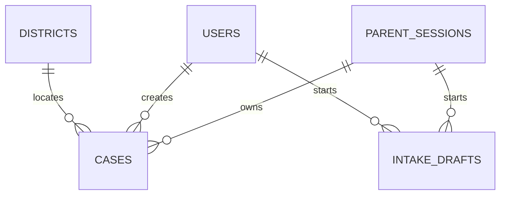
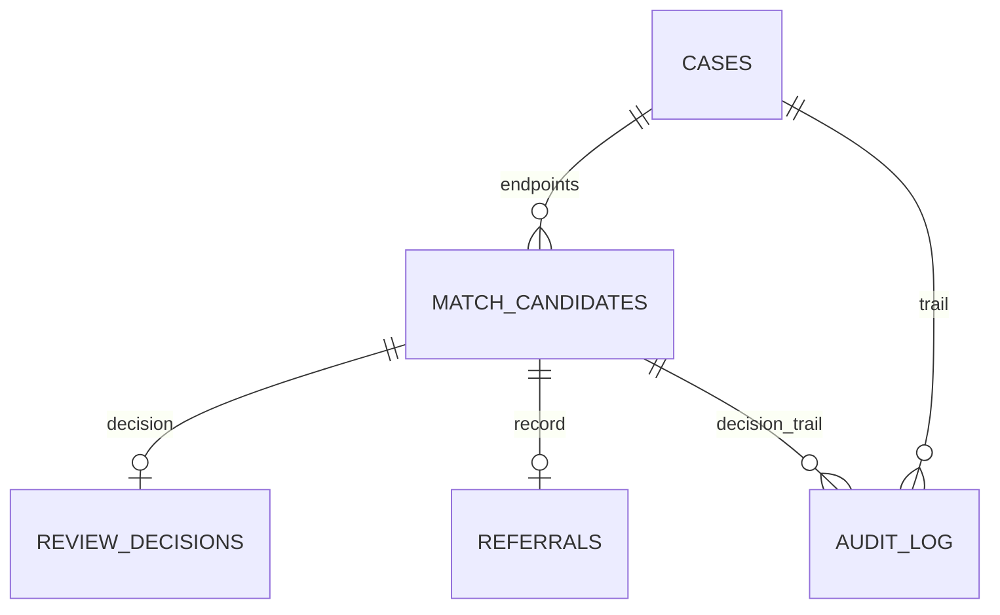

# D5 — Background Schema — Fera

| Field | Value |
|---|---|
| Version | 2.0 |
| Date | 11 Oct 2026 (Asia/Dhaka, UTC+6) |
| Owner | Sadman Shaharier |
| Authors | Sadman Shaharier; Obidit Islam |
| Status | V2 team handover; implementation status UNVERIFIED |
| Companion | `fera_types_v2.ts` — byte-identical copy of §6 |
| Covers | All nine V2 source documents and the three V2 companions; validation report. |

## V2 release contract

**Authors:** Sadman Shaharier and Obidit Islam. **Version:** 2.0. **Issued:** 11 October 2026, Asia/Dhaka (UTC+6).

This is the revised team specification, not evidence that the application has been built. Actual repository progress, account configuration, interviews, evaluations, and spend remain **UNVERIFIED** until evidence is attached. V1 defaults are superseded by the V2 rules below; existing requirement IDs are retained.

- This release is a **synthetic-data prototype**. Officer verification and referral delivery are simulated and labelled. The schema rejects records marked non-synthetic; the application must also prevent real reports from entering this release.
- A candidate score is similarity, not identity probability. A reviewer decision does not establish guardian authority or safe reunification. A referral row means **referral recorded**, not delivered or acknowledged.
- Draft payload stays on the device before report confirmation, but providers process audio/text beforehand with a notice. Only expiry/counter/hash metadata and cost reservations are stored server-side before submission.
- Possible duplicates remain visible. Shared phone alone never establishes one child. No physical child-return action is performed by Fera.
- Counts distinguish missing-report rows, found-report rows, and confirmed pairs. They are not a census of unique children or proof of rescue.
- Sources, diagrams, tables, code blocks, and acceptance criteria are part of the handover. The companion code must match the embedded code exactly. [Team handover](TEAM_HANDOVER_V2.md) records change closure, evidence gaps, and release gates.

## Changes to earlier documents

V2 consolidates 537 unique IDs, their corrected definition locations, new API/entity/test/task records, and the revised TypeScript contracts. All companion snippets match their delivered files. D2A and D5 consistently use Uint8Array at the speech adapter boundary.

---

## 1 Project metadata

| Field | Value |
|---|---|
| Name | Fera (ফেরা) |
| One line | Bangla-first reviewed report and candidate coordination; no rescue guarantee |
| Event | Hack for Humanity 2026 (AI Collective Bangladesh, AIUB), Track 3 Smart Society & Public Services |
| Round 2 due | 14 Oct 2026 confirmed date; exact time/deliverables/submission channel pending organiser email |
| Grand Finale | 24 Oct 2026 at AIUB: 5–10 min presentation + live demo |
| Judging | Social/human impact, feasibility, scalability; weights UNKNOWN (OQ-025); no equal-weight claim |
| Team | Sadman Shaharier (lead/integration), Obidit Islam (intake & LLM), Masnun Kabir (data, matching & dashboard) — institutions/registration spelling pending verification |
| Platform | Responsive web app; mobile-first for parents, desktop-first for officers; no hardware |

## 2 Problem context

| Item | Value and evidence status |
|---|---|
| Reported missing, Jan–Jul 2026 | 15,717 children |
| Still untraced | 2,038 (13 %), Jan–Jul cohort reported 3 Sep 2026; 13,679 were reported returned/rescued. No claim that existing agencies record no outcomes. |
| Aged 10–17 | 97 % |
| Rate | About 74 per day |
| Linked operational registry | Unverified hypothesis; no absence claim |
| Existing system | CID's MUN Alert, live since 13 Jan 2026, helpline 13219, joined Meta's alert network May 2026 |

Breaking points: lost first hours; scattered reports with no missing↔found link; unvalidated need for clearer case-level coordination follow-up.

## 3 Domain concepts

| Concept | Definition in Fera | Fera's role |
|---|---|---|
| GD (General Diary) | Police-station record of a reported incident, here a missing child | Fera drafts the text; the family files it (FR-008) |
| MUN Alert | CID's missing-child alert system with Amber Alert for Bangladesh | Fera never issues or withdraws alerts (BR-002) |
| 13219 | MUN Alert's toll-free helpline | Fera shows the number and a summary to read out (FR-010) |
| CID Missing Children Cell | Unit named in sources as able to issue or withdraw alerts; public briefing names Missing Children Cell; operational partnership unverified | External; no integration |
| Missing case | Report of a child not found by family | `cases.kind = missing` |
| Found case | Report of a child found by staff, shelter, station or public source | `cases.kind = found` |
| Match | A ranked missing↔found pair; a candidate until an officer decides | ENTITY-005; BR-001 |
| Referral | Internal simulated referral record after a reviewer decision; not proof of delivery, custody, identity or safe resolution | ENTITY-007; BR-005 |
| Duplicate | Two same-kind records likely describing one child | ENTITY-008; BR-021 |
| Closure | A missing case reaching `closed` with an outcome | FR-018; GOAL-006 |
| Disaster mode | Planned extension for flood/cyclone shelters; no measured need | FR-036 (Could) |
| Synthetic data | Team-written records with known ground truth, labelled on screen | BR-026 |

## 4 Stakeholders

| Stakeholder | Interest | Interaction |
|---|---|---|
| Parents and guardians (PERSONA-001) | Fast, complete report; updates | Parent screens |
| Verifying officers (PERSONA-002) | Accurate shortlist; accountable decisions | Officer screens |
| Shelter/station staff (PERSONA-003) | Found children matched | Staff screens |
| Child-protection caseworkers (PERSONA-004) | Safe placement after a match | Referral record only |
| Disaster-shelter volunteers (PERSONA-005) | Reunification after floods/cyclones | Could, SCREEN-015 |
| CID / MUN Alert | Cleaner cases; alert authority | No integration; future data agreement |
| Organisers, judges, mentors | Impact, feasibility, scalability | Deck, video, demo |
| AI providers | Process audio and report text | Via adapters (TB4) |
| Team | Deliver by 14 and 24 Oct | All |

## 5 Constraints

| Constraint | Value |
|---|---|
| AI budget | USD 30 total, hard cap USD 25 in app (DECISION-017) |
| Time | Round 2 on 14 Oct; exact official cutoff pending; finale 24 Oct |
| Capacity | Actual remaining capacity pending; at most 120 h for a fresh four-day start at assumed 10 h/person/day (A-040) |
| Network | Venue internet may fail; demo-safe mode required |
| Devices | Laptop + Android phone browser |
| Language | Bangla text and voice end to end; mixed script and Bangla numerals |
| Data | No private data; no scraping of private accounts; synthetic only in this release; public real-child material requires a later lawful-use gate |
| Safeguarding | BR-001 – BR-011 non-negotiable |
| Law | Personal Data Protection Act, 2026, qualified interpretation and effective provisions review required before real-child use; no compliance claim (OQ-011) |

## 6 TypeScript interfaces

`fera_types_v2.ts` is a byte-identical copy of this block. It type-checks with `tsc --strict` (TypeScript 5.4).

```ts
// Fera shared types V2.0 - D5 section 6. Exact companion of the V2 embedded block.
// Authors: Sadman Shaharier; Obidit Islam. 11 October 2026, Asia/Dhaka.
// Registry records (suite IDs) + domain records (D2 schema) + AI/API contracts (D2 §2, §5).

/* ---------- Shared primitives ---------- */
export type Uuid = string;
export type IsoDateTime = string; // ISO 8601 with +06:00
export type MoSCoW = "Must" | "Should" | "Could" | "Won't";
export type DocId = "00" | "D1" | "D2A" | "D2B" | "D3" | "D4" | "D6" | "D7";
export type Level = "L" | "M" | "H" | "Severe";
export type Role = "parent" | "staff" | "officer" | "admin";
export type AuthLabel = Role | "public";
export type Owner = "S" | "O" | "M";

/* ---------- Registry records ---------- */
export interface RegistryRecord {
  id: string;
  label: string;
  definedIn: DocId;
}
export interface Goal extends RegistryRecord {
  id: `GOAL-${string}`;
  metric: string;
  target: string;
  method: string;
  timeframe: string;
}
export interface Persona extends RegistryRecord {
  id: `PERSONA-${string}`;
  priority: MoSCoW;
}
export interface Story extends RegistryRecord {
  id: `STORY-${string}`;
  priority: MoSCoW;
  acceptance: string[];
  dependencyIds: string[];
  screenIds: string[];
}
export interface FunctionalRequirement extends RegistryRecord {
  id: `FR-${string}`;
  priority: MoSCoW;
  storyIds: string[];
  testIds: string[];
  mock: boolean;
}
export interface NonFunctionalRequirement extends RegistryRecord {
  id: `NFR-${string}`;
  category: string;
  measure: string;
}
export interface BusinessRule extends RegistryRecord {
  id: `BR-${string}`;
  safeguarding: boolean;
  frIds: string[];
  testIds: string[];
}
export interface Assumption extends RegistryRecord {
  id: `A-${string}`;
}
export interface Dependency extends RegistryRecord {
  id: `DEP-${string}`;
  owner: string;
  neededBy: string;
}
export interface Risk extends RegistryRecord {
  id: `RISK-${string}`;
  likelihood: Level;
  impact: Level;
  mitigation: string;
  owner: string;
}
export interface OpenQuestion extends RegistryRecord {
  id: `OQ-${string}`;
  defaultApplied: string | null;
  answeredBy: string;
  dueBy: string;
}
export interface Screen extends RegistryRecord {
  id: `SCREEN-${string}`;
  priority: MoSCoW;
  roles: Role[];
}
export interface Component extends RegistryRecord {
  id: `COMP-${string}`;
  layer: "server" | "client" | "ui";
}
export interface ApiEndpoint extends RegistryRecord {
  id: `API-${string}`;
  method: "GET" | "POST" | "PATCH" | "*";
  path: string;
  auth: AuthLabel[];
  priority: MoSCoW;
}
export interface EntityRecord extends RegistryRecord {
  id: `ENTITY-${string}`;
  table: string;
}
export interface Decision extends RegistryRecord {
  id: `DECISION-${string}`;
}
export interface TestCase extends RegistryRecord {
  id: `TC-${string}`;
  covers: string[];
  steps: string[];
  passIf: string;
}
export interface Task extends RegistryRecord {
  id: `TASK-${string}`;
  priority: MoSCoW;
  owners: Owner[];
  dependsOn: string[];
  hours: number;
  criticalPath: boolean;
}
export interface ErrorCode extends RegistryRecord {
  id: `E-${string}`;
  key: string;
  http: number | null;
  messageBn: string;
  messageEn: string;
}
export interface FlowAction extends RegistryRecord {
  id: `ACT-${string}`;
  roles: Role[];
}
export interface FlowDecision extends RegistryRecord {
  id: `D-${string}`;
}
export interface TraceLink {
  from: string;
  to: string;
  kind: "goal-story" | "story-fr" | "fr-screen" | "fr-test" | "br-fr" | "br-test" | "fr-task";
}

/* ---------- Domain enums (D2 §7) ---------- */
export type MatchingState = "queued" | "running" | "complete" | "failed";
export type MissingStatus = "submitted" | "open" | "matched_pending_review" | "confirmed" | "closed";
export type FoundStatus = "open" | "matched_pending_review" | "referred";
export type CaseKind = "missing" | "found";
export type CaseStatus = "submitted" | "open" | "matched_pending_review" | "confirmed" | "closed" | "referred";
export type StatusGroup = "open" | "matched" | "closed";
export type Sex = "male" | "female" | "other" | "unknown";
export type CaseSource = "parent" | "staff" | "public_import" | "synthetic";
export type UserRole = "staff" | "officer" | "admin";
export type CandidateStatus = "pending" | "confirmed" | "rejected" | "voided" | "superseded";
export type DecisionType = "confirm" | "reject";
export type Outcome = "coordination_recorded" | "resolved_outside_fera";
export type DuplicateStatus = "flagged" | "confirmed_same" | "dismissed";
export type OutputType = "gd" | "poster" | "helpline";
export type ActorType = "parent" | "staff" | "officer" | "admin" | "system";

/* ---------- Domain records (one per table) ---------- */
export interface User { // ENTITY-001
  id: Uuid;
  username: string;
  display_name: string;
  password_hash: string;
  role: UserRole;
  verified: boolean;
  district_code: number | null;
  is_active: boolean;
  created_at: IsoDateTime;
  updated_at: IsoDateTime;
}
export interface ParentSession { // ENTITY-002
  id: Uuid;
  created_at: IsoDateTime;
  last_seen_at: IsoDateTime;
  expires_at: IsoDateTime;
  revoked_at: IsoDateTime | null;
}
export interface Case { // ENTITY-003
  id: Uuid;
  ref_code: string;
  kind: CaseKind;
  status: CaseStatus;
  source: CaseSource;
  source_url: string | null;
  is_synthetic: boolean;
  reporter_session_id: Uuid | null;
  created_by_user_id: Uuid | null;
  raw_text: string | null;
  child_name: string | null;
  child_name_latin: string | null;
  age_years: number | null;
  age_min: number | null;
  age_max: number | null;
  sex: Sex;
  height_cm: number | null;
  clothing: string | null;
  marks: string | null;
  circumstances: string | null;
  event_at: IsoDateTime | null;
  event_at_approx: boolean;
  event_at_lower: IsoDateTime | null;
  event_at_upper: IsoDateTime | null;
  provenance: Record<string, EvidenceSpan>;
  embedding_model: string | null;
  embedding_revision: string | null;
  embedding_space: string | null;
  matching_state: MatchingState;
  matched_at: IsoDateTime | null;
  match_error_id: string | null;
  place_text: string | null;
  district_code: number | null;
  thana: string | null;
  reporter_relation: string | null;
  contact_phone: string | null;
  gd_number: string | null;
  embedding: number[] | null;
  client_submission_id: Uuid | null;
  submission_payload_hash: string | null;
  input_hash: string | null;
  version: number;
  outcome: Outcome | null;
  outcome_note: string | null;
  closed_at: IsoDateTime | null;
  anonymised_at: IsoDateTime | null;
  created_at: IsoDateTime;
  updated_at: IsoDateTime;
}
export interface CaseVersion { // ENTITY-004
  id: Uuid;
  case_id: Uuid;
  version: number;
  snapshot: Record<string, unknown> | null;
  edited_by: ActorType;
  edited_at: IsoDateTime;
}
export interface MatchCandidate { // ENTITY-005
  id: Uuid;
  missing_case_id: Uuid;
  found_case_id: Uuid;
  missing_version: number;
  found_version: number;
  score: number;
  rank: number;
  reason_bn: string;
  reason_en: string;
  components: MatchComponents;
  status: CandidateStatus;
  created_at: IsoDateTime;
  decided_at: IsoDateTime | null;
}
export interface MatchComponents {
  cosine: number;
  name: number;
  clothing: number;
  district: number;
  age: number;
}
export interface ReviewDecision { // ENTITY-006
  id: Uuid;
  candidate_id: Uuid;
  officer_id: Uuid;
  decision: DecisionType;
  officer_verified_at_decision: true;
  reason: string | null;
  decided_at: IsoDateTime;
}
export interface Referral { // ENTITY-007
  id: Uuid;
  candidate_id: Uuid;
  found_case_id: Uuid;
  missing_case_id: Uuid;
  agency_name: string;
  referred_by: Uuid;
  referred_at: IsoDateTime;
  record_state: "recorded";
  is_simulated: true;
  note: string | null;
}
export interface DuplicateLink { // ENTITY-008
  id: Uuid;
  case_a: Uuid;
  case_b: Uuid;
  score: number;
  rule: "profile" | "same_phone";
  status: DuplicateStatus;
  created_at: IsoDateTime;
  resolved_by: Uuid | null;
  resolved_at: IsoDateTime | null;
  reason: string | null;
}
export interface AuditEntry { // ENTITY-009
  id: number;
  at: IsoDateTime;
  actor_type: ActorType;
  actor_user_id: Uuid | null;
  actor_session_id: Uuid | null;
  action: string;
  case_id: Uuid | null;
  candidate_id: Uuid | null;
  details: Record<string, unknown>;
  request_id: string | null;
}
export interface District { // ENTITY-010
  code: number;
  name_en: string;
  name_bn: string;
  division_en: string;
  lat: number;
  lng: number;
}
export interface DistrictNeighbour { // ENTITY-011
  district_code: number;
  neighbour_code: number;
}
export interface GeneratedOutput { // ENTITY-012
  id: Uuid;
  case_id: Uuid;
  type: OutputType;
  text_bn: string | null;
  case_version: number;
  created_at: IsoDateTime;
}
export interface AiCall { // ENTITY-013
  id: number;
  at: IsoDateTime;
  draft_id: Uuid | null;
  case_id: Uuid | null;
  reservation_id: Uuid | null;
  request_id: string | null;
  operation: "transcribe" | "extract" | "embed";
  provider: string;
  model: string;
  duration_ms: number;
  input_units: number | null;
  output_units: number | null;
  est_cost_usd: number;
  cache_hit: boolean;
  ok: boolean;
  error_id: string | null;
}
export interface RateLimitBucket { // ENTITY-014
  key: string;
  window_start: IsoDateTime;
  count: number;
}

// New V2 metadata entities; these store no child text or audio before submission.
export interface IntakeDraft { // ENTITY-015
  id: Uuid;
  session_id: Uuid | null;
  user_id: Uuid | null;
  kind: CaseKind;
  created_at: IsoDateTime;
  expires_at: IsoDateTime;
  payload_hash: string | null;
  ai_calls_used: number;
  revision: number;
}
export interface AiBudget { // ENTITY-016
  id: true;
  cap_usd: number;
  committed_usd: number;
  reserved_usd: number;
}
export interface AiReservation { // ENTITY-017
  id: Uuid;
  draft_id: Uuid | null;
  reserved_usd: number;
  actual_usd: number | null;
  state: "reserved" | "settled";
  created_at: IsoDateTime;
  settled_at: IsoDateTime | null;
}
export interface EvidenceSpan {
  quote: string;
  start_utf16: number;
  end_utf16: number;
  derivation: "direct" | "digits" | "time_interval" | "district_mapping" | "romanisation";
}

/* ---------- AI adapter contracts (D2 §2.1–§2.3) ---------- */
export interface ExtractInput {
  kind: CaseKind;
  sourceText: string; // reviewed raw transcript/text; evidence quotes refer to this
  normalisedText: string; // deterministic normalisation; preserve span mapping
  nowIso: IsoDateTime;
}
export interface ExtractOutput {
  child: {
    name: string | null;
    age_years: number | null;
    age_min: number | null;
    age_max: number | null;
    sex: Sex;
    height_cm: number | null;
    clothing: string | null;
    marks: string | null;
  };
  event: {
    at: IsoDateTime | null;
    at_approx: boolean;
    at_lower: IsoDateTime | null;
    at_upper: IsoDateTime | null;
    place_text: string | null;
    district_text: string | null;
    thana: string | null;
    circumstances: string | null;
  };
  reporter: { relation: string | null; phone: string | null };
  evidence: Record<string, EvidenceSpan>;
}
export interface LLMProvider {
  readonly id: "gemini" | "openai" | "claude";
  extractCase(input: ExtractInput): Promise<ExtractOutput>;
}
export interface SpeechProvider {
  readonly id: "whisper" | "cache";
  transcribe(audio: Uint8Array, mime: string, langHint: "bn"): Promise<{ text: string; durationS: number }>;
}
export interface EmbeddingProvider {
  readonly id: "local" | "api";
  readonly dim: 384;
  embed(texts: string[]): Promise<number[][]>;
}

/* ---------- API shapes (D2 §5) ---------- */
export interface CaseDraft extends ExtractOutput {
  kind: CaseKind;
  source_text: string; // browser payload; persist only after explicit report confirmation
  child: ExtractOutput["child"] & { name_latin: string | null };
  event: ExtractOutput["event"] & { district_code: number | null };
}
// Narrow DTOs, not ORM rows. Server projections are explicit allowlists.
export interface OwnerCaseView {
  id: Uuid; ref_code: string; kind: "missing"; status: MissingStatus;
  status_group: StatusGroup; is_synthetic: true; version: number;
  editable: boolean; matching_state: MatchingState;
  draft: CaseDraft | null; // own editable report only; null after terminal lock/redaction
  created_at: IsoDateTime; updated_at: IsoDateTime;
}
export interface StaffOwnCaseView {
  id: Uuid; ref_code: string; kind: "found"; status: FoundStatus;
  is_synthetic: true; version: number; matching_state: MatchingState;
  draft: CaseDraft | null; created_at: IsoDateTime;
}
export interface AdminCaseView {
  id: Uuid; ref_code: string; kind: CaseKind; status: CaseStatus;
  district_code: number | null; is_synthetic: true;
  anonymised_at: IsoDateTime | null;
  // No child payload, contact, candidate IDs/scores, or free-text notes.
}
export interface OfficerCaseView {
  id: Uuid;
  ref_code: string;
  kind: CaseKind;
  status: CaseStatus;
  status_group: StatusGroup;
  is_synthetic: boolean;
  source: CaseSource;
  source_url: string | null;
  child: {
    name: string | null;
    age_years: number | null;
    age_min: number | null;
    age_max: number | null;
    sex: Sex;
    height_cm: number | null;
    clothing: string | null;
    marks: string | null;
  };
  event: {
    at: IsoDateTime | null;
    at_approx: boolean;
    at_lower: IsoDateTime | null;
    at_upper: IsoDateTime | null;
    place_text: string | null;
    district_code: number | null;
    district_name_bn: string | null;
    thana: string | null;
  };
  contact_phone: string | null; // verified officer projection only; never logged
  contact_phone_masked: string | null;
  version: number;
  duplicate_of: string[]; // review cues; flagged links never suppress a distinct report
  matching_state: MatchingState;
  created_at: IsoDateTime;
  updated_at: IsoDateTime;
}
export interface NextQuestion {
  field: string;
  bn: string;
  en: string;
}
export interface ExtractResponse {
  draft_token: string; // opaque signed draft/principal/expiry binding; usage is server-owned
  draft_id: Uuid;
  draft_revision: number;
  expires_at: IsoDateTime;
  draft: CaseDraft;
  missing_fields: string[];
  next_question: NextQuestion | null;
  ai_calls_used: number;
  cached: boolean;
}
export interface TranscribeResponse {
  draft_token: string;
  draft_id: Uuid;
  ai_calls_used: number;
  transcript: string;
  language: "bn" | "mixed";
  duration_s: number;
  cached: boolean;
}
export interface OutputResponse {
  type: OutputType;
  text_bn: string;
  label_bn: string;
  word_count: number;
  generated_at: IsoDateTime;
}
export type DecisionRequest =
  | { decision: "reject"; reason: string; expected_missing_version: number; expected_found_version: number }
  | { decision: "confirm"; reason?: string; agency_name?: string;
      expected_missing_version: number; expected_found_version: number;
      reviewer_checklist: { descriptions_reviewed: true; contradictions_reviewed: true;
        identity_not_proven_by_score: true; referral_is_simulated: true } };
export interface DecisionResponse {
  candidate_status: CandidateStatus;
  missing: { ref_code: string; status: CaseStatus };
  found: { ref_code: string; status: CaseStatus };
  referral_id: Uuid | null;
  referral_state: "recorded" | null;
  referral_is_simulated: true;
}
export interface ReportCounts { open: number; matched: number; closed: number; }
export interface DistrictStats {
  code: number; name_bn: string; name_en: string; lat: number; lng: number;
  missing_reports: ReportCounts;
  found_reports: { open: number; matched: number; referral_recorded: number };
  confirmed_pairs: number;
}
export interface DashboardStatsResponse {
  generated_at: IsoDateTime;
  counting_basis: "report_rows_separated_by_kind";
  totals: { missing_reports: ReportCounts;
    found_reports: { open: number; matched: number; referral_recorded: number };
    confirmed_pairs: number };
  districts: DistrictStats[];
}
export interface CreateMissingRequest {
  draft: CaseDraft & { kind: "missing" };
  confirmed: true;
  client_submission_id: Uuid;
  draft_token?: string; // absent for manual form; paid extraction requires its own token
}
export interface CandidateDecisionView {
  candidate_id: Uuid; missing: OfficerCaseView; found: OfficerCaseView;
  score: number; components: Record<string, number | null>; explanation_version: string;
  qualified: boolean; identity_probability: false;
}
export interface DuplicateDecisionRequest {
  status: "confirmed_same" | "dismissed";
  reason: string;
  profile_evidence_reviewed: true;
}
export interface RematchResponse {
  case_id: Uuid; matching_state: MatchingState;
  // Admin gets this status-only shape. Officer reads candidates via API-008/009.
}

export interface ErrorEnvelope {
  error: {
    id: string;
    key: string;
    message_bn: string;
    message_en: string;
    retryable: boolean;
    fallback?: "manual_form";
  };
}

export type TypedCaseRecord =
  | (Case & { kind: "missing"; status: MissingStatus })
  | (Case & { kind: "found"; status: FoundStatus });
// Uuid/IsoDateTime and number ranges need runtime validation. pg numeric/bigint/Date
// values must be explicitly mapped before returning these DTOs.
```

## 7 Registry

Every ID in the suite appears in exactly one row below. "Defined in" names the file that introduces it.

### 7.1 Goals (GOAL, 9)

| ID | Label | Metric | Defined in |
|---|---|---|---|
| GOAL-001 | A parent produces a reviewed Bangla report in the first hour | Time to complete report, assistant vs manual form | 00_Gap_Check_and_Registry |
| GOAL-002 | AI extracts case fields correctly from messy Bangla | Field-level extraction accuracy | 00_Gap_Check_and_Registry |
| GOAL-003 | The right found-child record appears in the officer's shortlist | Recall@5; precision@1; precision@5 reported | 00_Gap_Check_and_Registry |
| GOAL-004 | Duplicate reports of one child are detected | Duplicate-detection pairwise F1 | 00_Gap_Check_and_Registry |
| GOAL-005 | Bangla voice is usable for intake | Word error rate | 00_Gap_Check_and_Registry |
| GOAL-006 | Every demo report has an explicit recorded coordination status, visible by district | Seeded cases shown with correct status | 00_Gap_Check_and_Registry |
| GOAL-007 | The live demo does not fail | Rehearsals passing end to end | 00_Gap_Check_and_Registry |
| GOAL-008 | Humans make every match decision | Match-driven status changes with a logged officer action | 00_Gap_Check_and_Registry |
| GOAL-009 | Results are reported honestly | Metrics slide with failure cases | 00_Gap_Check_and_Registry |

### 7.2 Personas (PERSONA, 5)

| ID | Label | Profile | Defined in |
|---|---|---|---|
| PERSONA-001 | Parent/guardian ("Shirin") | Dhaka mother, 30s; son, 13, did not return from madrasa; Bangla-first, weak formal writing, And… | 00_Gap_Check_and_Registry |
| PERSONA-002 | Verifying officer ("SI Karim") | Thana duty officer, several missing-child GDs a week; reviews matches on a desktop. | 00_Gap_Check_and_Registry |
| PERSONA-003 | Shelter/station staff ("Rumana") | NGO volunteer at a railway-station children's desk; logs found children on a phone. | 00_Gap_Check_and_Registry |
| PERSONA-004 | Child-protection caseworker | Intended future referral recipient; V2 records a simulated referral only; no recipient UI or delivery integration. | 00_Gap_Check_and_Registry |
| PERSONA-005 | Disaster-mode shelter volunteer | Logs separated children after floods/cyclones; planned extension, no measured need. | 00_Gap_Check_and_Registry |

### 7.3 User stories (STORY, 23)

| ID | Label | Priority | Defined in |
|---|---|---|---|
| STORY-001 | Report by voice | Must | D1_PRD |
| STORY-002 | Report by typed text | Must | D1_PRD |
| STORY-003 | Answer follow-up questions | Must | D1_PRD |
| STORY-004 | Review before anything is shared | Must | D1_PRD |
| STORY-005 | Get a GD draft | Must | D1_PRD |
| STORY-006 | Get a shareable poster | Must | D1_PRD |
| STORY-007 | Get a 13219-ready summary | Should | D1_PRD |
| STORY-008 | Log a found child | Must | D1_PRD |
| STORY-009 | See ranked candidates | Must | D1_PRD |
| STORY-010 | Compare and confirm a match | Must | D1_PRD |
| STORY-011 | Reject a candidate | Must | D1_PRD |
| STORY-012 | Refer and close | Must | D1_PRD |
| STORY-013 | See the district picture | Must | D1_PRD |
| STORY-014 | Detect duplicate reports | Must | D1_PRD |
| STORY-015 | Import synthetic public-format fixtures | Should | D1_PRD |
| STORY-016 | Redact identifying payloads from eligible terminal cases | Must | D1_PRD |
| STORY-017 | Audit decisions | Must | D1_PRD |
| STORY-018 | Continue when AI fails | Must | D1_PRD |
| STORY-019 | Edit after submission | Should | D1_PRD |
| STORY-020 | See my case status | Should | D1_PRD |
| STORY-021 | Disaster-mode logging | Could | D1_PRD |
| STORY-022 | Measure and report results | Must | D1_PRD |
| STORY-023 | Run the demo without internet | Must | D1_PRD |

### 7.4 Functional requirements (FR, 37)

| ID | Label | Priority | Defined in |
|---|---|---|---|
| FR-001 | accept typed reports of 20–2,000 characters in Bangla, English or mixed script. | Must | D1_PRD |
| FR-002 | accept voice notes of 5–120 s and return an editable Bangla transcript. | Must | D1_PRD |
| FR-003 | normalise Bangla digits and derive explicit Asia/Dhaka event intervals anchored to the recorded intake clock; ambiguous time requires review. | Must | D1_PRD |
| FR-004 | extract case fields from text, leaving unstated fields empty and never guessing. | Must | D1_PRD |
| FR-005 | ask at most four one-at-a-time follow-ups, then require accessible manual completion of unresolved mandatory fields. | Must | D1_PRD |
| FR-006 | show every extracted field as editable and require an explicit confirm. | Must | D1_PRD |
| FR-007 | keep drafts out of matching, staff/officer views and exports until confirmed. | Must | D1_PRD |
| FR-008 | generate a Bangla GD draft from a fixed template using confirmed fields only. | Must | D1_PRD |
| FR-009 | generate a reviewed no-photo poster with 13219, a separate sharing acknowledgement and optional contact inclusion. | Must | D1_PRD |
| FR-010 | generate a 13219-ready summary of ≤ 80 words. | Should | D1_PRD |
| FR-011 | let staff log a found child by form or free text and review before saving. | Must | D1_PRD |
| FR-012 | rank up to five qualified candidates nationally with evidence reasons and similarity scores; allow an empty shortlist. | Must | D1_PRD |
| FR-013 | exclude candidate pairs that fail the hard filters in BR-017. | Must | D1_PRD |
| FR-014 | list cases with pending candidates for verified officers, newest candidate first. | Must | D1_PRD |
| FR-015 | show missing and found records side by side with agree/differ/unknown per field. | Must | D1_PRD |
| FR-016 | atomically record a verified candidate decision, current endpoint states, simulated referral recorded and safe audit; no receipt or custody claim. | Must | D1_PRD |
| FR-017 | on reject with a reason, remove the candidate and apply BR-012 and BR-019. | Must | D1_PRD |
| FR-018 | record coordination_recorded closure after confirmed/referral-recorded state, or resolved_outside_fera from open; neither proves safe reunification. | Must | D1_PRD |
| FR-019 | show separate missing-report, found-report and confirmed-pair district counts with accessible icon, text and colour. | Must | D1_PRD |
| FR-020 | restrict candidates and matched records to verified officers per BR-024. | Must | D1_PRD |
| FR-021 | write an append-only audit entry for every action listed in STORY-017. | Must | D1_PRD |
| FR-022 | flag possible duplicates while keeping every unreviewed report independently discoverable; shared phone alone never suppresses a report. | Must | D1_PRD |
| FR-023 | provide optional reviewed reversible duplicate grouping/dismissal with profile evidence, reason and preserved original reports. | Could | D1_PRD |
| FR-024 | import invented fixture texts in public-report format with a synthetic label and source metadata; real public-child import is disabled in V2. | Should | D1_PRD |
| FR-025 | redact direct and related identifying payloads only from eligible terminal reports; retain active linked evidence. | Must | D1_PRD |
| FR-026 | open a pre-filled manual form after 2 failed extractions or an AI service error. | Must | D1_PRD |
| FR-027 | in demo-safe mode, return stored outputs for scripted demo inputs with no network. | Must | D1_PRD |
| FR-028 | report frozen held-out metrics with explicit denominators, abstention/coverage, cache exclusion and failure examples. | Must | D1_PRD |
| FR-029 | let parents edit a case after submission per BR-025, keeping all versions. | Should | D1_PRD |
| FR-030 | show parents their own case status and authorised edit/output availability without candidate or other-party evidence. | Should | D1_PRD |
| FR-031 | idempotently return one case per principal and submission UUID; identical retry returns it, a changed payload conflicts, a new UUID remains a distinct report. | Must | D1_PRD |
| FR-032 | load synthetic seed records and label them "সিনথেটিক" (synthetic) on every screen. | Must | D1_PRD |
| FR-033 | default parent screens to Bangla with an English toggle on every screen. | Must | D1_PRD |
| FR-034 | block generated or displayed text containing alert wording or "runaway" terms. | Must | D1_PRD |
| FR-035 | treat officer accounts as verified only when an admin marks them so. [MOCK: seeded accounts] | Must | D1_PRD |
| FR-036 | provide a disaster-mode logging screen labelled as a planned extension. | Could | D1_PRD |
| FR-037 | sign in staff, officers and admins with a role; parents need no account. | Must | D1_PRD |

### 7.5 Non-functional requirements (NFR, 17)

| ID | Label | Requirement | Defined in |
|---|---|---|---|
| NFR-001 | Performance | Parent intake screen usable on a mid-range Android over 4G | D1_PRD |
| NFR-002 | Performance | Text → draft | D1_PRD |
| NFR-003 | Performance | 120 s voice note → transcript | D1_PRD |
| NFR-004 | Performance | Matching for one case vs 500 records | D1_PRD |
| NFR-005 | Performance | District map with 1,000 cases | D1_PRD |
| NFR-006 | Performance | Concurrent users (A-020) | D1_PRD |
| NFR-007 | Reliability | Scripted demo journey with network off | D1_PRD |
| NFR-008 | Reliability | Draft survives network loss; fallback form after AI failure | D1_PRD |
| NFR-009 | Security | Encrypted transport; no secrets reach the browser; rate limits 10/min/user, 30/min/IP on AI act… | D1_PRD |
| NFR-010 | Privacy | No payload in logs/analytics; synthetic audio/text reaches declared providers before submit with notice; endpoint terms pending review | D1_PRD |
| NFR-011 | Accessibility | WCAG 2.2 AA; tap targets ≥ 44 × 44 px; text contrast ≥ 4.5:1 | D1_PRD |
| NFR-012 | Usability | Parent stories completed unaided; any field corrected in 1 tap | D1_PRD |
| NFR-013 | Compatibility | Android browser at 360 px width; current desktop browsers; Bangla renders with no missing glyphs | D1_PRD |
| NFR-014 | Maintainability | AI provider switched by configuration only; setup from README | D1_PRD |
| NFR-015 | Scalability | Register supports all 64 districts and 30,000 cases/year (74/day × 365 ≈ 27,000) without data-m… | D1_PRD |
| NFR-016 | Cost | Total external AI spend from 9 Oct to 24 Oct | D1_PRD |
| NFR-017 | Auditability | Audit entries immutable through the product | D1_PRD |

### 7.6 Business rules (BR, 26)

| ID | Label | Linked FRs (safeguarding rules) | Defined in |
|---|---|---|---|
| BR-001 | AI retrieves/ranks only. Active verified officers record candidate decisions; identity and guardian verification are external pilot gates. | FR-016, FR-017, FR-020 | D1_PRD |
| BR-002 | No issuing, withdrawing or broadcasting alerts. Outputs are reviewed drafts; no CID integration is claimed. | FR-008, FR-009, FR-010, FR-034 | D1_PRD |
| BR-003 | No runaway labels, inferred absence reasons, or rescue promises. | FR-004, FR-034 | D1_PRD |
| BR-004 | No submitted child payload, matching, other-party visibility, or export before reporter review/confirmation. Providers process intake after notice; pre-submit DB holds metadata only. | FR-006, FR-007 | D1_PRD |
| BR-005 | Confirm creates a simulated internal referral record. referred means referral recorded; no receipt, custody, return, or safe reunification is inferred. | FR-016, FR-018 | D1_PRD |
| BR-006 | No face search, photos, identity documents, exact coordinates, or physical return action in this release. | FR-009, FR-011, FR-020 | D1_PRD |
| BR-007 | Candidates and other-party matched evidence are officer-only. Parent gets own scoped editable payload/status; staff gets own found payload/status. Admin gets aggregate/redacted metadata only. | FR-020, FR-030, FR-035 | D1_PRD |
| BR-008 | Only specified report fields are collected. Evidence quotes refer to reviewed source text; deterministic derivations retain source spans; unknowns remain unknown. | FR-004, FR-011 | D1_PRD |
| BR-009 | Admin redacts identifying payloads only after closure; found evidence is retained while linked missing case is unclosed. Retained IDs/date/district are pseudonymous, not irreversible anonymity. | FR-025 | D1_PRD |
| BR-010 | Decisions, state changes, edits, payload redaction and denied access have safe append-only audit events. Denials after rollback are logged separately; unknown case FK is null. | FR-021 | D1_PRD |
| BR-011 | No unsupported legal compliance claim. Accurate primary-law references are permitted. Real-data processing requires qualified partner/legal/provider review. | FR-025, NFR-010 | D1_PRD |
| BR-012 | Missing report: Browser draft is not a persisted case. Initial persisted state is submitted; submitted → open; open → matched_pending_review when at least one qualified candidate exists; matched_pending_review → open when none remain; matched_pending_review… |  | D1_PRD |
| BR-013 | Found report: Initial state open; open ↔ matched_pending_review; matched_pending_review → referred only in the confirmation transaction. The UI says “রেফারেল নথিভুক্ত (সিমুলেশন)” / “Referral recorded (simulation)”. closed_at on referred is the coordination … |  | D1_PRD |
| BR-014 | Counts: Missing Open = submitted/open; Missing Matched = matched_pending_review/confirmed; Missing Closed = closed. Found Open = open; Found Matched = matched_pending_review; Found Referral recorded = referred. Confirmed pairs are counted once from confirme… |  | D1_PRD |
| BR-015 | Required submission fields: Missing: age or complete age range, sex selection (unknown allowed), district, non-empty last-seen place, event interval, and reporter phone. Found: description, district, place, event interval, staff contact; age may be unknown.… |  | D1_PRD |
| BR-016 | Field rules: Missing ages 0–17. Exact age yields age_min = age_max = age_years; a range has both endpoints and no conflicting exact age. Found estimated ranges may extend to 25 to represent uncertainty; wholly adult profiles are not automatically treated as… |  | D1_PRD |
| BR-017 | Eligibility: Opposite kinds; sex equal or unknown; age ranges overlap within ±2 years when both known, otherwise unknown is allowed with less evidence; found upper time ≥ missing lower time; live open/matched versions; neither record payload-redacted/confir… |  | D1_PRD |
| BR-018 | Ranking: Retrieve eligible records nationally using exact filtered search for the ~200-record baseline. District/adjacency is a soft bonus, never a gate after five weak local results. L2-normalised embeddings share a pinned space/revision/prefix policy. Use… |  | D1_PRD |
| BR-019 | Rejections: A rejected pair is not re-suggested at the same report versions. Editing creates new versions and invalidates old pending candidates. Display prior rejection history to the officer. |  | D1_PRD |
| BR-020 | One-to-one by report: At most one confirmed candidate per endpoint. The transaction locks endpoints in sorted UUID order, rechecks versions/authorisation, confirms one pair, voids other pending pairs, and reconciles each affected report's queue state. Dupli… |  | D1_PRD |
| BR-021 | Duplicates: Shared phone creates only a weak flagged cue and cannot independently yield confirmed_same or suppress a report. Compatible profiles may create a possible-duplicate cue using dev-calibrated similarity, district and time evidence. Human review ma… |  | D1_PRD |
| BR-022 | Outputs: Fixed templates use only reporter-reviewed fields plus fixed instructions and 13219. Poster export has a separate preview/share acknowledgement and contact inclusion choice. Downloads cannot be remotely recalled; no photo does not mean no sensitive… |  | D1_PRD |
| BR-023 | Limits: Audio 5–120 s and ≤2 MB; codec/bitrate must satisfy both, and duration is verified server-side. Text 20–2,000 characters; at most four conversational follow-ups, then manual completion. At most six dispatched paid transcribe/extract calls per draft,… |  | D1_PRD |
| BR-024 | Permissions: Parent: own missing creation/read/edit/output only. Staff/unverified officer: own found creation/read and found-only intake. Verified officer: candidate review/decision/closure, operational case list, aggregate dashboard and safe audit. Admin: … |  | D1_PRD |
| BR-025 | Edits: Owner edits only submitted/open/matched_pending_review with expected_version. Increment version, snapshot the old reviewed payload, void pending pairs, update affected states, and queue bounded reliable rematching. Terminal edits are rejected; payloa… |  | D1_PRD |
| BR-026 | Synthetic release: Every demo/seed/import record is synthetic, with a visible label; real public child reports are not imported in V2. Model-quality evaluation disables fixtures and caches. Mock authority, cached outputs, compressed video time, and lack of … |  | D1_PRD |

### 7.7 Assumptions (A, 40)

| ID | Label | Defined in |
|---|---|---|
| A-001 | OQ-001 – OQ-007 unanswered; Turn 0 defaults apply: voice and poster Must, 13219 Should; 7-state… | D1_PRD |
| A-002 | Numeric targets are provisional and revised after the first evaluation run on 11 Oct. | D1_PRD |
| A-003 | Personas are fictional, built from published reporting. | D1_PRD |
| A-004 | No real police, CID or MUN Alert data is available before the finale. | D1_PRD |
| A-005 | Parents use a smartphone browser with a microphone; feature phones are out of scope. | D1_PRD |
| A-006 | Officer verification is a flag set by an admin on seeded accounts [MOCK]. | D1_PRD |
| A-007 | A referral is a recorded entry with an agency name; no external integration. | D1_PRD |
| A-008 | The GD draft uses a generic Bangla template; the official online GD field list is UNKNOWN (OQ-0… | D1_PRD |
| A-009 | The parent reads the 13219 summary on their own call; Fera never contacts 13219. | D1_PRD |
| A-010 | Usability testers are adult volunteers role-playing a parent, not real affected parents (OQ-019… | D1_PRD |
| A-011 | The manual-form baseline is the same testers filling a plain form with the same fields. | D1_PRD |
| A-012 | The speech test set is 20 scripted Bangla prompts recorded by ≥ 3 speakers. | D1_PRD |
| A-013 | The team compiles a neighbouring-district list; if absent, search goes same district, then nati… | D1_PRD |
| A-014 | Duplicate thresholds (±1 year, 72 h) are provisional and tuned on the synthetic set. | D1_PRD |
| A-015 | A 0–100 similarity score is understandable to officers if labelled as similarity. | D1_PRD |
| A-016 | Drafts expire after 24 h. | D1_PRD |
| A-017 | Demo-safe mode covers only scripted inputs for ≥ 3 named synthetic cases. | D1_PRD |
| A-018 | Hosting and database run on free tiers; the USD 30 budget covers AI services only. | D1_PRD |
| A-019 | Public reference data gives names and centroids for all 64 districts (DEP-004). | D1_PRD |
| A-020 | 50 concurrent users is a PRD v2 target; realistic demo load is ≤ 10. | D1_PRD |
| A-021 | A structured draft shortens the time to file a GD. | D1_PRD |
| A-022 | Parents accept AI-drafted text if they can review and edit it. | D1_PRD |
| A-023 | Low-literacy parents prefer speaking to typing. | D1_PRD |
| A-024 | Public found-child notices exist in enough volume to be worth matching. | D1_PRD |
| A-025 | Officers use a ranked queue if each candidate shows evidence side by side. | D1_PRD |
| A-026 | The candidate local model (multilingual-e5-small, 384-d) gives usable Bangla similarity; verifi… | D2_TRD_PartA |
| A-027 | The local model loads within the hosting function's size and time limits; if not, EMBED_PROVIDE… | D2_TRD_PartA |
| A-028 | Match score = 100 × (0.55 cosine + 0.15 name + 0.15 clothing + 0.10 district + 0.05 age closene… | D2_TRD_PartA |
| A-029 | Duplicate profile threshold is a development-only hypothesis, calibrated on hard negatives and frozen before held-out test; phone alone never confirms a duplicate. | D2_TRD_PartA |
| A-030 | Android Chrome MediaRecorder output (webm/opus) is accepted by the speech provider; verified 10… | D2_TRD_PartA |
| A-031 | Browsers allow microphone access only on HTTPS or localhost. The finale phone reaches the deplo… | D2_TRD_PartA |
| A-032 | District codes 1–64 are Fera-internal, not official geocodes. | D2_TRD_PartA |
| A-033 | The team builds a Bangla→Latin romanisation table for name similarity. | D2_TRD_PartA |
| A-034 | A free-tier managed Postgres with pgvector >= 0.8.1 (HNSW) is available (OQ-021). | D2_TRD_PartA |
| A-035 | Time words map to fixed hours: সকাল 08:00, দুপুর 13:00, বিকেল 16:00, সন্ধ্যা 18:30, রাত 21:00, … | D2_TRD_PartA |
| A-036 | 2 MB is enough for a 120 s webm/opus note from Android Chrome. | D2_TRD_PartA |
| A-037 | Usage volumes in §12.2 (190 audio minutes, 1,100 extraction calls, ~1,200 input + 400 output to… | D2_TRD_PartB |
| A-038 | Four-times output weighting is a budget assumption; verify actual input/output rates at the 11 Oct contract gate. | D2_TRD_PartB |
| A-039 | 200 total reports: 80 missing, 80 found, 40 additional decoys; 60 canonical true pairs, 20 no-match missing queries, 25 duplicate links within the total. | D2_TRD_PartB |
| A-040 | Actual availability and completed work must be inventoried on 11 Oct. A fresh 11–14 Oct start at 10 h/person/day gives at most 120 team-hours; this is an assumption, not verified capacity. | D6_Implementation_Plan |

### 7.8 Dependencies (DEP, 11)

| ID | Label | Owner | Defined in |
|---|---|---|---|
| DEP-001 | Speech-to-text service with Bangla support | Obidit | D1_PRD |
| DEP-002 | At least two interchangeable language-model services | Obidit | D1_PRD |
| DEP-003 | Text-similarity capability that also works offline for scripted inputs | Masnun | D1_PRD |
| DEP-004 | District reference data: 64 districts, Bangla/English names, centroids | Masnun | D1_PRD |
| DEP-005 | Synthetic set, ~200 records, known pairs, duplicates, decoys | Masnun | D1_PRD |
| DEP-006 | 50 hand-labelled reports | Masnun, Obidit | D1_PRD |
| DEP-007 | Public news and alert texts (public pages only) | Masnun | D1_PRD |
| DEP-008 | Free-tier hosting and database | Sadman | D1_PRD |
| DEP-009 | Finale kit: laptop, Android phone, mobile hotspot | Sadman | D1_PRD |
| DEP-010 | Mentor or organiser answers to OQ-003 and OQ-010 | Sadman | D1_PRD |
| DEP-011 | Base map display; offline fallback without map tiles | Masnun | D1_PRD |

### 7.9 Risks (RISK, 17)

| ID | Label | Likelihood | Defined in |
|---|---|---|---|
| RISK-001 | Core journey unfinished by 14 Oct official cutoff (time pending) | M | D1_PRD |
| RISK-002 | Bangla speech recognition too poor | H | D1_PRD |
| RISK-003 | AI invents or misreads fields | M | D1_PRD |
| RISK-004 | AI service outage, quota or spend over USD 30 | M | D1_PRD |
| RISK-005 | Venue internet fails at the finale | M | D1_PRD |
| RISK-006 | Matching below targets | M | D1_PRD |
| RISK-007 | Synthetic set too easy, inflating metrics | M | D1_PRD |
| RISK-008 | Stalker or trafficker misuse | L | D1_PRD |
| RISK-009 | False match sends a child into danger | L | D1_PRD |
| RISK-010 | Judges favour environment-themed projects | M | D1_PRD |
| RISK-011 | "Why not just MUN Alert?" | H | D1_PRD |
| RISK-012 | Overclaiming on metrics, interviews or law | M | D1_PRD |
| RISK-013 | Bangla text renders badly on low-end phones | L | D1_PRD |
| RISK-014 | Instructions hidden in imported public text steer the AI | M | D1_PRD |
| RISK-015 | Local embedding model too large or slow for serverless hosting | M | D2_TRD_PartA |
| RISK-016 | Phone microphone blocked when the app is served over plain HTTP in local mode | M | D2_TRD_PartA |
| RISK-017 | V2 Round 2 estimates total 184 h and may exceed actual remaining capacity | M | D6_Implementation_Plan |

### 7.10 Open questions (OQ, 26)

| ID | Label | Context / default / owner | Defined in |
|---|---|---|---|
| OQ-001 | Are **voice intake** and **poster + 13219 summary** Must for Round 2? | PRD v2 marks both Should (v2 FR7, FR8). PROJECT CONTEXT lists "Bangla intake → poster + GD" as … | 00_Gap_Check_and_Registry |
| OQ-002 | Adopt the separate missing/found state machine from PROJECT CONTEXT (draft → submitted → open → matched-pending-review → confirmed → closed/referred)? | PRD v2 uses open / matched / closed / reopened and closes both cases on confirm. Changes BRs, s… | 00_Gap_Check_and_Registry |
| OQ-003 | What did mentors say in session 1 (7–8 Oct) about the environment theme and disaster mode? | PRD v2 rates "judges favour environmental projects" Medium/High risk. The answer decides whethe… | 00_Gap_Check_and_Registry |
| OQ-004 | Which accounts and API keys does the team already hold (LLM providers, OpenAI for Whisper, Postgres host, Vercel)? Any free credits? | Sets the default LLM provider, the embedding source and the USD 30 budget estimate. | 00_Gap_Check_and_Registry |
| OQ-005 | Finale demo topology: deployed app over venue Wi-Fi, or laptop-local (localhost DB, phone on laptop hotspot)? | Venue internet may fail. Local-first changes DB hosting, embeddings and the fallback design. | 00_Gap_Check_and_Registry |
| OQ-006 | What exists today (9 Oct)? Repo skeleton, synthetic set, 50 labelled reports, any user conversations held? | Actual repository progress and user/evaluation evidence are UNVERIFIED; inventory now. | 00_Gap_Check_and_Registry |
| OQ-007 | Demo auth and roles: real login or a role switcher? Keep PRD v2's extra "helper" role? | PRD v2 roles: parent, helper, staff, officer, admin. PROJECT CONTEXT: parent, officer, shelter … | 00_Gap_Check_and_Registry |
| OQ-008 | Evidence scope | PROJECT CONTEXT says use only 5 figures. Deck and PRD v2 also cite age 0–9 split, MUN Alert "20… | 00_Gap_Check_and_Registry |
| OQ-009 | Accessibility level | PRD v2 targets WCAG 2.1 AA; D4 spec asks 2.2 AA. | 00_Gap_Check_and_Registry |
| OQ-010 | Alert authority wording | Deck slide 4 says only CID's Missing Children Cell can issue alerts, and also that a proposed C… | 00_Gap_Check_and_Registry |
| OQ-011 | Personal Data Protection Act (2026) | PRD v2 says "passed April 2026". No clauses are in any source. | 00_Gap_Check_and_Registry |
| OQ-012 | Retention period for closed cases | PRD v2: "to be set with a partner". Safeguarding requires delete/redact identifying payloads. | 00_Gap_Check_and_Registry |
| OQ-013 | LLM/STT provider data terms | PRD v2: "confirm per provider" no-training and retention terms. | 00_Gap_Check_and_Registry |
| OQ-014 | Persona count | PRD v2 has 4 personas incl. child-protection officer; D1 spec asks for 3. | 00_Gap_Check_and_Registry |
| OQ-015 | Dedupe priority | PRD v2 puts duplicate merge at Could (v2 FR10). Deck promises a duplicate-detection quality metric… | 00_Gap_Check_and_Registry |
| OQ-016 | Official online GD field list and format? | UNKNOWN; generic template (A-008) | D1_PRD |
| OQ-017 | Source for neighbouring-district adjacency? | Team-compiled (A-013) | D1_PRD |
| OQ-018 | Which child-protection agency name should a referral show? | UNKNOWN; demo shows "শিশু সুরক্ষা সেবা" (child-protection services) | D1_PRD |
| OQ-019 | Can usability tests ethically include real affected parents? | Default: no (A-010) | D1_PRD |
| OQ-020 | Should parents return to a case from another device? | Default: Won't this release | D1_PRD |
| OQ-021 | Managed Postgres host | Pick on 10 Oct; must pass CREATE EXTENSION vector and HNSW index creation | D2_TRD_PartA |
| OQ-022 | Speech provider limits and price | Verify from provider docs on 10 Oct; record in Part B §12 | D2_TRD_PartA |
| OQ-023 | Hosting limits for local embeddings | 10 Oct spike; fallback A-027 | D2_TRD_PartA |
| OQ-024 | Do classes, exams or labs reduce team hours before 14 Oct? | UNKNOWN; inventory actual availability and finished work at the 11 Oct review | D6_Implementation_Plan |
| OQ-025 | Judging weights for impact, feasibility, scalability | Organisers | D7_Closing_Pack |
| OQ-026 | Is synthetic data without real public-child news acceptable for Round 2 technical evaluation? | Organisers / mentors | D7_Closing_Pack |

### 7.11 Screens (SCREEN, 16)

| ID | Label | Priority | Defined in |
|---|---|---|---|
| SCREEN-001 | Welcome and language | Must | D3_App_Flow |
| SCREEN-002 | Intake chat (voice/text) | Must | D3_App_Flow |
| SCREEN-003 | Case review | Must | D3_App_Flow |
| SCREEN-004 | Case submitted and outputs | Must | D3_App_Flow |
| SCREEN-005 | Manual case form | Must | D3_App_Flow |
| SCREEN-006 | Parent case status and edit | Should | D3_App_Flow |
| SCREEN-007 | Found-child log | Must | D3_App_Flow |
| SCREEN-008 | Sign-in | Must | D3_App_Flow |
| SCREEN-009 | Review queue | Must | D3_App_Flow |
| SCREEN-010 | Match review (side by side) | Must | D3_App_Flow |
| SCREEN-011 | District dashboard | Must | D3_App_Flow |
| SCREEN-012 | Case detail and audit trail | Must | D3_App_Flow |
| SCREEN-013 | Admin data tools | Must | D3_App_Flow |
| SCREEN-014 | Duplicate review | Could | D3_App_Flow |
| SCREEN-015 | Disaster mode | Could | D3_App_Flow |
| SCREEN-016 | Not found / not allowed | Must | D3_App_Flow |

### 7.12 Components (server COMP-001–021; UI COMP-022–050) (COMP, 50)

| ID | Label | Detail | Defined in |
|---|---|---|---|
| COMP-001 | Parent client | Screens SCREEN-001–006; draft in localStorage | D2_TRD_PartA |
| COMP-002 | Staff/officer/admin client | SCREEN-007–016 | D2_TRD_PartA |
| COMP-003 | Voice recorder | Capture 5–120 s via MediaRecorder; show timer | D2_TRD_PartA |
| COMP-004 | API layer | Route handlers; Zod; auth guard; rate limit; request ID | D2_TRD_PartA |
| COMP-005 | Auth and session | Auth.js credentials; parent cookie | D2_TRD_PartA |
| COMP-006 | Speech adapter | Transcribe; script check; cache lookup | D2_TRD_PartA |
| COMP-007 | LLM adapter | Extraction via contract §2.1; retry; fallback | D2_TRD_PartA |
| COMP-008 | Normaliser | Bangla numerals → ASCII; dates/time words → BST ISO; phone; district lookup (bn/en/alias); roma… | D2_TRD_PartA |
| COMP-009 | Intake orchestrator | Merge extraction + answers; evidence check; required-field check; templated question; AI call c… | D2_TRD_PartA |
| COMP-010 | Output generator | GD, poster text, 13219 summary from templates | D2_TRD_PartA |
| COMP-011 | Embedding service | Build case description string; embed | D2_TRD_PartA |
| COMP-012 | Matching engine | Hard filters (SQL), cosine (pgvector), bonuses, top 5, template reason | D2_TRD_PartA |
| COMP-013 | Duplicate detector | Apply D1 BR-021; write duplicate_links | D2_TRD_PartA |
| COMP-014 | Case service + state guard | Create, edit (versions), transitions, referral, close, redact identifying payloads | D2_TRD_PartA |
| COMP-015 | Audit logger | Append audit_log rows inside the same transaction | D2_TRD_PartA |
| COMP-016 | Wording guard | Block alert wording and "runaway" terms in Fera-generated text and labels | D2_TRD_PartA |
| COMP-017 | Demo-safe cache | Fixtures for scripted inputs: transcript, extraction, embeddings | D2_TRD_PartA |
| COMP-018 | Dashboard and map | Aggregate counts; Leaflet map; table view | D2_TRD_PartA |
| COMP-019 | Admin tools | Seed loader (CLI), public import, redact identifying payloadsr, verify officer [MOCK] | D2_TRD_PartA |
| COMP-020 | Evaluation harness | Compute 5 metrics; write report | D2_TRD_PartA |
| COMP-021 | Rate limiter | Fixed-window counters in Postgres | D2_TRD_PartA |
| COMP-022 | App header with language toggle | All | D4_Design_Brief |
| COMP-023 | Synthetic badge "সিনথেটিক" | Any seeded record | D4_Design_Brief |
| COMP-024 | Chat bubble (assistant / user) | SCREEN-002 | D4_Design_Brief |
| COMP-025 | Voice record button with timer | SCREEN-002, SCREEN-007 | D4_Design_Brief |
| COMP-026 | Transcript editor | SCREEN-002 | D4_Design_Brief |
| COMP-027 | Question prompt with quick-reply chips | SCREEN-002 | D4_Design_Brief |
| COMP-028 | Editable field card | SCREEN-003, SCREEN-007 | D4_Design_Brief |
| COMP-029 | Confirm bar (checkbox + submit) | SCREEN-003, SCREEN-007 | D4_Design_Brief |
| COMP-030 | Output card with copy | SCREEN-004 | D4_Design_Brief |
| COMP-031 | Poster preview + PNG download | SCREEN-004 | D4_Design_Brief |
| COMP-032 | Manual case form | SCREEN-005 | D4_Design_Brief |
| COMP-033 | Status badge (icon + text + colour) | SCREEN-004, -006, -009, -011, -012 | D4_Design_Brief |
| COMP-034 | Found-child form | SCREEN-007, SCREEN-015 | D4_Design_Brief |
| COMP-035 | Review queue list | SCREEN-009 | D4_Design_Brief |
| COMP-036 | Candidate row (rank, score, reason) | SCREEN-009 | D4_Design_Brief |
| COMP-037 | Side-by-side evidence table | SCREEN-010, SCREEN-014 | D4_Design_Brief |
| COMP-038 | Decision panel (confirm / reject + reason) | SCREEN-010 | D4_Design_Brief |
| COMP-039 | Close-case dialog | SCREEN-012 | D4_Design_Brief |
| COMP-040 | District map | SCREEN-011 | D4_Design_Brief |
| COMP-041 | District table | SCREEN-011 | D4_Design_Brief |
| COMP-042 | Audit timeline | SCREEN-012 | D4_Design_Brief |
| COMP-043 | Admin action panel | SCREEN-013 | D4_Design_Brief |
| COMP-044 | Inline alert / toast | All | D4_Design_Brief |
| COMP-045 | Empty state | SCREEN-006, -009, -013, -016 | D4_Design_Brief |
| COMP-046 | Loading state with 10 s message | SCREEN-002, -004, -007 | D4_Design_Brief |
| COMP-047 | Sign-in form | SCREEN-008 | D4_Design_Brief |
| COMP-048 | Cached badge "ক্যাশ" | Any AI output from demo cache | D4_Design_Brief |
| COMP-049 | Duplicate banner "সম্ভাব্য একই শিশু" | SCREEN-010, SCREEN-012 | D4_Design_Brief |
| COMP-050 | Consent notice | SCREEN-001 | D4_Design_Brief |

### 7.13 API endpoints (API, 23)

| ID | Label | Priority | Defined in |
|---|---|---|---|
| API-001 | POST /api/intake/transcribe | Must | D2_TRD_PartA |
| API-002 | POST /api/intake/extract | Must | D2_TRD_PartA |
| API-003 | POST /api/cases | Must | D2_TRD_PartA |
| API-004 | GET /api/cases/:id | Must | D2_TRD_PartA |
| API-005 | PATCH /api/cases/:id | Should | D2_TRD_PartA |
| API-006 | POST /api/cases/:id/outputs | Must (gd, poster) / Should (helpline) | D2_TRD_PartA |
| API-007 | POST /api/found-cases | Must | D2_TRD_PartA |
| API-008 | GET /api/review-queue | Must | D2_TRD_PartA |
| API-009 | GET /api/candidates/:id | Must | D2_TRD_PartA |
| API-010 | POST /api/candidates/:id/decision | Must | D2_TRD_PartA |
| API-011 | POST /api/cases/:id/close | Must | D2_TRD_PartA |
| API-012 | GET /api/dashboard/stats | Must | D2_TRD_PartA |
| API-013 | GET /api/cases/:id/audit | Must | D2_TRD_PartA |
| API-014 | POST /api/match/:caseId | Must | D2_TRD_PartA |
| API-015 | POST /api/admin/import | Should | D2_TRD_PartA |
| API-016 | POST /api/admin/anonymise | Must | D2_TRD_PartA |
| API-017 | POST /api/admin/users/:id/verify | Must [MOCK] | D2_TRD_PartA |
| API-018 | GET /api/my-case | Could | D2_TRD_PartA |
| API-019 | GET /api/health | Must | D2_TRD_PartA |
| API-020 | /api/auth/* | Must | D2_TRD_PartA |
| API-021 | GET /api/admin/users | Must | D2_TRD_PartA |
| API-022 | GET /api/cases (officer district list) | Must | D2_TRD_PartA |
| API-023 | POST /api/duplicates/:id/decision | Could | D2_TRD_PartA |

### 7.14 Entities (ENTITY, 17)

| ID | Label | Table | Defined in |
|---|---|---|---|
| ENTITY-001 | User | users | D2_TRD_PartA |
| ENTITY-002 | ParentSession | parent_sessions | D2_TRD_PartA |
| ENTITY-003 | Case | cases | D2_TRD_PartA |
| ENTITY-004 | CaseVersion | case_versions | D2_TRD_PartA |
| ENTITY-005 | MatchCandidate | match_candidates | D2_TRD_PartA |
| ENTITY-006 | ReviewDecision | review_decisions | D2_TRD_PartA |
| ENTITY-007 | Referral | referrals | D2_TRD_PartA |
| ENTITY-008 | DuplicateLink | duplicate_links | D2_TRD_PartA |
| ENTITY-009 | AuditEntry | audit_log | D2_TRD_PartA |
| ENTITY-010 | District | districts | D2_TRD_PartA |
| ENTITY-011 | DistrictNeighbour | district_neighbours | D2_TRD_PartA |
| ENTITY-012 | GeneratedOutput | generated_outputs | D2_TRD_PartA |
| ENTITY-013 | AiCall | ai_calls | D2_TRD_PartA |
| ENTITY-014 | RateLimitBucket | rate_limits | D2_TRD_PartA |
| ENTITY-015 | IntakeDraft | `intake_drafts` | D2_TRD_PartA |
| ENTITY-016 | AiBudget | `ai_budget` | D2_TRD_PartA |
| ENTITY-017 | AiReservation | `ai_reservations` | D2_TRD_PartA |

### 7.15 Decisions (DECISION, 17)

| ID | Label | Section | Defined in |
|---|---|---|---|
| DECISION-001 | Single Next.js App Router app (UI + API), TypeScript strict | §2 | D2_TRD_PartA |
| DECISION-002 | PostgreSQL 16 + pgvector; raw SQL via `pg`; `schema_v2.sql` is the migration | §2, §7 | D2_TRD_PartA |
| DECISION-003 | Auth.js credentials for staff/officer/admin; signed anonymous cookie for parents | §9 | D2_TRD_PartA |
| DECISION-004 | LLM used for extraction only, behind a fixed JSON contract, temp 0, 1 retry, 1 fallback provider | §2.1 | D2_TRD_PartA |
| DECISION-005 | Speech via `SpeechProvider`; Whisper API default; cache for scripted notes | §2.2 | D2_TRD_PartA |
| DECISION-006 | Local embeddings (Transformers.js, 384-d) by default; API embeddings as switchable fallback | §2.3 | D2_TRD_PartA |
| DECISION-007 | Follow-up questions, GD, poster, 13219 summary and match reasons from templates, not LLM | §4 | D2_TRD_PartA |
| DECISION-008 | Matching = SQL hard filters + pgvector cosine + rule bonuses | §4 | D2_TRD_PartA |
| DECISION-009 | Leaflet with OSM tiles online; tile-less markers plus table offline | §2 | D2_TRD_PartA |
| DECISION-010 | Vercel for Round 2; laptop-local copy for the finale; phone uses its own mobile data | §3.6 | D2_TRD_PartA |
| DECISION-011 | Rate limits stored in Postgres (serverless-safe) | §4 | D2_TRD_PartA |
| DECISION-012 | No optimistic updates for any state-changing action | §8 | D2_TRD_PartA |
| DECISION-013 | No per-case coordinates; district centroid only | §6 | D2_TRD_PartA |
| DECISION-014 | Draft held in the browser; nothing persisted before confirm | §3.4, §8 | D2_TRD_PartA |
| DECISION-015 | Poster PNG rendered in the browser via canvas | §2 | D2_TRD_PartA |
| DECISION-016 | Dev/test split for matching evaluation |  | D2_TRD_PartB |
| DECISION-017 | Hard AI spend cap in app |  | D2_TRD_PartB |

### 7.16 Error codes (E, 24)

| ID | Label | HTTP | Defined in |
|---|---|---|---|
| E-001 | VALIDATION_FAILED | 400 | D2_TRD_PartA |
| E-002 | UNAUTHENTICATED | 401 | D2_TRD_PartA |
| E-003 | FORBIDDEN_ACTION | 403 | D2_TRD_PartA |
| E-004 | NOT_FOUND | 404 | D2_TRD_PartA |
| E-005 | ILLEGAL_TRANSITION | 409 | D2_TRD_PartA |
| E-006 | SUBMISSION_PAYLOAD_CONFLICT | 409 | D2_TRD_PartA |
| E-007 | RATE_LIMITED | 429 | D2_TRD_PartA |
| E-008 | AUDIO_TOO_LARGE | 413 | D2_TRD_PartA |
| E-009 | AUDIO_LENGTH_OUT_OF_RANGE | 422 | D2_TRD_PartA |
| E-010 | SPEECH_UNINTELLIGIBLE | 422 | D2_TRD_PartA |
| E-011 | SPEECH_UNAVAILABLE | 503 | D2_TRD_PartA |
| E-012 | LLM_INVALID_OUTPUT | 422 | D2_TRD_PartA |
| E-013 | LLM_UNAVAILABLE | 503 | D2_TRD_PartA |
| E-014 | AI_TIMEOUT | 504 | D2_TRD_PartA |
| E-015 | UNSUPPORTED_LANGUAGE | 422 | D2_TRD_PartA |
| E-016 | OUTPUT_BLOCKED | 422 | D2_TRD_PartA |
| E-017 | REFERRAL_REQUIRED | 409 | D2_TRD_PartA |
| E-018 | EDIT_LOCKED | 409 | D2_TRD_PartA |
| E-019 | SESSION_EXPIRED | 401 | D2_TRD_PartA |
| E-020 | OUTPUT_REQUEST_LIMIT_RESERVED | 429 | D2_TRD_PartA |
| E-021 | INTERNAL | 500 | D2_TRD_PartA |
| E-022 | MIC_UNAVAILABLE | — | D2_TRD_PartA |
| E-023 | AI_BUDGET_CAP | 429 | D2_TRD_PartA |
| E-024 | NETWORK_OFFLINE | client only | D2_TRD_PartB |

### 7.17 Test cases (TC, 66)

| ID | Label | Defined in |
|---|---|---|
| TC-001 | Voice intake | D6_Implementation_Plan |
| TC-002 | Text intake, mixed script, Bangla numerals | D6_Implementation_Plan |
| TC-003 | Follow-up questions | D6_Implementation_Plan |
| TC-004 | Review before share | D6_Implementation_Plan |
| TC-005 | GD draft fields, no invented facts | D6_Implementation_Plan |
| TC-006 | Poster, no photo | D6_Implementation_Plan |
| TC-007 | 13219 summary ≤ 80 words | D6_Implementation_Plan |
| TC-008 | Found-child log | D6_Implementation_Plan |
| TC-009 | Top-5 candidates, hard filters | D6_Implementation_Plan |
| TC-010 | Confirm → referral → close | D6_Implementation_Plan |
| TC-011 | Reject → open, not re-suggested | D6_Implementation_Plan |
| TC-012 | Map counts equal register | D6_Implementation_Plan |
| TC-013 | Duplicate flag and link | D6_Implementation_Plan |
| TC-014 | Public import with source URL | D6_Implementation_Plan |
| TC-015 | Related-payload redaction | D6_Implementation_Plan |
| TC-016 | Audit completeness | D6_Implementation_Plan |
| TC-017 | Manual form fallback | D6_Implementation_Plan |
| TC-018 | Edit after submission | D6_Implementation_Plan |
| TC-019 | Parent status view hides match data | D6_Implementation_Plan |
| TC-020 | Evaluation report | D6_Implementation_Plan |
| TC-021 | Offline scripted demo | D6_Implementation_Plan |
| TC-022 | Unauthorised access to matched record | D6_Implementation_Plan |
| TC-023 | Non-officer cannot confirm | D6_Implementation_Plan |
| TC-024 | No alert or "runaway" wording | D6_Implementation_Plan |
| TC-025 | Outputs labelled as drafts | D6_Implementation_Plan |
| TC-026 | No photo upload or face search | D6_Implementation_Plan |
| TC-027 | Data minimisation | D6_Implementation_Plan |
| TC-028 | No personal data in logs | D6_Implementation_Plan |
| TC-029 | One-to-one confirm lock | D6_Implementation_Plan |
| TC-030 | Field validation | D6_Implementation_Plan |
| TC-031 | Scoped submission UUID idempotency | D6_Implementation_Plan |
| TC-032 | Illegal state transitions rejected | D6_Implementation_Plan |
| TC-033 | Accessibility audit | D6_Implementation_Plan |
| TC-034 | Performance targets | D6_Implementation_Plan |
| TC-035 | Disaster-mode screen | D6_Implementation_Plan |
| TC-036 | AI spend tracking | D6_Implementation_Plan |
| TC-037 | No legal compliance claims | D6_Implementation_Plan |
| TC-038 | Shared-phone distinct children | D6_Implementation_Plan |
| TC-039 | Unknown found age | D6_Implementation_Plan |
| TC-040 | Overlapping time uncertainty | D6_Implementation_Plan |
| TC-041 | No plausible candidate | D6_Implementation_Plan |
| TC-042 | Concurrent submission UUID | D6_Implementation_Plan |
| TC-043 | Draft replay/concurrency | D6_Implementation_Plan |
| TC-044 | Admin rematch projection | D6_Implementation_Plan |
| TC-045 | Owner editable read | D6_Implementation_Plan |
| TC-046 | Stale candidate decision | D6_Implementation_Plan |
| TC-047 | Wrong referral endpoints | D6_Implementation_Plan |
| TC-048 | Reject without reason | D6_Implementation_Plan |
| TC-049 | Terminal report edit | D6_Implementation_Plan |
| TC-050 | Related note redaction | D6_Implementation_Plan |
| TC-051 | Audit truncate/privilege | D6_Implementation_Plan |
| TC-052 | Unknown-resource denial | D6_Implementation_Plan |
| TC-053 | Last competitor invalidated | D6_Implementation_Plan |
| TC-054 | Matching fails after submit | D6_Implementation_Plan |
| TC-055 | One pair dashboard lifecycle | D6_Implementation_Plan |
| TC-056 | Evaluation fixture contamination | D6_Implementation_Plan |
| TC-057 | Single-DB offline scenario | D6_Implementation_Plan |
| TC-058 | Reflow/keyboard/Bangla | D6_Implementation_Plan |
| TC-059 | Embedding space switch | D6_Implementation_Plan |
| TC-060 | Provider notice/metadata | D6_Implementation_Plan |
| TC-061 | Encoded audio limits | D6_Implementation_Plan |
| TC-062 | PostgreSQL16/runtime host | D6_Implementation_Plan |
| TC-063 | Correction/reopen pilot gate | D6_Implementation_Plan |
| TC-064 | Manifest/group split | D6_Implementation_Plan |
| TC-065 | Concurrent AI budget | D6_Implementation_Plan |
| TC-066 | Legal claims/source accuracy | D6_Implementation_Plan |


### 7.18 Flow actions (ACT, 33)

| ID | Label | Role | Defined in |
|---|---|---|---|
| ACT-001 | Tap Start | Parent | D3_App_Flow |
| ACT-002 | Record voice note | Parent, staff | D3_App_Flow |
| ACT-003 | Type report or description | Parent, staff | D3_App_Flow |
| ACT-004 | Edit transcript | Parent | D3_App_Flow |
| ACT-005 | Send / next | Parent | D3_App_Flow |
| ACT-006 | Answer follow-up question | Parent | D3_App_Flow |
| ACT-007 | Edit a field | Parent, staff | D3_App_Flow |
| ACT-008 | Check and submit | Parent | D3_App_Flow |
| ACT-009 | Request GD draft | Parent | D3_App_Flow |
| ACT-010 | Request poster | Parent | D3_App_Flow |
| ACT-011 | Request 13219 summary | Parent | D3_App_Flow |
| ACT-012 | Copy text | Parent | D3_App_Flow |
| ACT-013 | Download poster PNG | Parent | D3_App_Flow |
| ACT-014 | Open manual form | Parent | D3_App_Flow |
| ACT-015 | Discard / cancel | Parent, staff | D3_App_Flow |
| ACT-016 | View case status | Parent | D3_App_Flow |
| ACT-017 | Correct details after submit | Parent | D3_App_Flow |
| ACT-018 | Sign in | Staff, officer, admin | D3_App_Flow |
| ACT-019 | Save found child | Staff, officer | D3_App_Flow |
| ACT-020 | Open candidate | Officer | D3_App_Flow |
| ACT-021 | Confirm match | Officer | D3_App_Flow |
| ACT-022 | Reject match with reason | Officer | D3_App_Flow |
| ACT-023 | Close case with outcome | Officer | D3_App_Flow |
| ACT-024 | Use map or district table | Officer, admin | D3_App_Flow |
| ACT-025 | View audit trail | Officer, admin | D3_App_Flow |
| ACT-026 | Import invented fixture texts | Admin | D3_App_Flow |
| ACT-027 | Redact identifying payloads from eligible terminal cases | Admin | D3_App_Flow |
| ACT-028 | Verify officer [MOCK] | Admin | D3_App_Flow |
| ACT-029 | Sign out | Staff, officer, admin | D3_App_Flow |
| ACT-030 | Switch language | All | D3_App_Flow |
| ACT-031 | Retry / continue draft | Parent, staff | D3_App_Flow |
| ACT-032 | Mark duplicate same/different | Officer | D3_App_Flow |
| ACT-033 | Log separated child (disaster mode) | Staff | D3_App_Flow |

### 7.19 Flow decisions (D, 16)

| ID | Label | Defined in |
|---|---|---|
| D-001 | Microphone available and permitted? | D3_App_Flow |
| D-002 | Audio length 5–120 s and ≤ 2 MB? | D3_App_Flow |
| D-003 | Transcript intelligible and Bangla/English? | D3_App_Flow |
| D-004 | Required fields complete? | D3_App_Flow |
| D-005 | AI calls used < 6? | D3_App_Flow |
| D-006 | Extraction valid within 2 attempts? | D3_App_Flow |
| D-007 | Submission UUID retry or conflicting payload? | D3_App_Flow |
| D-008 | Role officer and verified? | D3_App_Flow |
| D-009 | Pending candidates exist? | D3_App_Flow |
| D-010 | Officer confirms or rejects? | D3_App_Flow |
| D-011 | Other pending candidates remain? | D3_App_Flow |
| D-012 | Referral exists? | D3_App_Flow |
| D-013 | Case editable (BR-025)? | D3_App_Flow |
| D-014 | Device online? | D3_App_Flow |
| D-015 | Session valid? | D3_App_Flow |
| D-016 | Admin typed confirmation correct? | D3_App_Flow |

### 7.20 Tasks (TASK, 64)

| ID | Label | Priority | Defined in |
|---|---|---|---|
| TASK-001 | Repo: Next.js App Router, TS strict, Tailwind, ESLint, CI (lint, typecheck, test) | Must | D6_Implementation_Plan |
| TASK-002 | Pick DB host (OQ-021); apply `schema_v2.sql`; local Docker DB | Must | D6_Implementation_Plan |
| TASK-003 | Provider keys, `.env.example`, record real prices in `docs/costs.md` (OQ-004, OQ-022) | Must | D6_Implementation_Plan |
| TASK-004 | Spike: local embedding model on Vercel (OQ-023, RISK-015) | Must | D6_Implementation_Plan |
| TASK-005 | Spike: Android MediaRecorder → STT (A-030) | Must | D6_Implementation_Plan |
| TASK-006 | Auth.js credentials, parent cookie, `requireRole`, seeded users | Must | D6_Implementation_Plan |
| TASK-007 | API layer: error envelope E-001 – E-024, Zod helpers, request ID, rate limiter (COMP-021) | Must | D6_Implementation_Plan |
| TASK-008 | Layout shell, `tokens_v2.css`, Noto Sans Bengali, language toggle (COMP-022) | Must | D6_Implementation_Plan |
| TASK-009 | District data: 64 rows bn/en/centroids + neighbours (DEP-004, A-013) | Must | D6_Implementation_Plan |
| TASK-010 | Synthetic set generator: ~200 records, ground truth, duplicates, decoys (A-039) | Must | D6_Implementation_Plan |
| TASK-011 | 50 hand-labelled reports | Must | D6_Implementation_Plan |
| TASK-012 | Normaliser: Bangla digits, time words, phone, district aliases, romaniser (COMP-008) | Must | D6_Implementation_Plan |
| TASK-013 | LLM adapter: 2 providers, Zod contract, evidence check, retry, fallback (COMP-007) | Must | D6_Implementation_Plan |
| TASK-014 | Speech adapter + API-001 (COMP-006) | Must | D6_Implementation_Plan |
| TASK-015 | Case service, state guard, audit, versions (COMP-014, COMP-015) | Must | D6_Implementation_Plan |
| TASK-016 | Embedding service + `npm run reembed` (COMP-011) | Must | D6_Implementation_Plan |
| TASK-017 | Matching engine: filters, cosine, bonuses, template reasons (COMP-012) | Must | D6_Implementation_Plan |
| TASK-018 | Duplicate detector (COMP-013) | Must | D6_Implementation_Plan |
| TASK-019 | Seed loader with synthetic labels and 3 demo cases | Must | D6_Implementation_Plan |
| TASK-020 | Intake orchestrator + API-002 + question templates (COMP-009) | Must | D6_Implementation_Plan |
| TASK-021 | SCREEN-001/002 intake chat + recorder (COMP-024 – COMP-027) | Must | D6_Implementation_Plan |
| TASK-022 | SCREEN-003 review + API-003 + draft persistence | Must | D6_Implementation_Plan |
| TASK-023 | Output templates GD/poster + wording guard + API-006 (COMP-010, COMP-016) | Must | D6_Implementation_Plan |
| TASK-024 | SCREEN-004 outputs + poster PNG (COMP-030, COMP-031) | Must | D6_Implementation_Plan |
| TASK-025 | SCREEN-005 manual form fallback (COMP-032) | Must | D6_Implementation_Plan |
| TASK-026 | SCREEN-007 found-child log + API-007 (COMP-034) | Must | D6_Implementation_Plan |
| TASK-027 | SCREEN-009 queue + API-008 (COMP-035, COMP-036) | Must | D6_Implementation_Plan |
| TASK-028 | SCREEN-010 match review + API-009/010 (COMP-037, COMP-038) | Must | D6_Implementation_Plan |
| TASK-029 | SCREEN-012 case detail, close, audit + API-011/013 (COMP-039, COMP-042) | Must | D6_Implementation_Plan |
| TASK-030 | SCREEN-011 map + table + API-012 (COMP-040, COMP-041) | Must | D6_Implementation_Plan |
| TASK-031 | SCREEN-008 sign-in + SCREEN-016 (COMP-047, COMP-045) | Must | D6_Implementation_Plan |
| TASK-032 | SCREEN-013 admin: redact identifying payloads + verify [MOCK] + API-016/017 (COMP-043) | Must | D6_Implementation_Plan |
| TASK-033 | Demo-safe cache + fixtures for 3 cases + cached badge (COMP-017, COMP-048) | Must | D6_Implementation_Plan |
| TASK-034 | Accessibility pass: axe + keyboard + 320 CSS px reflow, 200 % text zoom and 400 % viewport zoom | Must | D6_Implementation_Plan |
| TASK-035 | Bangla copy review; all empty/error/loading states | Must | D6_Implementation_Plan |
| TASK-036 | Test on 2 Android phones (Bangla rendering, mic, 360 px) | Must | D6_Implementation_Plan |
| TASK-037 | Unit tests: normaliser, matcher, state guard, wording guard | Must | D6_Implementation_Plan |
| TASK-038 | Playwright E2E: essential journey + safeguarding TCs | Must | D6_Implementation_Plan |
| TASK-039 | Evaluation harness: smoke/dev run first; held-out run after manifest/model freeze | Must | D6_Implementation_Plan |
| TASK-040 | WER recordings (60 clips) + run | Must | D6_Implementation_Plan |
| TASK-041 | Timing study, ≥ 5 testers, assistant vs manual form | Must | D6_Implementation_Plan |
| TASK-042 | Production deploy + managed DB seed + smoke test | Must | D6_Implementation_Plan |
| TASK-043 | Final evaluation run on freeze build | Must | D6_Implementation_Plan |
| TASK-044 | Round 2 deck, 5–8 slides | Must | D6_Implementation_Plan |
| TASK-045 | Round 2 demo video, 1–2 min | Must | D6_Implementation_Plan |
| TASK-046 | README, Drive folder (links TXT, deck, video), reply to selection email | Must | D6_Implementation_Plan |
| TASK-047 | 13219 summary (FR-010) | Should | D6_Implementation_Plan |
| TASK-048 | Synthetic fixture import + API-015 (FR-024) | Should | D6_Implementation_Plan |
| TASK-049 | Edit after submit + API-005 + SCREEN-006 (FR-029) | Should | D6_Implementation_Plan |
| TASK-050 | Parent status API-018 (FR-030) | Should | D6_Implementation_Plan |
| TASK-051 | Duplicate review SCREEN-014 (FR-023) | Could | D6_Implementation_Plan |
| TASK-052 | Disaster mode SCREEN-015 (FR-036) | Could | D6_Implementation_Plan |
| TASK-053 | Finale local stack: Docker DB, model cache, fixtures, `DEMO_MODE=1` | Must | D6_Implementation_Plan |
| TASK-054 | 5 rehearsals, ≥ 1 internet-off | Must | D6_Implementation_Plan |
| TASK-055 | Finale deck, 5–10 min | Must | D6_Implementation_Plan |
| TASK-056 | Fixes from mentor session 2 (12–13 Oct) | Should | D6_Implementation_Plan |
| TASK-057 | 5–10 user conversations, only if OQ-019 allows | Should | D6_Implementation_Plan |
| TASK-058 | Backup recording of the finale demo | Must | D6_Implementation_Plan |
| TASK-059 | `npm run spend` + spend cap check (DECISION-017) | Must | D6_Implementation_Plan |
| TASK-060 | Performance check against D2 Part B §12.1 | Must | D6_Implementation_Plan |
| TASK-061 | Apply V2 required fields, DTOs, token/idempotency and referral/count semantics | Must | D6_Implementation_Plan |
| TASK-062 | V2 schema invariants, restricted roles and full related-payload redaction | Must | D6_Implementation_Plan |
| TASK-063 | Atomic paid-call counters/reservations, replay handling and price sheet | Must | D6_Implementation_Plan |
| TASK-064 | Identity-grouped manifest, no-match/duplicate hard negatives, frozen metrics | Must | D6_Implementation_Plan |


## 8 Relationships

### 8.1 Link types

| From | To | Meaning | Where recorded |
|---|---|---|---|
| GOAL | STORY | Story contributes to goal | D1 §19 |
| STORY | FR | Requirement implements story | D1 §11 "Story" column |
| FR | SCREEN | Requirement visible on screen | D1 §10 stories, D3 §2 |
| FR / BR / NFR | TC | Test verifies requirement | D1 §11, §13.1; D6 §8 |
| BR | FR | Rule enforced by requirement | D1 §13.1 |
| FR | API | Endpoint serves requirement | D2 §5 |
| API | COMP | Component handles endpoint | D2 §4 |
| COMP | ENTITY | Component reads/writes table | D2 §4, §6 |
| SCREEN | COMP (UI) | Screen uses UI component | D3 §2, D4 §8 |
| SCREEN | ACT / D / E | Flow actions, decisions, errors | D3 §7, §9 |
| TASK | FR / COMP / TC | Task builds and proves | D6 §5 |
| RISK | TASK / OQ | Mitigation and open question | D1 §16, D6, D7 |
| A | OQ | Assumption awaiting answer | D1 §14, §17 |

### 8.2 Domain ER diagram

#### Intake and ownership relationships



#### Candidate decision and audit relationships



| Additional relationship | Cardinality / rule |
|---|---|
| District → district_neighbours | One-to-many outgoing rows; no self-neighbour |
| Case → case_versions / generated_outputs | One-to-many; versioned snapshots/templates, cleared on redaction |
| Case ↔ duplicate_links | Each link references two ordered same-kind endpoints; reports retained |
| User → review_decisions / referrals | One-to-many authors; decision author must be active verified officer at decision time |
| User / parent_session → audit_log | Optional actor references; safe audit remains after payload redaction |
| Intake draft → ai_reservations / ai_calls | One-to-many metadata and usage links; no child payload in draft metadata |
| Reservation → ai_calls | At most one usage row per reservation |
| Case → ai_calls | Optional case link after submission |
| ai_budget singleton | Global reserved/committed cap enforced transactionally; no per-child identity |


### 8.3 Requirement traceability (essential journey)

| Goal | Story | Requirement / business rule | Screen | Acceptance |
|---|---|---|---|---|
| GOAL-001 reviewed report | STORY-001 voice | FR-002 | SCREEN-002 | TC-001 |
| GOAL-001 reviewed report | STORY-004 review | FR-006; BR-004 review before register sharing | SCREEN-003 | TC-004 |
| GOAL-003 shortlist quality | STORY-009 candidates | FR-012 qualification/abstention | SCREEN-009 | TC-009, TC-041 |
| GOAL-008 human decision | STORY-010 confirm | FR-016; BR-001 human review; BR-005 referral recorded | SCREEN-010 | TC-010, TC-046/047 |
| GOAL-006 report status | STORY-013 district picture | FR-019; BR-014 counting basis | SCREEN-011 | TC-012, TC-055 |

## 9 Glossary

| Bangla | English | Note |
|---|---|---|
| ফেরা | Fera ("return") | Product name |
| নিখোঁজ | Missing | Case kind |
| পাওয়া গেছে | Found | Case kind |
| সাধারণ ডায়েরি (জিডি) | General Diary (GD) | Police record |
| থানা | Thana (police station area) | Optional field |
| জেলা | District | 64 districts |
| শেষ দেখা | Last seen | Event time/place |
| খসড়া | Draft | Label on every output |
| পোস্টার | Poster | Text-only output |
| মিল | Match | Candidate pair |
| সম্ভাব্য মিল | Likely match | Queue label |
| মিলের মাত্রা | Similarity score | 0–100, not a probability |
| মিল নিশ্চিত করুন | Confirm match | Officer action |
| মিল নয় | Not a match | Officer action |
| সম্ভাব্য একই শিশু | Possible same child | Duplicate banner |
| রেফারেল | Referral | After confirm |
| শিশু সুরক্ষা সেবা | Child-protection services | Default referral agency text (OQ-018) |
| কর্মকর্তা | Officer | Role |
| স্বেচ্ছাসেবক | Volunteer | Staff persona |
| আশ্রয়কেন্দ্র | Shelter | Disaster mode |
| অজানা | Unknown | Empty field |
| সিনথেটিক | Synthetic | Seed data label |
| ক্যাশ | Cached | Demo-safe output label |
| পরিচয় তথ্য অপসারণ | Redact identifying payloads | Admin action |
| খোলা / যাচাই চলছে / বন্ধ | Open / Being checked / Closed | Parent status labels |
| পরিকল্পিত সম্প্রসারণ | Planned extension | Disaster mode banner |
| দুর্যোগ মোড | Disaster mode | Could |

## 10 V2 integrity and evidence

The companion code is generated once and embedded exactly. Registry counts and uniqueness are mechanically checked; definitions and references must be checked against the delivered source. Requirement-to-test links describe planned acceptance, not achieved application results. The verification folder distinguishes executed companion checks from pending application/PG16/host/partner evidence.

| Prefix | Count |
|---|---|
| A | 40 |
| ACT | 33 |
| API | 23 |
| BR | 26 |
| COMP | 50 |
| D | 16 |
| DECISION | 17 |
| DEP | 11 |
| E | 24 |
| ENTITY | 17 |
| FR | 37 |
| GOAL | 9 |
| NFR | 17 |
| OQ | 26 |
| PERSONA | 5 |
| RISK | 17 |
| SCREEN | 16 |
| STORY | 23 |
| TASK | 64 |
| TC | 66 |
| Total | 537 |


Authoritative locations: GOAL/PERSONA/OQ baseline in 00/D1; business requirements in D1; API/ENTITY in D2; SCREEN/ACT in D3; UI COMP in D4; shared interfaces and index here; TC/TASK execution specifications in D6. TASK-036 attribution is corrected. Reserved IDs are reservations, not duplicate definitions. The V2 delta adds API-021–023, ENTITY-015–017, TC-038–066 and TASK-061–064. Existing IDs remain stable.

## IDs introduced

- None. D5 is a registry only.

## IDs referenced

- All IDs listed in §7 (GOAL-001 – GOAL-009, PERSONA-001 – PERSONA-005, STORY-001 – STORY-023, FR-001 – FR-037, NFR-001 – NFR-017, BR-001 – BR-026, A-001 – A-040, DEP-001 – DEP-011, RISK-001 – RISK-017, OQ-001 – OQ-026, SCREEN-001 – SCREEN-016, COMP-001 – COMP-050, API-001 – API-020, ENTITY-001 – ENTITY-014, DECISION-001 – DECISION-017, E-001 – E-024, TC-001 – TC-037, ACT-001 – ACT-033, D-001 – D-016, TASK-001 – TASK-060)
